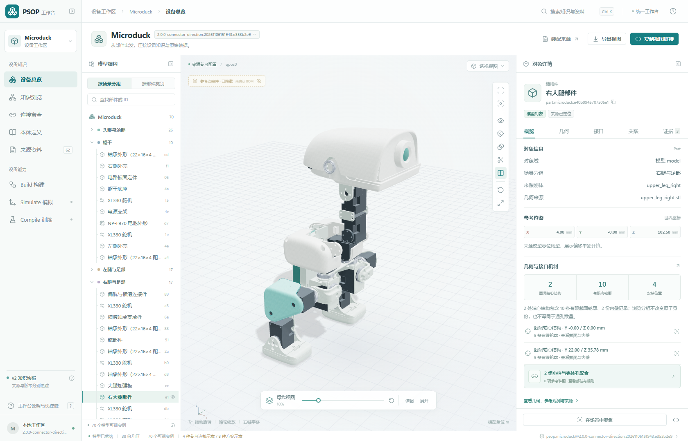
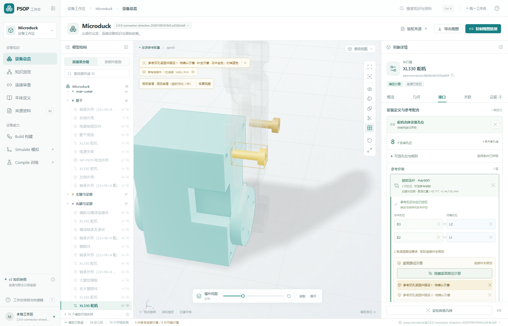
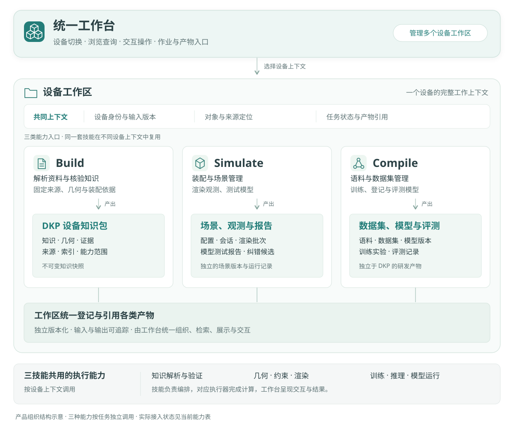

# PSOP

**Physical Standard Operation Procedure · 设备知识、3D 装配与模型研发工作台**

PSOP 把设备资料、三维部件、装配知识和来源证据组织到同一个工作台。一个工作区对应一台设备，Build、Simulate、Compile 围绕同一份设备知识协作。



*Microduck 工作区实景：70 个模型实例、38 份几何资产、62 份来源。截图及实现状态核对于 2026-11-07。*

## 当前能力

| 能力 | 当前可用内容 |
| --- | --- |
| 3D 工作台 | 真实 STL 参考装配、部件拾取、爆炸展开、隐藏与隔离、透明、剖切和视图恢复 |
| 知识与证据 | 查询部件、几何、安装孔位、规则及本体类型，联动定位 XML、CSV、装配说明和原始资料 |
| 安装与连接 | 舵机八个入口与共享孔道、连杆孔位、具体双孔对应、小柱与壳体孔配合、逐对连接审查 |
| 连接件示意 | 查看参考紧固路径；头位、杆向与有限孔壁区段经一致性检查，实物规格和保持仍待确认 |
| 设备与版本 | 工作区与快照切换，分享链接和视图导出保留对象、版本、相机及局部查看状态 |
| Build | 通过 `prepare → finalize → validate` 构建、校验并登记数据型 DKP |
| Simulate 查询 | CLI 查询已发布装配知识，或对显式定义执行有界选孔与刚性匹配 |

当前主线为 Build `3.0.0-draft.10`、知识剖面 `psop.hardware.source-model/1.9`、封套 `psop.dkp/2.0-draft.1`，机械语义目标为[硬件本体 draft.4](docs/architecture/hardware-ontology.md)。Build 从全部件清单生成结构调查，独立样例与逐区域审查分别验收，见[源模型复核](docs/build/interface-review/source-review.md)。

Simulate 的自由装配执行、批量多视角渲染和模型场景测试，以及 Compile 的数据集发布、训练和推理，仍待接入执行器。工作台已有对应入口，并显示实际能力状态。

## 看懂安装接口



右侧按 **安装定义 → 参考装配的双方孔位 → 紧固路径示意 → 测量与来源** 阅读。可选孔位与规则可以展开查看；选择孔位、对端或示意件时，3D 与详情保持同一连接上下文。

舵机两侧八个入口共享四条孔道。可选组合规则与参考中实际使用的双孔对应分别保存；大腿小柱与壳体孔的有限配合支持定位推断，保持方式仍未知。示意螺钉、来源实例与已确认物料分别标识。

完整操作见[工作台使用指南](docs/workbench.md)，机械分析见[连接还原](docs/build/connection-reconstruction.md)。

## 快速开始

需要 **Node.js 22.12+、Python 3.11+、Git LFS**。首次安装依赖和获取固定的 Microduck 补充 XML 需要联网。

```powershell
git lfs install
git clone --branch v2 https://github.com/Scisaga/psop.git
cd psop
git lfs pull
cd apps/workbench
npm ci
npm run prepare:workspace
npm run build
npm start
```

打开 **http://127.0.0.1:8780/**。Windows 也可双击[启动工作台.cmd](apps/workbench/启动工作台.cmd)，启动器会准备工作区、构建并打开页面。

已有工作区会复用登记内容。需要按当前代码重新生成知识时，在仓库根目录执行：

```powershell
python -B apps/workbench/scripts/prepare_workspace.py --fresh
```

这会创建并登记新快照。开发过程产生的旧知识版本可以从登记表及本地发布目录清理，运行当前工作台无需保留整套开发快照。

## 工作台、工作区与三技能



**工作台是统一界面与交互框架，设备工作区是围绕一个设备的业务上下文，三技能是在这个上下文中使用的能力。** 同一套技能与执行器可用于多个设备，三种能力按任务独立调用。

Build 发布 DKP 知识快照；Simulate 形成场景、观测和测试报告；Compile 组织数据集、模型及评测工件。工作台统一组织这些产物的检索、展示与交互。场景、语料、模型和报告在 DKP 之外独立版本化，并通过明确的输入与版本引用关联。

数据闭环通过产物衔接：场景观测进入语料，训练后的模型回到场景测试，报告与纠错候选经审核驱动后续数据或知识修订。场景与渲染使用共用执行底座，Compile 也可按数据计划调用；详细交接见[系统设计](docs/architecture/system-design.md)。图表达产品组织，实现进度见上方能力表。

## 仓库入口

| 路径 | 用途 |
| --- | --- |
| [apps/workbench](apps/workbench/README.md) | 前端、本地读取服务、启动器与浏览器测试 |
| [psop-build](skills/psop-build/SKILL.md) | 来源摄入、知识分析、DKP 发布和验证 |
| [psop-simulate](skills/psop-simulate/SKILL.md) | 有界装配查询及场景执行边界 |
| [psop-compile](skills/psop-compile/SKILL.md) | 语料、多模型训练和评测编排 |
| [packages/assembly](packages/assembly/psop_assembly/engine.py) | 共享选择规则与刚性孔组推理 |
| [device-materials](device-materials) | 原始资料、装配说明与支持来源，大型资料使用 Git LFS |
| [docs](docs/README.md) | 操作指南、架构、机械语义与数据合同 |

## 开发与验证

在仓库根目录运行 Python 测试，在工作台目录运行前端与集成检查：

```powershell
python -B -m unittest discover -s skills/psop-build/tests -v
python -B -m unittest discover -s skills/psop-simulate/tests -v
python -B -m unittest discover -s packages/assembly/tests -v
cd apps/workbench
npm run build
npm run test:api
npm run test:e2e
```

浏览器测试使用本机 Chrome，先准备 Microduck 工作区。需要特定历史快照的用例只在登记了对应版本时运行，其余用例直接验证当前数据与交互。

继续阅读：[工作台使用指南](docs/workbench.md) · [系统设计](docs/architecture/system-design.md) · [DKP 数据合同](docs/architecture/device-knowledge-package.md) · [文档目录](docs/README.md)。
