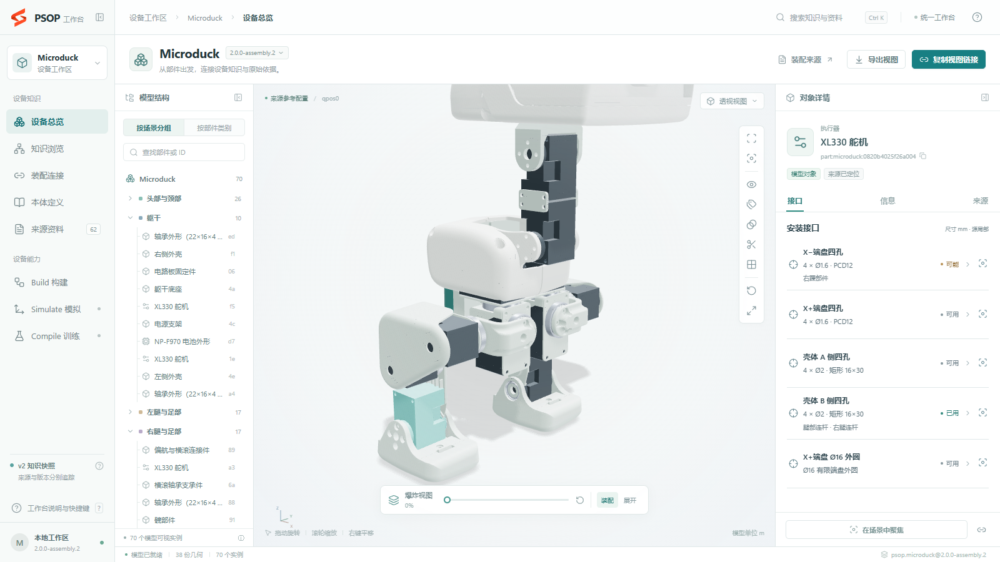

# PSOP

**Physical Standard Operation Procedure · 设备知识、3D 装配与模型研发工作台**

PSOP 把设备资料、三维部件、装配知识和来源证据组织到同一个工作台。一个工作区对应一台设备，Build、Simulate、Compile 围绕同一份设备知识协作。


*Microduck 工作区实景：70 个模型实例、38 份几何资产、62 份来源。截图及实现状态核对于 2026-11-07。*

## 当前能力

| 能力 | 当前可用内容 |
| --- | --- |
| 3D 工作台 | 真实 STL 参考装配、部件拾取、爆炸展开、隐藏与隔离、透明、剖切和视图恢复 |
| 知识与证据 | 查询部件、几何、安装孔位、规则及本体类型，联动定位 XML、CSV、装配说明和原始资料 |
| 几何与连接能力 | 从原始网格发现本件有限孔、锥面、平面和复合轮廓，分别查看潜在方式、功能接口、来源参考关系和跨件条件候选 |
| 原始依据 | 当前结论直接引用原件位置，文本按需加载；历史审查证据单独保留 |
| 设备与版本 | 工作区与快照切换，分享链接和视图导出保留对象、版本、相机及局部查看状态 |
| Build | 通过 `prepare → freeze → finalize → validate → register` 构建、冻结、校验并登记数据型 DKP |
| Simulate 装配环境 | 三维工作台、连续组装与拆开、自动组装成品参考演出、共享资源占用、撤销重做及多方案自动保存 |

当前主线为 Build `3.0.0-draft.22`、知识剖面 `psop.hardware.source-model/1.15`、封套 `psop.dkp/2.0-draft.1`，机械语义目标为[硬件本体 draft.4](docs/architecture/hardware-ontology.md)。Build 从原始网格发现本件有限几何，分开表达潜在能力、有依据的功能接口、原配置参考关系与位姿无关的跨件候选，通过独立原件要求验收；部件和候选详情按需加载。当前包 `2.0.0-capabilities.9` 为 70 个实例发布 257 项功能接口、145 条参考关系及逐件用法审查。本版分开表达用途、对端、几何与紧固状态，并将全部未决假设纳入跟进，见[原装状态复核](docs/build/reference-connection-status.md)。此前七项安装复核见[安装补录结果](docs/installation-followup.md)。默认显示可切回原始位置的工程推断配置，历史审查保留原义。见[Build 使用说明](docs/build/device-knowledge-build.md)、[合理修正及依据](docs/reference-assembly-repair.md)和[首次发布记录](docs/build-capabilities-release.md)。

[原装配安装接口全量复核](docs/original-installation-audit.md)发现的左右髋双孔及电机支架两侧轴承承座已补录。新增外壳阶梯孔与舵机接收位、眼环三凸耳与面板三通槽、镜头座径向入口及 PCB 锁扣定位耳；右外壳的约 0.5 mm 来源错位与眼环尚未明确的防脱工艺分别保留。

Simulate 已实现工作台交互装配、终态几何及有限采样的自动装配过程检查，详见[操作与验收](docs/simulate/verification.md)。自动组装在当前工作台播放，支持自由鼠标观察与可选视角跟随。动力学、连续路径的完备认证和模型测试留待后续；旧查询 CLI 已移除。Compile 的数据集发布、训练和推理仍待接入执行器。工作台显示实际能力状态。

## 看懂安装接口



1.15 的右侧按“几何与能力”“原装配”“兼容候选”分别查看；尚未绑定功能接口的有限几何也可搜索、选择和定位。功能接口保留逐成员选择及已有选孔规则，参考关系保留具体对端；候选显示局部匹配和待确认条件，查看依据时才打开原件。上图保留此前本件接口目录的操作示例。

舵机两个端盘四孔、两个壳体孔侧和壳体承座分别组织。两侧可共享同一物理孔道，但入口方向和实际选用分别保存；四孔组不会顺带选择支承外圆。头部舵机的固定壳体通过支架承槽和下壳承托定位，支架自身孔组连接下壳；“原装配用法”直接解释这条安装链，并列出对应部件的未决问题。参考配合与实物紧固资格分别标注。

完整操作见[工作台使用指南](docs/workbench.md)，机械分析见[连接还原](docs/build/connection-reconstruction.md)。

## 快速开始

需要 **Node.js 22.12+、Python 3.11+、Git LFS**。首次安装依赖和获取固定的 Microduck 补充 XML 需要联网。

```powershell
git lfs install
git clone --branch main https://github.com/Scisaga/psop.git
cd psop
git lfs pull
cd apps/workbench
npm ci
npm run prepare:workspace
npm run build
npm start
```

打开 **http://127.0.0.1:8780/**。Windows 可直接双击仓库根目录的[启动工作台.cmd](启动工作台.cmd)：优先使用本机已准备的 Node，未运行时准备工作区、构建并启动，已运行时直接打开页面。默认端口固定为 8780，不会自动改用其他端口；`--no-browser` 可关闭自动打开页面。原 [apps/workbench 启动入口](apps/workbench/启动工作台.cmd) 继续可用。

已有工作区会复用登记内容。需要按当前代码重新生成知识时，在仓库根目录执行：

```powershell
python -B apps/workbench/scripts/prepare_workspace.py --fresh
```

这会创建并登记新快照。开发过程产生的旧知识版本可以从登记表及本地发布目录清理，运行当前工作台无需保留整套开发快照。

当前 DKP `2.0.0-capabilities.10` 在 [releases](releases/microduck/2.0.0-capabilities.10/release.json) 中以一个 Git LFS 归档和版本摘要保存。首次准备工作区时会校验并自动还原最新发布，解包目录、构建临时目录和本机登记表被忽略。源码、冻结研究输入和正式验收证据继续纳入 Git，具体分类见[版本管理与发布工件](apps/workbench/README.md#版本管理与发布工件)。

## 工作台、工作区与三技能


**工作台是统一界面与交互框架，设备工作区是围绕一个设备的业务上下文，三技能是在这个上下文中使用的能力。** 同一套技能与执行器可用于多个设备，三种能力按任务独立调用。

Build 发布 DKP 知识快照；Simulate 形成场景、观测和测试报告；Compile 组织数据集、模型及评测工件。工作台统一组织这些产物的检索、展示与交互。场景、语料、模型和报告在 DKP 之外独立版本化，并通过明确的输入与版本引用关联。

数据闭环通过产物衔接：场景观测进入语料，训练后的模型回到场景测试，报告与纠错候选经审核驱动后续数据或知识修订。场景与渲染使用共用执行底座，Compile 也可按数据计划调用；详细交接见[系统设计](docs/architecture/system-design.md)。图表达产品组织，实现进度见上方能力表。

## 仓库入口

| 路径 | 用途 |
| --- | --- |
| [apps/workbench](apps/workbench/README.md) | 前端、本地读取服务、启动器与浏览器测试 |
| [psop-build](skills/psop-build/SKILL.md) | 来源摄入、知识分析、DKP 发布和验证 |
| [psop-simulate](skills/psop-simulate/SKILL.md) | 三维装配、接口占用、拆开及方案恢复 |
| [psop-compile](skills/psop-compile/SKILL.md) | 语料、多模型训练和评测编排 |
| [packages/assembly](packages/assembly/psop_assembly/engine.py) | 共享选择规则与刚性孔组推理 |
| [device-materials](device-materials) | 原始资料、装配说明与支持来源，大型资料使用 Git LFS |
| [docs](docs/README.md) | 操作指南、架构、机械语义与数据合同 |

## 开发与验证

在仓库根目录运行 Python 测试，在工作台目录运行前端与集成检查：

```powershell
python -B -m unittest discover -s skills/psop-build/tests -v
python -B -m unittest discover -s packages/assembly/tests -v
cd apps/workbench
npm run build
npm run test:api
npm run test:e2e
```

浏览器测试使用本机 Chrome，先准备 Microduck 工作区。需要特定历史快照的用例只在登记了对应版本时运行，其余用例直接验证当前数据与交互。

继续阅读：[工作台使用指南](docs/workbench.md) · [系统设计](docs/architecture/system-design.md) · [DKP 数据合同](docs/architecture/device-knowledge-package.md) · [文档目录](docs/README.md)。
