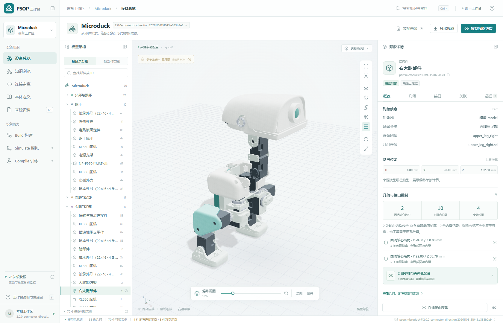

# PSOP 统一工作台

工作台管理多个设备工作区，读取 Build 发布的 DKP，提供模型、安装知识、本体和证据的联动浏览。当前使用 `psop.hardware.source-model/1.9`，保留 1.0～1.8 历史读取；几何页可定位待调查结构和原始区域，分别查看功能证据、审查状态与下一步。实现状态核对于 2026-11-07。



操作说明见[工作台使用指南](../../docs/workbench.md)。本页说明运行、数据与开发方式。

品牌标识采用朱红色「折叠空间」，用于左上角、启动页、关于窗口和 favicon。SVG 母版、各尺寸图标及原始选定方案统一位于 [assets/brand](../../assets/brand/README.md)。修改母版后，在仓库根目录运行 `node scripts/generate-brand-icons.mjs` 同步工作台静态资源。

## 运行

需要 Node.js 22.12+、Python 3.11+。大型原始资料使用 Git LFS；检出仓库后执行 `git lfs pull`。首次准备 Microduck 会下载固定版本的补充 XML。

Windows 双击[启动工作台.cmd](启动工作台.cmd)，或从本目录执行：

```powershell
node scripts/launch.mjs
```

启动器安装缺少的依赖、复用或准备设备工作区、构建并打开 **http://127.0.0.1:8780/**。`--no-browser` 关闭自动打开页面。

手动启动：

```powershell
npm ci
npm run prepare:workspace
npm run build
npm start
```

前端开发使用 `npm run dev`。可信局域网可用 `node scripts/launch.mjs --bind <本机具体IP>`，通过 `--port` 指定端口。当前服务没有账户和公网部署配置。

## 设备工作区和版本

`prepare:workspace` 调用实际 Build CLI，摄入材料、装配说明和支持资料，发布并登记 DKP。已有工作区会复用。

```powershell
# 生成并登记新快照
python -B scripts/prepare_workspace.py --fresh

# 登记已有包，相对路径以当前工作目录为基准
node scripts/workspaces.mjs register --dkp ../../build/<设备>/<包>.dkp --workspace <工作区ID>

# 创建空设备工作区并检查目录
node scripts/workspaces.mjs create --id <工作区ID> --device-id <设备ID> --name <设备名称>
node scripts/workspaces.mjs list
```

登记表在仓库根目录 `workspaces/registry.json`，生成包在 `build/`，均不进入 Git。工作区可以只有一个当前版本，也可以保留多个快照。清理时先移除旧登记引用，再删除不再被使用的包目录，保留当前选择及其他工作区的引用。当前 Microduck 开发工作区已清理为一份 1.8 快照。

读取层仍识别 source-model/1.0～1.8 的显式合同，运行当前工作台不依赖本机保留旧包。历史合同兼容不恢复旧 core 或包内 App。

## 主要交互

| 区域 | 当前行为 |
| --- | --- |
| 设备与版本 | 切换工作区及实际登记快照，跨页面沿用上下文 |
| 结构树与 3D | 拾取、隐藏、隔离、透明、剖切、爆炸／复原与视角控制 |
| 对象详情 | 概览、几何、接口、关联、证据；支持拖拽及键盘调宽 |
| 安装接口 | 可选成员与规则按需展开，具体参考装配只呈现一份双方对应及紧固路径详情 |
| 局部查看 | 聚焦孔口、小柱或连接件，淡化遮挡对象，支持恢复原视图 |
| 来源定位 | 打开原始 XML、CSV、说明、PDF 或图片，定位相关行与断言 |
| 分享与导出 | 保留设备、版本、对象、相机、显隐和局部检查状态 |
| 三技能 | Build 展示实际发布信息；Simulate / Compile 显示当前能力及待接入执行器 |

详情栏最小 320px、默认 380px、最大 640px，受画布可用空间约束；双击分隔条复原，窄屏采用纵向布局。

1.8 的参考螺钉从同一连杆孔道的外侧入口朝壳体目标绘制，并记录有限方向假设。未核实替代方案需要显式启用。实际规格、装入方式、保持与承载按证据分别标注；爆炸偏移、透明和高亮属于浏览状态。

## 数据与 API

工作台生成 DKP 的显示投影，知识与资产保持包内身份。目录读取核验 manifest 元数据；选择内容时完整验证并重放来源，资产读取继续检查字节和 SHA-256。

| GET 路径 | 内容 |
| --- | --- |
| `/api/workspaces` | 工作区、快照与默认选择 |
| `/api/workspaces/:id/snapshots/:snapshot/view` | 通用显示投影 |
| `/api/workspaces/:id/snapshots/:snapshot/knowledge` | 结构化设备知识 |
| `/api/workspaces/:id/snapshots/:snapshot/manifest` | 发布清单、摘要与能力 |
| `/api/workspaces/:id/snapshots/:snapshot/assets/:path` | 登记资产，支持范围读取 |

当前 HTTP API 只读，登记通过本地 CLI。模拟动作、批量渲染、训练、推理和模型测试尚未形成执行 API。详见[设备工作区](../../docs/architecture/device-workspace.md)。

## 验证与截图

先准备 Microduck 工作区，浏览器测试使用本机 Chrome：

```powershell
npm run build
npm run test:api
npm run test:e2e
node scripts/capture_docs.mjs
```

最后一个命令需要运行中的工作台服务，会重建[正式截图及来源记录](../../docs/assets/screenshots/README.md)。正式文档截图随 Git 发布；测试结果、运行时截图、依赖与构建目录仍被忽略。

端到端测试直接读取所选 DKP。单版本工作区也可运行，只有需要多个或特定历史快照的用例按登记情况跳过。
