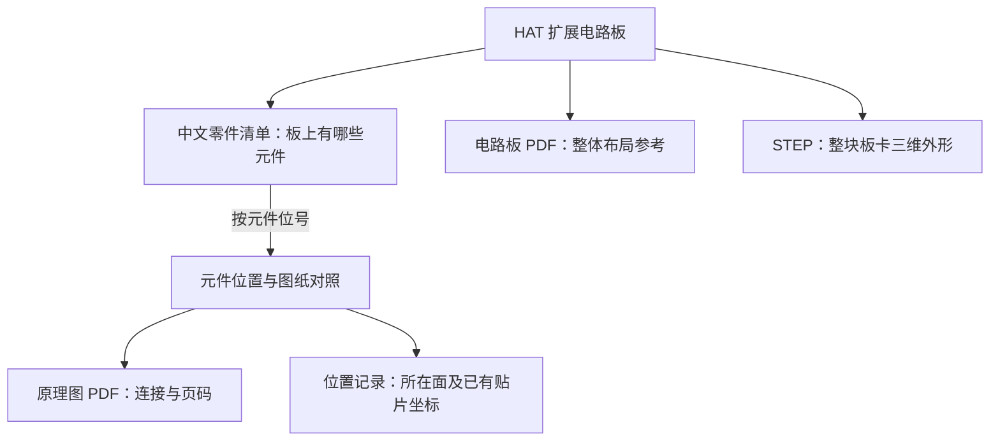

# HAT C1 电路板资料：中文使用说明

**本目录是官方 HAT C1 板级资料，尚未确认与本包 alpha 整机或 03 中的 HAT 外形模型对应。**可独立用于查板上元件、阅读电路和查看板卡外形；这份 BOM 不是整机采购清单。

**先看 [中文零件清单](HAT零件清单-中文.csv)，需要找某个元件时再看 [元件位置与图纸对照](HAT元件位置与图纸对照-中文.csv)。** 两张表可用 Excel 或 WPS 打开，首行为中文列名；型号、位号和原始数值保留原文。本地只保留中文版，英文原表通过下方官方来源链接查阅。

这里描述的是 Pollen Robotics 的 **RPI Robot HAT 扩展电路板**，不是 Microduck 的整机清单。HAT 是连接主控、舵机通信、音频和传感器等功能的板卡。以下中文内容根据官方原表与设计文件整理，不是厂家另发的一版中文制造文件。

## 这块板在机器人里做什么

HAT 是连接主控与部分外设的扩展电路板。主控运行程序，HAT 提供相应接口与电路；它不是主控计算机本身，也不包含机器人的全部电控系统。

| 功能部分 | 主要作用 | 本目录中能看到的例子 |
| --- | --- | --- |
| 主控连接 | 将扩展板与主控接口连接 | J4 的 40 位连接排母 |
| 电源电路 | 提供板上相应的电源转换与控制 | U9、U10 等元件；原理图第 3 页 |
| 舵机通信 | 为控制指令与状态传递提供通信接口 | J3、J11、J13、J14 及通信芯片；第 4 页 |
| 传感器与扩展 | 提供 IMU 和传感器连接接口 | U11（BMI088）、J5–J8；第 5 页 |
| 音频 | 连接和处理麦克风、扬声器相关信号 | MK1、U1、U2 等；第 6 页 |

**这个目录只讲板卡及板上的元件。**例如，舵机连接器属于板级清单，插在连接器外面的舵机本体不属于；主控、电池、外接扬声器和机器人外壳也不能从这份 BOM 中采购齐。

**板卡不需要 3D 打印。**PCB 板由电路板制造工艺生产，再装配电子元件。`HAT板卡三维模型.step` 用于查看板卡和元件的外形、尺寸及空间占用；它不会打印出可工作的电路板。外壳或板卡固定支架是否要打印，属于另一类机械结构问题。

## 与整机资料的关系

本目录的 `U11`、`J4` 等位号，只用于对应本目录 C1 板的 BOM、元件位置表和图纸。它们不是 Microduck 舵机 ID，也没有与 03 的 STL 建立逐件装配对应。

alpha 软件中的主控、头部及身体 IMU 接口，见 [设备说明](../01-设备信息/设备说明.md#主控与传感器接口)。软件提到 Robot HAT 或 BMI088，并不能证明实际使用本目录 C1 修订版；本目录不提供整机接线、线束长度或整板可直接互插的结论。

## 这些文件怎样对应

它们的共同索引是 **元件位号**，例如 `U11`。位号相同，才可以把不同文件中的信息联系到一起。

原理图画的是“电气上怎样连接”，PCB 图画的是“电路板上的布局”，STEP 显示的是“空间中的外形”。三者描述角度不同。STEP 内部几何对象与每个 `U/C/R/J` 位号尚未建立一一映射，**不能从 STEP 直接推导采购数量或电气连接**。

| 你要做什么 | 打开什么 | 怎么用 |
| --- | --- | --- |
| 看元件是什么、参数怎么读 | [HAT零件清单-中文.csv](HAT零件清单-中文.csv) | 47 行对应官方 BOM 的 47 行，查中文名称、参数、数量和装配标识 |
| 找某个元件在哪里 | [HAT元件位置与图纸对照-中文.csv](HAT元件位置与图纸对照-中文.csv) | 按位号搜索，找到原理图页码、所属模块、PCB 所在面和贴片坐标 |
| 看线路怎么连 | [HAT原理图.pdf](HAT原理图.pdf) | 按对照表给出的页码和位号定位，连线表示电气关系 |
| 看板上怎么放 | [HAT电路板图.pdf](HAT电路板图.pdf) | PDF 看整体布局；元件所在面与已有坐标查中文对照表 |
| 看整板三维形状 | [HAT板卡三维模型.step](HAT板卡三维模型.step) | 用支持 STEP 的 CAD 查看，不是供 3D 打印的整机塑料件 |
| 核对官方原始数据 | [官网 BOM](https://github.com/pollen-robotics/elec_RPI_Robot_HAT/blob/88d51faf7f5fcc845d2e3b42d4f05ebb98b963b9/production/ASE01187-C1_elec_RPI_Robot_HAT_BOM.csv)／[官网贴片表](https://github.com/pollen-robotics/elec_RPI_Robot_HAT/blob/88d51faf7f5fcc845d2e3b42d4f05ebb98b963b9/production/ASE01187-C1_elec_RPI_Robot_HAT_POS.csv) | 中文表中的数据行号、位号、型号和坐标均能回查 |

## 用 U11 走一遍

1. 在中文零件清单找到 `U11`：**惯性测量单元（IMU）**，型号 `BMI088`，原表数量 `1`，嘉立创料号 `C194919`，对应官方 BOM 第 **38 个数据行**（不含表头）。
2. 在中文对照表查 `U11`：属于“传感器与扩展接口”模块，对应 [原理图第 5 页](HAT原理图.pdf#page=5)。
3. 在中文对照表查看 `U11` 的 PCB 所在面：正面。板卡整体布局可参考 [HAT电路板图.pdf](HAT电路板图.pdf)。
4. 官方贴片表同一位号为：X=`19.995001` mm，Y=`-9.005001` mm，旋转角=`90.0`°，`top`（正面）。数值已原样写入中文对照表。

**BOM 按同规格合并行，贴片表按单个位号列行。** 例如多个 10 千欧电阻可能在 BOM 同一行，但 `R1`、`R2` 等各有各的位置。因此两张表不能按行号直接互相对齐，要按位号查。

## 常见名称与参数

| 标记 | 中文意思 | 例子 |
| --- | --- | --- |
| C | 电容位号 | `C1`；`1u` 表示 1 微法 |
| R | 电阻位号 | `R1`；`10k` 表示 10 千欧，`0R` 表示 0 欧 |
| U | 集成电路位号 | `U11` 是本板的 BMI088 |
| J | 连接器位号 | `J4` 是本板连接主控的 40 位排母 |
| Q／D | 晶体管／二极管位号 | 具体型号见该行，不根据字母猜替代料 |
| FB／L | 磁珠／电感位号 | 用于相应电路；具体参数保留原表 |
| MK／Y | 麦克风／振荡器位号 | `MK1` 为板载麦克风，`Y1` 标注 12 MHz |
| TP／FID | 测试点／贴装定位基准点 | 不是普通芯片；定位点不按器件采购 |
| DNP | 此版本不装配 | 板上可能仍有位置，但不能按普通装配项采购焊接 |
| Footprint | 封装，决定焊盘和外形匹配 | 不能把封装名称当成芯片型号 |
| LCSC Part # | 嘉立创商城料号 | 原表没有料号的地方，中文表也留空 |

## 原理图每页看什么

| PDF 页码 | 中文内容 | 典型位号 |
| --- | --- | --- |
| [1](HAT原理图.pdf#page=1) | 总说明、主控接口说明与板卡标识 | H1、H2、H3、FID1–FID3；部分为图形或说明对象 |
| [2](HAT原理图.pdf#page=2) | 主控连接和 HAT 识别电路 | J4、U4；U4 标为 DNP |
| [3](HAT原理图.pdf#page=3) | 电源转换与电源路径控制 | U9、U10、Q2、L4 |
| [4](HAT原理图.pdf#page=4) | 舵机 TTL／RS-485 通信接口 | J3、J11、J13、J14、U5–U8 |
| [5](HAT原理图.pdf#page=5) | IMU 及扩展接口 | U11、J5–J8 |
| [6](HAT原理图.pdf#page=6) | 麦克风、音频接口和功率放大 | MK1、U1、U2、U3、J1、J2、J9、Y1 |

所属模块和页码从官方原理图层级及 PDF 提取；芯片中文名称依据官方设计中的型号、符号说明和电路角色整理。具体型号以中文零件清单中保留的官方型号为准。

本地仅保留 PDF 图纸、STEP 三维模型和中文表，不保留 KiCad 工程。中文对照表中的 PCB 封装记录、所在面及差异说明，是依据下方官方 PCB 源文件整理的已有信息；可沿官方链接追溯。

## 已核对的关系及实际差异

- 官方 BOM **47 行，共 123 个位号**。整理时已在官方主原理图和 PCB 源文件中找到这 123 个位号，`Value` 字段一致；这不等于已验证所有电气连接及制造参数。
- 官方贴片表 **117 行**。其中 113 个位号与 BOM 相交；另有 `FID1`、`FID2`、`FID3`、`H3`，是定位点或标志图形，不是 BOM 漏列的待购芯片。
- BOM 中的 9 个 DNP 位号 `C25、R10、R11、R16、R17、R36、R37、R41、U4` 没有贴片坐标；标志 `H2` 也没有贴片坐标。中文表明确标注，不补猜坐标。
- 中文对照表共 **128 行**：覆盖主原理图中的全部实体/图形标识；其中 `H1` 是板卡说明标识，没有独立 PCB 元件封装。它不是新增采购件。
- **原表料号疑点**：第 32 数据行的 `R36、R37` 标为 `DNP-1M`，却与第 28 数据行的 `0R` 电阻共用 `C17168` 料号。中文表保留原值并标注疑点，没有擅自补成另一个料号。
- **C1 生产资料的版本标记**：本地 PDF 与官方 C1 生产包原件一致。[原理图第 1 页](HAT原理图.pdf#page=1)的修订表包含 `C1 / 08/07/2026`，但标题栏沿用 `B1 / 2026-05-06`。因此不能仅凭标题栏认定混入旧图。官方 [C1 生产文件提交](https://github.com/pollen-robotics/elec_RPI_Robot_HAT/commit/23eab11927f95ceca0dfa35bf182caeb7db39ea0)可追溯本组文件；[C1 发布提交](https://github.com/pollen-robotics/elec_RPI_Robot_HAT/commit/13dba3789547c7aeaa1a6114e884884c3db32202)注明用于 Grabette，尚无证据把 C1 对应到某一 Microduck 实机制造版本。
- 贴片表的中心和角度是官方导出值，不能简单当成 PCB 封装原点和属性角度。部分位号的值存在差异，已在对照表逐项标出；**中文表用于阅读核对，不作为经过校准的贴片机生产文件**。

因此现在可以直接用这些中文资料查元件、定位图纸、理解电路模块；如要生产该板，仍需对制造修订版、物料、坐标和贴装方向做生产核对。本目录也不提供整机电池选型或整机线束接线结论。

## 官方原文件与来源

固定来源：Pollen Robotics 官方 HAT 仓库，提交 `88d51faf7f5fcc845d2e3b42d4f05ebb98b963b9`。本地保留两份中文表，英文 BOM 和贴片原表仅保留官方来源链接。PDF 和 STEP 文件均未修改；中文表及本说明为本地整理，型号、数量、料号及已有贴片坐标保持官方原值。

| 文件 | 内容 | 官方来源 |
| --- | --- | --- |
| [HAT零件清单-中文.csv](HAT零件清单-中文.csv) | 中文名称、参数说明，以及保留的官方位号、封装、数量、型号和料号 | [原表](https://github.com/pollen-robotics/elec_RPI_Robot_HAT/blob/88d51faf7f5fcc845d2e3b42d4f05ebb98b963b9/production/ASE01187-C1_elec_RPI_Robot_HAT_BOM.csv) |
| [HAT元件位置与图纸对照-中文.csv](HAT元件位置与图纸对照-中文.csv) | 中文位号对照、图纸页码，以及原样保留的官方贴片坐标 | [原表](https://github.com/pollen-robotics/elec_RPI_Robot_HAT/blob/88d51faf7f5fcc845d2e3b42d4f05ebb98b963b9/production/ASE01187-C1_elec_RPI_Robot_HAT_POS.csv) |
| [HAT原理图.pdf](HAT原理图.pdf) | 板级连接、电源、音频及接口 | [原图](https://github.com/pollen-robotics/elec_RPI_Robot_HAT/blob/88d51faf7f5fcc845d2e3b42d4f05ebb98b963b9/production/ASE01187-C1_elec_RPI_Robot_HAT_SCH.pdf) |
| [HAT电路板图.pdf](HAT电路板图.pdf) | PCB 版图资料 | [原图](https://github.com/pollen-robotics/elec_RPI_Robot_HAT/blob/88d51faf7f5fcc845d2e3b42d4f05ebb98b963b9/production/PCB01186-C1_elec_RPI_Robot_HAT_PCB.pdf) |
| [HAT板卡三维模型.step](HAT板卡三维模型.step) | 板卡三维外形；从官方 ZIP 解出，未修改 | [原压缩包](https://github.com/pollen-robotics/elec_RPI_Robot_HAT/blob/88d51faf7f5fcc845d2e3b42d4f05ebb98b963b9/production/ASE01187-C1_elec_RPI_Robot_HAT_STEP.zip) |

[官方项目介绍](https://github.com/pollen-robotics/elec_RPI_Robot_HAT/blob/88d51faf7f5fcc845d2e3b42d4f05ebb98b963b9/README.md)、[官方 Apache 2.0 许可](https://github.com/pollen-robotics/elec_RPI_Robot_HAT/blob/88d51faf7f5fcc845d2e3b42d4f05ebb98b963b9/LICENSE)。中文表关系依据为上述 BOM、贴片表、原理图 PDF，以及[主原理图](https://github.com/pollen-robotics/elec_RPI_Robot_HAT/blob/88d51faf7f5fcc845d2e3b42d4f05ebb98b963b9/elec_RPI_Robot_HAT.kicad_sch)和[PCB 工程](https://github.com/pollen-robotics/elec_RPI_Robot_HAT/blob/88d51faf7f5fcc845d2e3b42d4f05ebb98b963b9/elec_RPI_Robot_HAT.kicad_pcb)。
