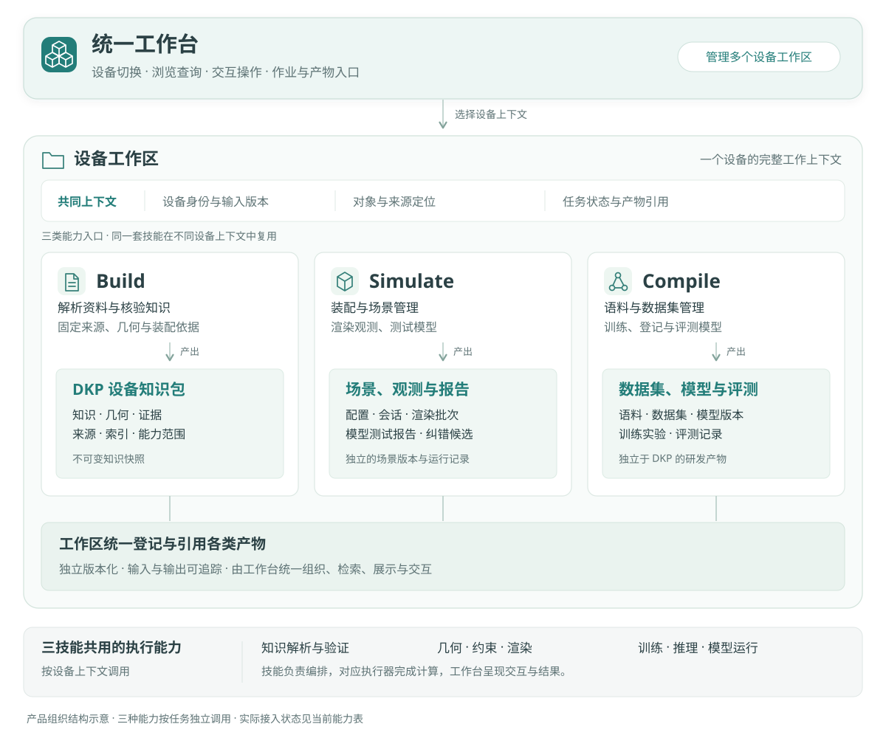
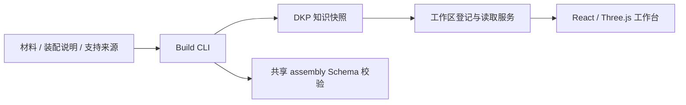

# PSOP 系统设计

2026-11-07。本文区分当前可运行系统与后续目标。机械语义依据[硬件本体 draft.4](hardware-ontology.md)，操作入口见[工作台指南](../workbench.md)。

## 产品组织关系

| 对象 | 职责与边界 |
| --- | --- |
| 统一工作台 | 通用界面与交互框架，管理多个设备工作区，组织各类知识、任务和产物的浏览与使用 |
| 设备工作区 | 围绕一个设备组织来源、身份、输入版本、作业及产物引用；可在尚无 DKP 时创建 |
| 三技能 | Build、Simulate、Compile 的工作规范与编排能力，使用所选设备上下文，实际计算由相应执行器完成 |
| 产物 | DKP、场景、观测、数据集、模型和报告分别保留身份、版本与血缘，由工作区登记引用 |

图按业务组织分层，三类能力可以按任务独立调用；同一套技能和执行能力在多个设备间复用。工作台、Agent 与 CLI 使用相应能力合同，图中的分组不表示每个工作区复制部署一套程序。具体接入状态见下表。

## 当前可运行系统

统一工作台管理设备工作区。一个工作区对应一个设备，登记零个或多个不可变 DKP；用户在其中选择知识版本、对象和来源。

以下流程仅描述当前已实现的知识构建和读取路径；工作台与三技能的产品层级以前图为准。

| 层次 | 当前实现 | 代码入口 |
| --- | --- | --- |
| 知识构建 | prepare、输入锁、几何与安装分析、原子发布、完整验证 | [psop-build](../../skills/psop-build/SKILL.md) |
| 数据交付 | 来源、知识、证据、资产、Schema 和可重建索引 | [DKP 合同](device-knowledge-package.md) |
| 本地服务 | 工作区登记、目录、所选快照与资产读取 | [workspaces.mjs](../../apps/workbench/scripts/workspaces.mjs)、[serve.mjs](../../apps/workbench/scripts/serve.mjs) |
| 通用前端 | 设备、模型、知识、本体、来源、连接审查及三技能页面 | [工作台](../../apps/workbench/README.md) |
| 共享规则 | 独立的声明式选择与刚性孔组包，Build 仍使用其 Schema 校验 | [assembly](../../packages/assembly/psop_assembly/engine.py) |

当前没有模拟动作、批量渲染、训练、推理或模型测试的执行 API。工作台为这些能力保留入口并显示未接入状态。

## 设备工作区和数据身份

设备工作区保存稳定工作区 ID、设备 ID、名称和快照引用。DKP 用 package ID、版本和摘要确定身份；当前选择、布局偏好与浏览状态属于包外上下文。

工作区可以只保留一份当前知识，也可以保留多个版本。旧开发快照可移除登记并清理目录，保留的包维持字节与摘要；数据不可变不要求永久保存每次开发构建。多设备与清理规则见[设备工作区](device-workspace.md)。

Build 交付设备数据，工作台提供通用软件。DKP 不携带设备专属 React、HTML、JS/CSS 或服务，前端也不从原始 ZIP 创建另一份权威知识。

## 当前知识与交互

Build `3.0.0-draft.9` 默认发布 `psop.hardware.source-model/1.8`，封套为 `psop.dkp/2.0-draft.1`。当前已跑通 Microduck 的材料、固定补充 XML、显式装配说明和厂商支持原件。

来源几何、安装能力、选择规则、参考对应与运行状态分别表达。舵机两侧八个安装入口共享四条孔道，标准双孔与连杆的映射固定来源构型；大腿小柱与壳体孔的有限配合支持定位推断，保持和承载仍未知。

1.8 以显式假设记录参考螺钉的外侧入口、头下位置、杆向与有限壁段，并独立核对一致性。实物规格、真实装入方式、螺纹、连续路径和保持未由此确认。未核实替代方案默认关闭。

工作台按“安装定义 → 参考装配双方孔位 → 紧固路径示意 → 测量与来源”组织。选孔、选择对端和选择示意件沿用同一详情；局部透明、爆炸和高亮只改变显示。完整语义见[装配接口与方案](assembly-interfaces.md)及[连接还原](../build/connection-reconstruction.md)。

## 三技能职责与后续闭环

| 能力 | 当前状态 | 待实现的执行能力 |
| --- | --- | --- |
| Build | 实际生产和验证数据型 DKP，提供来源与逐项能力 | 扩展设备适配、机制证据与覆盖 |
| Simulate | 三维装配环境、组合图、接口／共享资源占用、整组终态检查、拆开、历史及包外保存 | 动力学、连续装入路径、承载验证及模型测试 |
| Compile | 工作台提供语料、实验、模型和评测入口，具备职责约定 | 数据集发布、多模型训练、推理、模型登记及评测回流 |

能力之间通过显式产物及版本交接：

| 提供方 | 交接内容 | 消费方与用途 |
| --- | --- | --- |
| Build | DKP 知识快照 | 工作台浏览与检索；Simulate 和 Compile 固定知识基线 |
| 场景／渲染执行器 | 场景状态、观测和监督候选 | Compile 组织、审核并发布语料和数据集 |
| Compile | 数据生成或测试计划 | 调用共用场景底座生成观测或执行测试，固定输入和输出引用 |
| Compile | 已登记的模型版本 | Simulate 在固定场景中执行单模型或协作链测试 |
| Simulate | 测试报告、失败与纠错候选 | 经审核进入 Compile 后续数据版本；知识修订候选交 Build 形成新快照 |

该闭环还需要真实执行器、作业合同与状态持久化。观测、模型和报告在 DKP 之外独立版本化；它们引用相关知识快照，不把全部研发状态重新打回一个 DKP。

场景、相机、渲染和监督生成应使用共用底座。Compile 管理用途、标注、划分和模型版本；Simulate 管理场景交互和模型运行。界面与 Agent 使用同一类型化执行通道。

装配预览不直接提交权威矩阵，模型预测不成为物理状态。未来动作需显式验证范围、幂等、冲突与事件；机械、工程、任务和完成分别判断。多视角与同源场景按组划分，真实现场测试保持独立。

## 验证和历史边界

目录请求只核验 manifest 元数据；选择知识时完整验证并重放来源，资产读取逐次检查字节。结构测试、几何一致性、图形显示和完整机械执行分别报告。

source-model/1.0～1.7 的技术合同保留显式读取和回归分支，本机历史包可按需清理。旧 core／CMP／PORT／IFC、DKP v1 与包内独立 App 已退役，旧静态页面和演示报告不作为当前能力依据。
