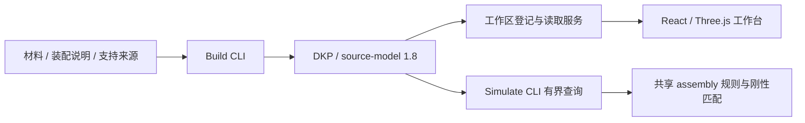

# PSOP 系统设计

2026-11-07。本文区分当前可运行系统与后续目标。机械语义依据[硬件本体 draft.4](hardware-ontology.md)，操作入口见[工作台指南](../workbench.md)。

## 当前可运行系统

统一工作台管理设备工作区。一个工作区对应一个设备，登记零个或多个不可变 DKP；用户在其中选择知识版本、对象和来源。

| 层次 | 当前实现 | 代码入口 |
| --- | --- | --- |
| 知识构建 | prepare、输入锁、几何与安装分析、原子发布、完整验证 | [psop-build](../../skills/psop-build/SKILL.md) |
| 数据交付 | 来源、知识、证据、资产、Schema 和可重建索引 | [DKP 合同](device-knowledge-package.md) |
| 本地服务 | 工作区登记、目录、所选快照与资产读取 | [workspaces.mjs](../../apps/workbench/scripts/workspaces.mjs)、[serve.mjs](../../apps/workbench/scripts/serve.mjs) |
| 通用前端 | 设备、模型、知识、本体、来源、连接审查及三技能页面 | [工作台](../../apps/workbench/README.md) |
| 有界推理 | 声明规则的成员选择与共同构型下的刚性孔组匹配 | [assembly](../../packages/assembly/psop_assembly/engine.py)、[Simulate](../../skills/psop-simulate/SKILL.md) |

当前没有模拟动作、批量渲染、训练、推理或模型测试的执行 API。工作台为这些能力保留入口并显示未接入状态。

## 设备工作区和数据身份

设备工作区保存稳定工作区 ID、设备 ID、名称和快照引用。DKP 用 package ID、版本和摘要确定身份；当前选择、布局偏好与浏览状态属于包外上下文。

工作区可以只保留一份当前知识，也可以保留多个版本。旧开发快照可移除登记并清理目录，保留的包维持字节与摘要；数据不可变不要求永久保存每次开发构建。多设备与清理规则见[设备工作区](device-workspace.md)。

Build 交付设备数据，工作台提供通用软件。DKP 不携带设备专属 React、HTML、JS/CSS 或服务，前端也不从原始 ZIP 创建另一份权威知识。

## 当前知识与交互

Build `3.0.0-draft.9` 默认发布 `psop.hardware.source-model/1.8`，封套为 `psop.dkp/2.0-draft.1`。当前已跑通 Microduck 的材料、固定补充 XML、显式装配说明和厂商支持原件。

来源几何、安装能力、选择规则、参考对应与运行状态分别表达。舵机两侧八个安装入口共享四条孔道，标准双孔与连杆的映射固定来源构型；大腿小柱与壳体孔的有限配合支持定位推断，保持和承载仍未知。

1.8 以显式假设记录参考螺钉的外侧入口、头下位置、杆向与有限壁段，并独立核对一致性。实物规格、真实装入方式、螺纹、连续路径和保持未由此确认。未核实替代方案默认关闭。

工作台按“安装定义 → 参考装配双方孔位 → 紧固路径示意 → 测量与来源”组织。选孔、选择对端和选择示意件沿用同一详情；局部透明、爆炸和高亮只改变显示。完整语义见[装配接口与方案](assembly-interfaces.md)及[连接还原](../build/connection-reconstruction.md)。

## 三技能职责与后续闭环

| 能力 | 当前状态 | 待实现的执行能力 |
| --- | --- | --- |
| Build | 实际生产和验证数据型 DKP，提供来源与逐项能力 | 扩展设备适配、机制证据与覆盖 |
| Simulate | CLI 有界查询，工作台提供场景与测试入口 | 自由装配动作、约束验证、批量多视角渲染、模型场景测试 |
| Compile | 工作台提供语料、实验、模型和评测入口，具备职责约定 | 数据集发布、多模型训练、推理、模型登记及评测回流 |

目标闭环为：Simulate 生成观测与监督候选，Compile 审核并发布语料、训练模型，固定模型版本回到 Simulate 测试，失败再形成待审核候选。该闭环还需要真实执行器、作业合同与状态持久化。

场景、相机、渲染和监督生成应使用共用底座。Compile 管理用途、标注、划分和模型版本；Simulate 管理场景交互和模型运行。界面与 Agent 使用同一类型化执行通道。

装配预览不直接提交权威矩阵，模型预测不成为物理状态。未来动作需显式验证范围、幂等、冲突与事件；机械、工程、任务和完成分别判断。多视角与同源场景按组划分，真实现场测试保持独立。

## 验证和历史边界

目录请求只核验 manifest 元数据；选择知识时完整验证并重放来源，资产读取逐次检查字节。结构测试、几何一致性、图形显示和完整机械执行分别报告。

source-model/1.0～1.7 的技术合同保留显式读取和回归分支，本机历史包可按需清理。旧 core／CMP／PORT／IFC、DKP v1 与包内独立 App 已退役，旧静态页面和演示报告不作为当前能力依据。
