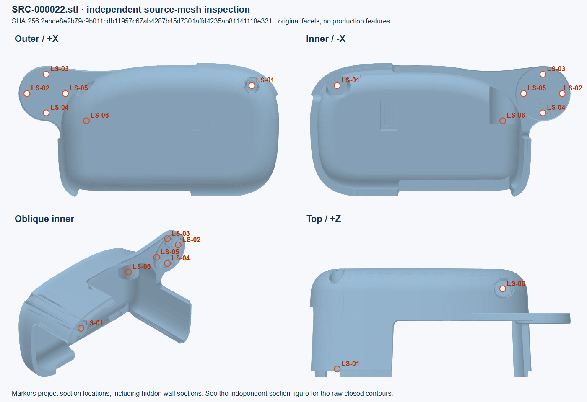
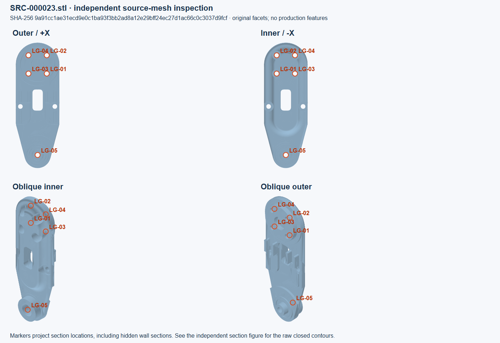
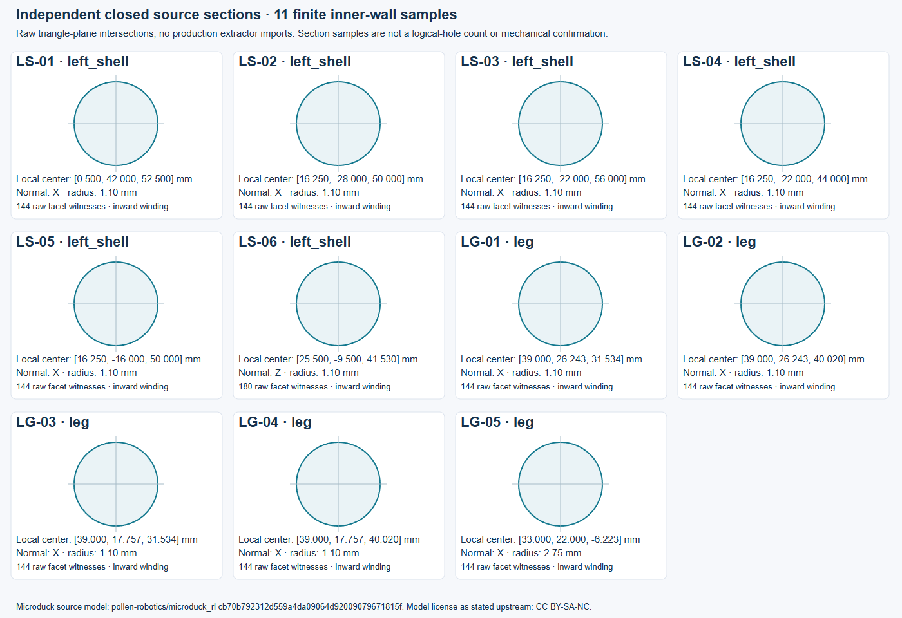

# Microduck 源模型与连接实查

## 1.10：右外壳与横滚轴承支承件

2026-11-07。当前冻结输入为 [microduck-relations.json](../../../device-materials/interface-review/microduck-relations.json)，继承下方原 1.9 独立标注，新增两处右壳显示目标以及关系两端的原始三角截面。完整研究原文为 [connection-studies.md](../../../device-materials/interface-review/references/connection-studies.md)。

右壳身份由固定 XML 的 `trunk_base/geom[2]` visual、CSV 的 `right_shell` 与 `SRC-000033.stl` 对应为 `part:microduck:9d70b219a5533bf1`。用户提供的坐标用于独立定位及验收，通用解释器不按这些名称或坐标发现关系。

两处显示目标独立于 Build 检测器重新执行原始三角与平面相交：

| 标注 | 源局部截面 | 内壁直径 | 原三角 | 最大半径残差 |
| --- | --- | --- | ---: | ---: |
| RS-DISPLAY-X | X=-2.5，Y=42，Z=52.5 mm | 1.6 mm | 144 | 0.760 μm |
| RS-DISPLAY-Z | X=-25.5，Y=-9.5，Z=41.53 mm | 2.2 mm | 180 | 1.047 μm |

两者均闭合且源法向朝向内壁。它们不是两个已确认接口，残差不是制造公差。新输入的全部 27 个有限内壁截面已用原独立复核器实际检查：

```powershell
python -B device-materials/interface-review/independent_sections.py --annotations device-materials/interface-review/microduck-relations.json
```

实际查阅了材料 ZIP 的设备说明、模型 README、部件索引、操作与维修说明、HAT C1 板级说明及 CSV，并查看官方整机原始照片。模型索引不是机械 BOM，HAT 清单不提供壳体紧固件；照片中目标内部被遮挡且未绑定 STL 修订。另查看已捕获的 ROBOTIS 装配/舵盘螺钉原图并重新访问官方入口。Onshape workspace 仍未取得内容，下载入口未取得尺寸 PDF，均未记为已读 CAD/图纸。

| 实际部位 | 具体判断 | 依据及确认边界 |
| --- | --- | --- |
| 右壳 Y/Z 四孔 PCD 12 mm | 与颈部舵机对应四孔的螺钉夹持假设 | Ø2.2/1.6 mm、共同参考构型全部组距、约 0.0785 mm 轴距、约 0.6 mm 有限间隔及厂商一般装配图；实际螺钉、螺纹、输出活动区归属及所用孔数未确认 |
| 右壳 Y=42 / Z=52.5 mm | 左壳通过孔至右壳接收孔的闭壳螺钉假设 | Ø2.2/1.6 mm、约 0.8 mm 有限间隔；单孔不足以说明整壳抗转，头部承座、长度和实际保持仍缺证 |
| 右壳 X=-25.5 / Y=-9.5 mm 的 Z 向台阶 | 已调查，关系目标未完成 | Ø2.2 mm 壁和 Ø5 mm 部分扩口保留；未找到明确有限对端及逐孔装配依据，不并入其他假设 |
| 横滚轴承支承件 16 mm 双孔 | 与对应舵机壳体双孔的螺钉夹持假设 | Ø2.2/2 mm、有限壁长约 1/23 mm、共同位姿及厂商框架图；不确认保持、载荷、最少用孔数 |
| 同支承件 18 mm 双孔 | 已调查，仍缺承接件证据 | 对应 yaw2roll Ø2.05 mm 孔、约 0.2 mm 间隔，双方接近通过孔，缺螺纹/螺母/嵌件资料 |

另排除了“Ø19 mm 大孔直接承座 Ø22 mm 轴承外圈”的解释：尺寸不互补，名称和同轴不能证明压配或保持。上述有依据的假设与已有安装定义分别发布；定位、保持、运动和限位分别保存状态。整件、整机和未标注区域没有因此完成调查。

## 1.9 原始独立标注（历史范围）

本轮标注输入为 [microduck-review.json](../../../device-materials/interface-review/microduck-review.json)。它由隔离源 STL 的多视图审阅和原始三角平面截面建立，没有导入 Build 提取器，也没有把提取器结果复制为应检分母。

左外壳身份由固定 MJCF 的 `trunk_base/geom[10]` visual、CSV 的 `left_shell` 和源 STL 对应确定：`part:microduck:e27cbdd6c07a264e`，源 `SRC-000022`，SHA-256 `2abde8e2b79c9b011cdb11957c67ab4287b45d7301affd4235ab81141118e331`。另一类样例为左腿连杆实例 `part:microduck:638f29b46b322e64`，`leg`、`SRC-000023`，SHA-256 `9a91cc1ae31ecd9e0c1ba93f3bb2ad8a12e29bff24ec27d1ac66c0c3037d9fcf`。

本清单验收 11 个有限内壁截面：左外壳 6 个、连杆 5 个。它们是独立选定的源几何见证，不表示整件孔数、整机召回率、11 个已确认接口或机械验收。阶梯孔的不同壁段可能属于同一逻辑通道。未纳入标注的区域明确保持 `unreviewed`。



左壳 `LS-06` 是可复现的原漏项。源局部 `Z=41.53 mm` 截面在 `[25.5, -9.5, 41.53] mm` 周围产生闭合圆轮廓，半径 `1.1 mm`。它有 180 个原始三角见证，索引从 `4213` 开始；轮廓逐点半径残差不超过约 `1.05 μm`，源三角法线朝向内壁。这里的误差反映源离散网格，并非制造公差。四视图的标记是截面位置投影，允许投影到遮挡面；不能把标记处的可见表面当作完整孔壁。



连杆 `LG-01`～`LG-04` 使用源局部 `X=39 mm` 的四个上端内孔截面，`LG-05` 使用 `X=33 mm` 的底部大孔段。标注仅负责几何应检依据；上端安装位置的已有用户声明仍来自单独的装配知识输入，不能由这份几何标注替代。底部阶梯孔的保持和实际连接方式没有据此确认。



复核器读取原始材料 ZIP，只用标准库重新计算三角与平面的交线、连接闭合性、原始三角索引、源法线与径向的关系以及半径残差。原始三角索引采用二进制 STL 的零基 facet 顺序。运行：

```powershell
python -B device-materials/interface-review/independent_sections.py
```

实际结果为 11/11 源截面通过，最大逐点半径残差约 `1.283 μm`。这个命令检查标注有源几何依据；是否被 Build 产物遗漏，需要另行将冻结标注与产物中的结构位置、轴、半径和原三角见证比较。删除产物中的一个应检结构，即使重算产物统计，也不改变本清单的分母。

来源检查记录和五份原文保存在 [references](../../../device-materials/interface-review/references)，每份都在标注 JSON 中保存相对 `capture_path` 和 SHA-256。具体检查了固定 `microduck_rl` 提交 `cb70b792312d559a4da09064d92009079671815f` 的 README、docs 目录和模型导出配置，以及官方 runtime 提交 `4861141fdc7c7acd253671acf5abdd55b77b779e` 的完整非截断文件树。检索目标是左壳 Z 孔的装配对象、装入侧和保持件；所检查内容未提供这些逐孔依据。路径名搜索及有限文档检查不证明其他位置不存在装配图。

模型导出配置提供了 [Onshape 源链接](https://cad.onshape.com/documents/804927696f06d877f3f1803e/w/5b75db19292e71970de02dee/e/ef6e972847fec8d82570b35e)。它使用可变 workspace `/w/`，不等于冻结 CAD 修订。本轮实际打开该地址时，网页读取工具返回不可访问，未取得 CAD 内容。下一步需要匹配 STL 修订的固定 CAD 导出或可读取装配图；不能从读取失败猜测认证要求或孔的用途。

同时检查了已捕获的 ROBOTIS X330 装配图入口。其厂商一般图示不能确认左壳 Z 孔功能、Microduck 实际用法或保持。标注中的几何、功能 `unknown`、资料缺项和调查停止原因分别保存；未知不表示没有接口，也不表示全部调查已完成。

余下具体范围包括左壳内外唇缘、窄槽、台阶和上方扩口，以及连杆中部长槽、两侧孔与凸缘。源网格已进行多视图初看，但这些区域尚未被独立逐三角分类，不能计入样例验收通过范围。其他同网格实例也需单独核查其对端、位姿和装配语境。

源模型与派生审阅图归因于 Pollen Robotics 的 [Microduck RL 固定提交](https://github.com/pollen-robotics/microduck_rl/tree/cb70b792312d559a4da09064d92009079671815f)；上游 README 将 3D 模型声明为 CC BY-SA-NC。这里的派生源网格视图用于同一模型的结构复核，不作为制造图纸或实物状态证据。
