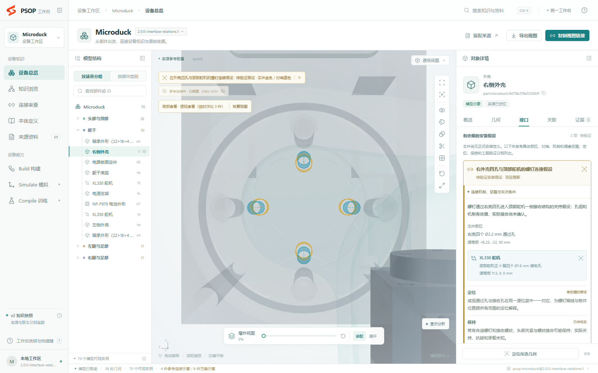
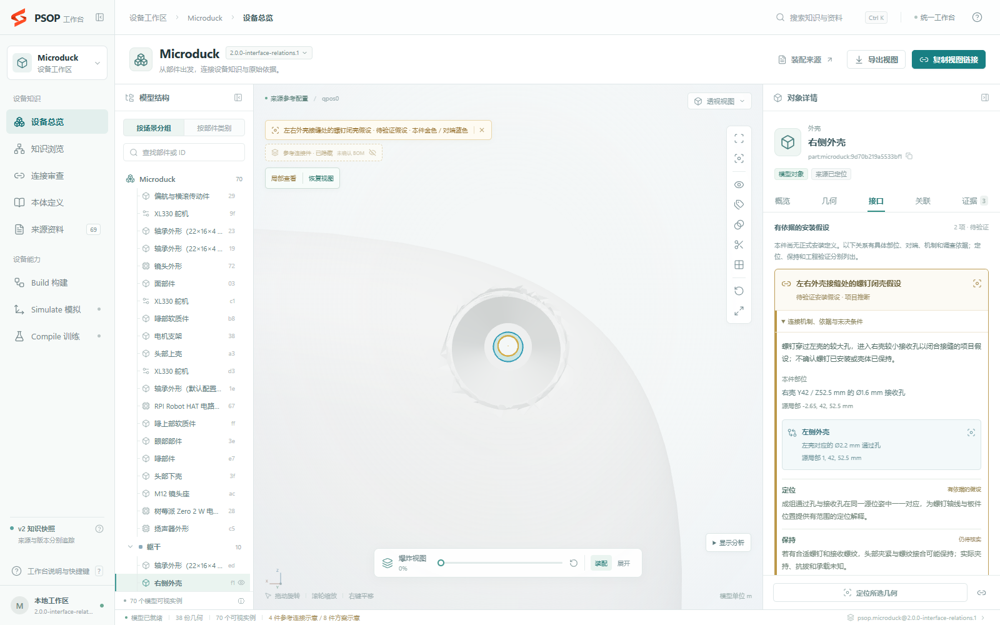
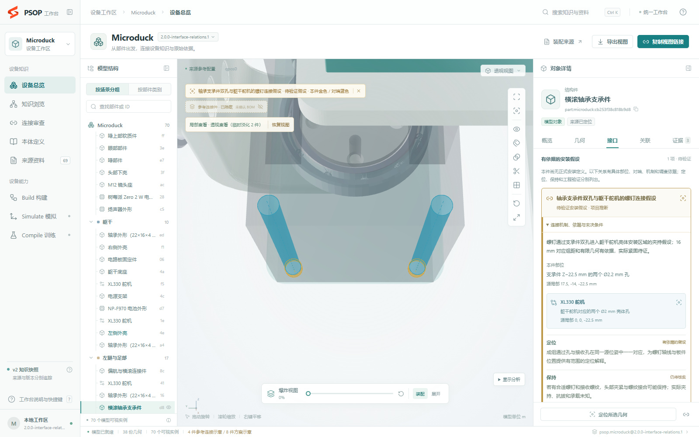
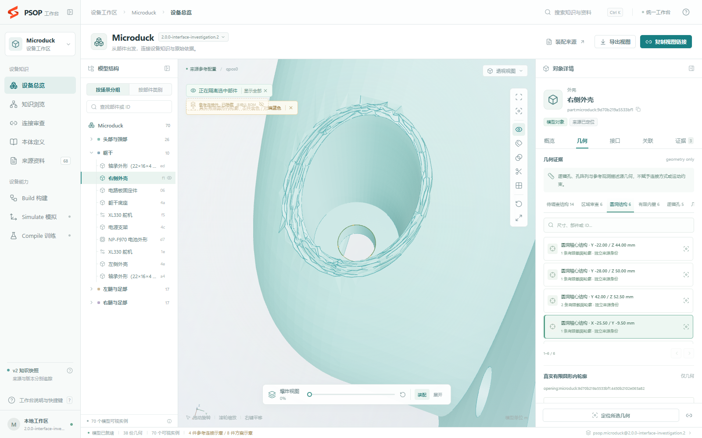
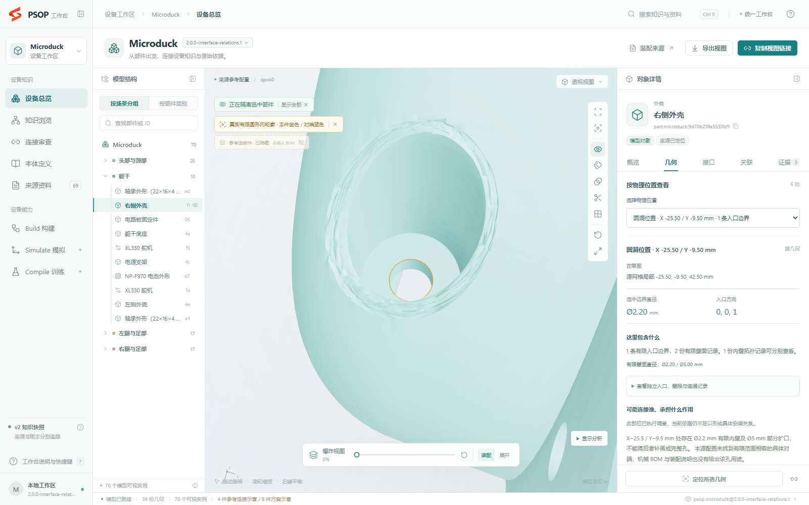
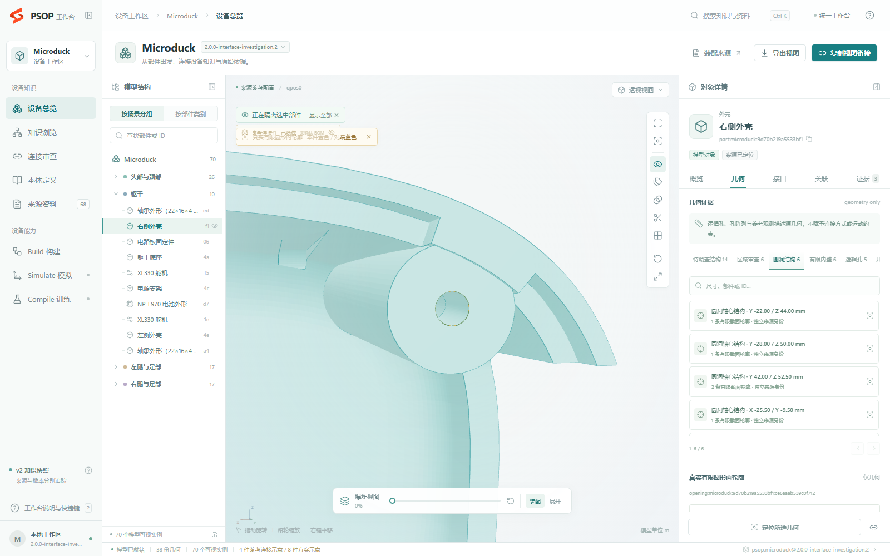
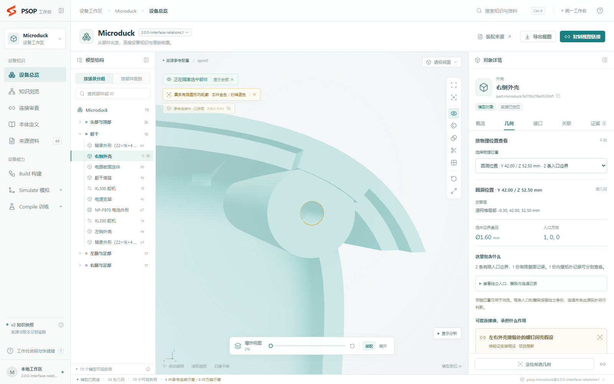
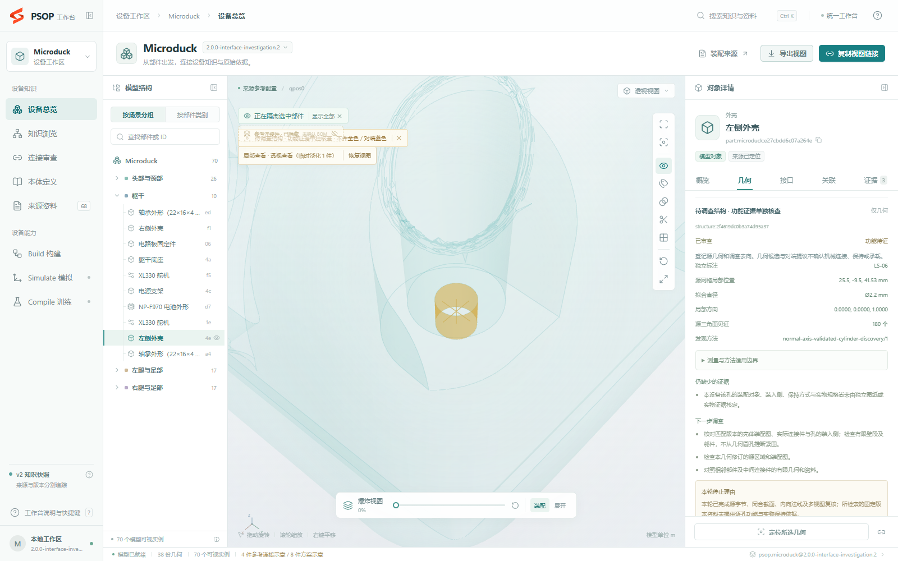

# Microduck 接口分析与显示验收

## 本轮 1.10：右外壳与另一类支承件

2026-11-07（Asia/Shanghai）。起始为 `main / 0c33581`，工作区干净；实际调用仓库 `skills/psop-build`，无另装的同名技能。当前工具 `3.0.0-draft.11`，剖面 `psop.hardware.source-model/1.10`，发布包为 `build/microduck/source-1.10/microduck-1.dkp`，版本 `2.0.0-interface-relations.1`。

包摘要 `1c8eeda600249ce33b99ec622417a744d5cdaf43a512f1495a4780ae0030cb00`；当前登记快照 `dkp-1c8eeda600249ce33b99`。原 `.2` / 1.9 包、摘要和登记均保留。工具摘要为 `36ff93e1e499aad07ff21d26fcbbfe5dd531c89d9463ace4e37aa0716998f449`，调查输入摘要为 `4027932ed7225231bfc836852a7a47293b3be6aed2cd180c4acab723a1ce098a`。

### 三类问题的实际根因与修复

选孔时的额外青色三角线来自整件 `EdgesGeometry`。固定右壳 Z 孔、相机和隔离状态后，[只关孔口覆盖层](right-shell-z-overlay-disabled.png)仍有青线，[只关整件描边](right-shell-z-edges-disabled.png)则青线消失。源 STL 非索引三角的逐面法向另造成连续壁的明暗起伏，原始内唇确有不规则棱面，未将它们全部误称为描边或 Z-fighting。

现在默认关闭整件描边；原边线、原三角边和原面片法向可在“显示分析”显式打开。选中件及关系参与者使用边连通、35° 锐边阈值的展示法向，保持原顶点和三角顺序；38 个实际资产的顶点 SHA 前后完全一致。覆盖层保留深度测试，真实台阶、孔径、内唇棱面和遮挡关系保留。

原面板将调查任务、入口、壁段、孔组和观测等异层数组放在同级标签。新界面按具体物理位置显示坐标、尺寸、组成与连接用途，独立入口、壁段和拓扑按需展开，原始分类另收进分析区。浏览分组不合并真实孔道。选中假设跳到已有安装定义的对端后，当前关系仍保持在首屏；来源定位优先当前部件的 XML/CSV 行。

原调查默认生成 `unknown`、通用下一步和停止理由，具体解释主要依赖已有声明，接口页也只读取已有安装定义。新流程要求实际执行来源和有限几何调查，再冻结具体关系与独立期望。1.10 分开保存 `not_investigated`、已实查但缺证以及有依据假设；自动停止文字不授予已调查状态。1.9 没有的新工作字段显示为历史未单独记录，不补造历史状态。

### 新产生的具体关系

| 入口 | 具体结果与依据 | 确认边界 |
| --- | --- | --- |
| [右壳四孔—颈部舵机](http://127.0.0.1:8780/#explorer?workspace=microduck&snapshot=dkp-1c8eeda600249ce33b99&part=part:microduck:9d70b219a5533bf1&detail=interfaces&hypothesis=installation-hypothesis:right-shell-neck-four) | PCD 12 mm、Ø2.2/1.6 mm、全部组距相符、轴距约 0.0785 mm、有限间隔约 0.6 mm，结合厂商一般螺钉图支持夹持假设 | 实际用孔数、螺纹、螺钉长度、舵机活动区及保持未确认 |
| [左右壳接缝](http://127.0.0.1:8780/#explorer?workspace=microduck&snapshot=dkp-1c8eeda600249ce33b99&part=part:microduck:9d70b219a5533bf1&detail=interfaces&hypothesis=installation-hypothesis:right-left-shell-closure) | Y=42 / Z=52.5 mm 处 Ø2.2/1.6 mm 互补孔、约 0.8 mm 有限间隔，支持穿左壳进入右壳的闭壳螺钉假设 | 单孔不证明整壳抗转，承座、实物紧固件和保持仍缺证 |
| [横滚轴承支承件—舵机](http://127.0.0.1:8780/#explorer?workspace=microduck&snapshot=dkp-1c8eeda600249ce33b99&part=part:microduck:cb253f38c818b9d8&detail=interfaces&hypothesis=installation-hypothesis:bearing-roll-housing-pair) | 此前无手写安装定义的支承件，16 mm 双孔、Ø2.2/2 mm、有限壁长约 1/23 mm、共同位姿及厂家框架图支持螺钉夹持假设 | 不确认实际装入深度、最少用孔数、保持或承载 |

三项都有具体本件/对端、局部几何引用、定位/保持/运动/限位分工、支持和反对依据、替代解释、中间件及未决条件。输入和原件见[本轮源实查](source-review.md)。它们发布为 `installation_hypotheses`，没有升级为正式 Interface 或已接合结果。既有 23 项安装定义及 16 类原有知识数组逐项比较保持一致，已有安装用途依据的 80 项候选也保留原资格。

### 右壳显示与面板前后对照

| 原 .2 / 1.9 基线 | 正式 1.10 快照，同一近景相机与状态 |
| --- | --- |
|  |  |
|  |  |

两处均实际执行并查看选中/取消、位置切换、完整装配视图、隔离、局部透视、近景和另一视角；相机与显示参数见 [视觉验收记录](right-shell-visual-acceptance.json)。近景两组前后相机完全相同。完整装配视图允许真实部件遮挡目标；局部和隔离视图用于看清边界，不关闭深度测试来制造可见性。Z 孔原有内唇棱面仍存在，额外青色三角线已去除。

像素基线已实际查看后才接受。Z 孔测试重新开启整件边线时必须与正常基线不同，关闭后必须恢复匹配；截图时仅隐藏分析控件，避免把控件展开当成边线差异。左右树、详情、3D、来源、对端跳转、分享及导出另外验收。

### 验证与仍未完成范围

完整 Build 回归 165 项：164 通过、1 跳过；跳过的是本机已清理的原始 1.8 包字节保留验证，1.9 原包已由当前校验器和 HTTP 实际读取。独立源截面 27/27、法向不变性测试 3/3、API 7/7、Simulate 边界 5/5 通过。正式快照完整 Chrome 浏览回归 40 通过、2 跳过、0 失败；跳过的是未登记的 1.2/1.8，包含两处已查看基线的像素正例与边线反例。正式包五项查询覆盖三条正例和两条拒绝升级的反例：前两项独立完整校验，后三项复用验证并逐项核对全部 77 个文件的路径、字节和 SHA，不宣称五次独立完整 CLI 重放。机器记录见 [verification.json](verification.json)。

几何核验完成范围为两处右壳目标及冻结的 27 个有限截面；本轮没有改变源孔径、三角、拓扑或原有提取结果。显示修复完成范围为本次两处选孔、局部/隔离和多视角，以及按物理位置组织的详情。接口分析完成范围为上列三条有依据假设；五项实查不等于整个部件、整机或工程验证完成。

仍未完成：右壳 X=-25.5 / Y=-9.5 mm 的 Z 向台阶孔没有明确有限对端及逐孔用途资料；支承件另一组 18 mm 双孔缺螺纹、螺母或嵌件接收机制证据。这两项均保留实查、具体缺证和几何，不升级为接口。另已排除 Ø19 mm 大孔直接承座 Ø22 mm 轴承外圈的无依据解释。

原照片、板级 BOM 和软件文档未补齐这些逐孔依据。[匿名 Onshape 实际加载记录](onshape-access-2026-11-07.json)显示等待 25 秒后转到登录页，权限端点 403、直接装配端点 401，未取得 CAD；这只限定该匿名会话，不认定文档永久不可用。[固定上游文档的有界复核](upstream-access-2026-11-07.json)也未取得上述接收件规格。下一步需要匹配 STL 修订的 CAD/装配图、实际紧固件及保持资料，其他未审区域继续公开保留。

1.9 历史交付与验证记录（原范围）

2026-11-07（Asia/Shanghai）。本轮基于 `v2` / `f5a7d659dd8ea3d3f992eb8c5bb12f090d56bf4a` 推进，起始工作区干净，没有回退历史审查提交。当前会话的技能目录没有安装版 `psop-build`；本轮显式读取和执行仓库 `skills/psop-build`，工具为 `3.0.0-draft.10`，剖面 `psop.hardware.source-model/1.9`。完整机器记录见 [verification.json](verification.json)，独立标注、资料原文和多视图见[源模型复核](source-review.md)。

## 根因与逐层证据

左壳身份由固定 MJCF `trunk_base/geom[10]` visual、CSV 与原始 STL 共同确定：`part:microduck:e27cbdd6c07a264e` / `left_shell` / `SRC-000022`。原件 SHA 为 `2abde8e2b79c9b011cdb11957c67ab4287b45d7301affd4235ab81141118e331`。

独立截面 `LS-06` 位于源局部 `[25.5,-9.5,41.53] mm`，Z 轴，源测量半径约 1.1 mm；参考构型世界位置为 `[13.5,25.5,143.9515] mm`。原始三角从 4213 起共 180 片，形成闭合内轮廓。修复前后均使用同一份源几何和来源位姿。

| 链路 | 修复前的实际状态 | 本轮结果 |
| --- | --- | --- |
| 原始网格 | 独立原三角截面已观察到 LS-06 | 原件、SHA 和截面清单保持不变 |
| 圆柱提取 | [旧提取器](../../../skills/psop-build/scripts/psop_build_v2/mechanics.py) 的轴向法向 `1e-4` 筛选将真实壁面切碎；候选最大约 26.4% 角覆盖，低于 35% 后被过滤 | 新的法向轴提议、严格圆残差、有限长度、角覆盖和内外法向共同复核；恢复全部 180 片、完整角覆盖；保留任意源方向的能力边界 |
| 接口解释 | 原包左壳有 5 段孔壁、6 个圆内开口、5 个纯几何安装候选，但安装定义为 0；功能解释仍受显式声明限定 | 新 [investigation.py](../../../skills/psop-build/scripts/psop_build_v2/investigation.py) 默认从源几何产生待调查结构；未获得用途依据的 LS-06 保持 unknown，不补造接口 |
| 对端调查 | 全 Part 对的 AABB 筛查与已有局部几何记录不能证明逐结构已调查 | 每个有限结构保留源位姿下的方向、轴距/有限间隔提议与下一步；没有对端也不删除几何，不认定永久不可装 |
| 消费与显示 | 旧工作区只登记 1.8；接口视图过滤 geometry_candidate，几何页仍能查看已有结构；服务无静默缓存隐藏的证据 | 1.9 增加可定位的结构/区域、实查来源、审查与功能状态、缺证和停止理由；显式旧 snapshot 保留并提示工作区当前版本 |

因此，LS-06 的实际漏失发生在几何提取；已有几何未能进入功能调查和接口显示，是另两层独立问题。新发现不通过增加一条左壳安装声明来解决，也没有把孔自动解释为紧固接口。

## 前后对照与覆盖范围

| 样例 | 旧提取器壁段 | 新提取器壁段 | 独立源样例定位 |
| --- | ---: | ---: | --- |
| 左外壳 `left_shell` | 5 | 7 | 5/6 → 6/6；恢复 LS-06，并保留同轴半径 2.5 mm、角覆盖约 50.56% 的部分大壁 |
| 左腿连杆 `leg` | 14 | 18 | 5/5 → 5/5；新方法另恢复四个半径约 2.2 mm 的阶梯壁段，原有样例继续定位 |

这些数字是有限壁段，不是逻辑孔数或连接数量。发布候选保留兼容的旧观测和新观测；连杆有两处源三角支持不同、范围重叠的旧/新部分壁观测，因此候选中的圆柱观测为 20 项，不据此宣称 20 个孔。机器记录逐项给出位置、支持三角、半径与角覆盖。

默认调查清单涵盖全部 70 个源 Part 实例、38 份几何资产和 68 份可用来源；同几何的两个连杆实例分别保留位姿、区域和候选 ID。原网格全部三角被分配到 420 个法向初筛区域，它们仍为 `auto_screened`。11 个独立截面区域为 `reviewed`，另外 2 个具名余区为 `unreviewed`，区域整体 `complete=false`。结构候选中 2265 项功能待证，80 项仅有其关联安装声明范围内的依据。

全部件、2345 项结构的状态/位置/缺证/下一步，以及 433 个区域的清单已保存在 [investigation-index.json](investigation-index.json)。这是绑定上述包摘要的精简审查索引；完整有限几何和原三角列表仍以包内 `knowledge/entities.json`、`indexes/scene.json` 为准。

独立期望清单固定于原始模型，而非生产检测输出。1.8 记录能定位 10/11，具体缺项为 LS-06；1.9 定位 11/11。故意删除 LS-06 的候选，同时更新 scene、knowledge、引用、计数、覆盖统计和 manifest 摘要后，清单分母仍为 11，报告 10/11，并以 `Independent feature coverage missing: LS-06` 拒绝校验。这是漏项验收；同算法重放另用于完整性校验。

## 版本、运行与验证

交付包：`build/microduck/source-1.9/microduck-2.dkp`，版本 `2.0.0-interface-investigation.2`，封套 `psop.dkp/2.0-draft.1`。

包摘要：`59ce1b25aea434fc336718cfa6bca6f570d34037c87194ba1f45773fbcd3c9a1`。

工具摘要：`aff3f77a5d378038ea82a574e18d48289a53772f3c8b3a39179b219fb97d6ca8`；调查输入摘要：`60cdfb7b41ffdb9226d885b9afd6759e6915eba85de1afffa904ca0b9ee2faa8`。五份实际检索原件均以相对路径和 SHA 冻结并作为独立 Source 发布。当前输入、生成器、Schema 和实际产物对应；1.0～1.8 的 Schema 和原有算法未被原地改写。

实际使用现有 `prepare → finalize → validate → register`，可复制命令见[构建指南](../device-knowledge-build.md)。`prepare` 的研究包还保存全部可用资料元数据，供后续主动调查读取。所有研究检索在摄入前完成，`finalize` 与 `validate` 只读取固定本地输入。

最终工作区选中 `dkp-59ce1b25aea434fc3367`。独立 CLI 校验通过，冷读约 167.9 秒；首次内容读取的完整校验仍需时间，工作台等待上限已据实调整。包内事实和几何没有因延长等待而改变。

| 验证 | 最终结果 |
| --- | --- |
| 独立原始截面复核 | 11/11；固定清单匹配产物 11/11 |
| 发布级回归 | 6/6；包含重新封装后的 LS-06 故意遗漏拒绝、输入字节锁和历史 1.8 实际读取 |
| 新几何 / 调查单元 | 7/7、8/8；包含旋转/平移、椭圆/锥度/短弧反例、身份与坐标对应、未知与空标注 |
| 共享装配 / Simulate 边界 | 21/21、5/5 |
| 实际 1.9 查询 | 成功返回左壳＋连杆的 66 项结构、25 个区域；独立输入来源可见，证据无悬空来源；未执行物理动作 |
| 工作台构建 / API | 构建通过，API 7/7 |
| 完整 Chrome 浏览 | 35 通过、1 跳过、0 失败；跳过项是未登记历史 1.2，1.8 兼容已实际通过 |
| 技能、文档与工作区 | 技能验证通过；六份相关文档链接无缺失；`git diff --check` 通过 |

完整 Build 初跑执行 152 个测试，其中一项输入字节锁测试的两个子例恰逢并发修改生产工具，先被更早的工具版本锁拒绝，与其预期的输入字节错误文字不符。冻结工具后，该发布套件 6/6 重新运行通过。没有将初次整套运行写成“152/152 通过”。浏览初跑的一个旧断言要求默认进入圆洞分类；1.9 默认进入待调查结构后，测试改为显式选择圆洞，再保留原位置、轮廓分组和 3D 断言；完整 36 项已重新运行得到上表结果。

原始运行与重跑位置见机器记录 `validation`；浏览明细另见 [workbench-validation.json](workbench-validation.json)。工作台实景与相机/隔离/源 SHA 记录均绑定最终 `.2` 摘要：

近景的[复现参数](left-shell-ls06-closeup-1.9.json)保留相机、隔离和原三角数；[全景](left-shell-ls06-workbench-1.9.png)保留版本及上下文。这些图证明源几何可定位和查看，不证明机械接合或保持。工作期间出现的其他品牌图标改动已保留，不计入本调查范围。

后续按用户“只保留最新版”的指令，登记表已仅保留 `.2`。执行层曾以 `blocked by policy` 拒绝自动删除；提供手动命令后，经文件系统复核，九处旧包和中间构建目录均已移除（清单见机器记录）。最终 `.2` 包的 manifest SHA-256 未变。先前历史 1.8 兼容测试的通过记录保留；当前旧快照已按用户要求清理。

## 仍待证和未完成

- LS-06 及同轴部分大壁：逐孔装配对象、装入侧、保持方式、实际连接件和实物规格未核定；几何记录保留。已有资料检查和具体下一步已进入候选与冻结输入。
- 左壳唇缘、窄槽、台阶和扩口；连杆中部长槽、侧孔和凸缘：已保留可定位的源区域，未纳入逐结构独立验收。其他实例和未标注区域仍需各自复核。
- 固定上游模型导出配置指向的 Onshape URL 使用可变 `/w/`；本轮实际读取失败，没有取得匹配的冻结机械修订。已记录阻塞和需取得的 CAD/装配图，未由厂商通用图或左右镜像补造用途。
- 定位提议不确认保持、活动归属、连续装拆路径、承载或工程批准。样例通过不代表整机或任意设备的 100% 召回。

