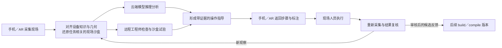

# PSOP 介绍材料的三阶段调整分析

本分析以 2026 年 9 月 14 日的[19 页旧主稿](legacy/script.md)为起点，结合本地三阶段项目、Microduck build 产物，以及 [servforce/psop](https://github.com/servforce/psop) 已有的现场运行与终端能力。当前重点是 **build 整理材料与知识图谱，compile 构建 EG、语料并训练调优模型，simulate 提供 Web 设备实验室与模型推理交互**。手机与 AR 作为已有现场入口保留在产品主线中，并扩展现场采集与沙盒重建、云端推理、远程工程师分析和现场结果复核。

旧稿保留设备服务的起点、知识与操作的关联、EG 的任务表达、模型训练、手机／AR 入口和工程师协作。改稿重点是把知识生产、Web 实验和现场执行连接起来，让读者看到每个阶段的输入、产物和完整应用链路。旧版逐页稿完整保留，SVG 使用的 imagegen PNG 单独保存供改稿复用。

## 旧稿已经演进到什么位置

这套材料已经超出早期“六智能体分工”的介绍。它的主线是“资料 → PSkill → 端侧模型训练 → 技能与模型分发 → 手机／AR 现场运行”，并包含世界模型、开源社区与企业订阅。第 8 页还引用旧 Runtime 的机械臂组装配对实验。

改稿围绕三阶段重新组织主流程、演示对象和应用效果。旧第 6 页“推理都在端侧完成”改为按任务安排浏览器、现场端或云端推理。第 9–11 页的多端分发、手机／AR 和工程师协作继续保留，并扩展为现场闭环；第 19 页用同一设备任务串联 Web 实验、现场执行和远程分析。

## 建议采用的核心介绍

> PSOP 面向硬件设备，把说明书、设计资料、BOM、图片和视频整理成可追溯的设备知识包；围绕具体任务构建执行图，生产真实与合成语料，训练并评测设备模型；在 Web 沙盒实验室中提供设备安装、使用、运行和模型指导，并通过手机与 AR 连接真实现场。现场采集结果还原为任务相关的沙盒，供云端模型或远程工程师分析，再把指导返回现场并复核结果，形成持续改进的闭环。

对外可以用“设备知识、模型、沙盒与现场协作”解释产品，随后引入 build、compile、simulate。介绍主文同时展示 Web 实验室、已有手机／AR 现场入口，以及现场还原与远程分析的扩展链路。首次出现 DKP 时说明它是贯穿生产链的设备知识包；EG 是定义任务前提、动作、结果及异常路径的执行图。内部 ID、Schema 名称和详细校验字段放到技术附录。

Microduck 继续作为设备知识与沙盒的展示样例，既有机械臂任务用于展示 AR 现场执行。业务范围面向硬件设备的安装、使用、维护和服务；试点记录操作质量、定位时间、工时和差旅变化。

## 三个阶段应该怎样讲

| 阶段 | 读者应理解的问题 | 核心工作与交付 | 演示重点 |
| --- | --- | --- | --- |
| build | 系统如何认识这台设备 | 整理资料，建立实体、关系、状态、任务与证据；形成 build-profile DKP 和知识 App | 从源材料进入部件、关系和证据，再查看三维参考装配与资料缺口 |
| compile | 设备知识怎样变成可执行任务和模型能力 | 构建具体 EG、场景与动作规则，生成可重放轨迹及语料，训练、调优、评测模型；形成 compile-profile DKP | 一个任务怎样表达前提、动作、预期结果和异常；同一轨迹怎样用于模型学习与评估 |
| simulate | 用户怎样在网页里实验并获得帮助 | 读取固定 compile 产物，交付包外 Web 沙盒；提供设备操作、运行模拟、观察、状态判断与指导 | 用户尝试操作，沙盒给出实际结果，模型从观察给出判断或请求补充视角 |

阶段边界以[系统设计](../architecture/system-design.md)和[DKP 契约](../architecture/device-knowledge-package.md)为准。需要在介绍里讲清下面四件事：

1. **compile 的数据生产复用仿真。** 无界面批量执行和渲染生成语料，simulate 复用同一套执行语义，提供面向用户的交互实验室。
2. **任务知识在 compile 中形成具体 EG。** build 提取任务和原子操作，compile 完成任务图与实例绑定。
3. **沙盒状态与模型判断分别记录。** 引擎维护沙盒状态，模型根据观察识别状态、解释结果、建议下一步，并在证据不足时请求补充观察。
4. **反馈进入新版本。** 会话、现场观察和纠正记录保存在 DKP 外，经整理与审核进入新的 build／compile revision。

## Meta Muse Gadgets 的启发与落地建议

截至 2026-10-05 查阅的官方资料，Meta Muse Gadgets 提供 ESP32 与 Linux SDK，让 Muse 接入设备上的显示屏、按钮、传感器、执行器和命令。Linux SDK 通过结构化命令定义声明用途、参数与返回结果，包括设备健康查询、文件操作和命令执行。[官方项目](https://github.com/facebookincubator/muse-gadget-sdk)、[命令定义](https://github.com/facebookincubator/muse-gadget-sdk/blob/main/linux/src/musegadget/executor.py)

由此对 PSOP 提出的设计建议是：**把设备知识变成 AI 可以观察、执行和验收的设备能力。** 在原有核心介绍后，可以补充“PSOP 让 AI 获得一台设备的知识、可执行任务，以及判断操作是否成功的依据”。以下是落地建议，沿用现有三阶段所有权和交付边界。

| 阶段 | 应落实的能力 | 如何进入介绍与演示 |
| --- | --- | --- |
| build | 从资料中明确设备支持哪些操作、有哪些状态、通过什么信息可以观察，以及适用配置和证据；登记为已有任务、原子操作、状态与接口知识 | 查看一个部件时，同时看到用途、相关操作、可观察信息和资料缺口；具体 EG 与执行适配仍由 compile 形成 |
| compile | 将具体 EG 的动作绑定到类型化接口和场景执行器，定义前提、预期变化、失败分支及验收；生成轨迹、语料、模型与评测 | 选择一个任务，展示动作调用、执行回执、前后观察，以及这些记录怎样支持模型学习和测试 |
| simulate | 用户与可选 Agent 使用同一套已验证的操作契约；沙盒执行动作，模型根据观察判断状态、建议下一步或请求补充信息 | 展示完整的观察、操作、检查、纠正和验收循环，分别呈现沙盒事实与模型判断 |

落地时优先处理四件事：

1. **先打通一个任务，再扩大设备覆盖。** 从资料足够的设备任务开始，形成“DKP → EG 与动作接口 → 可重放轨迹 → 模型判断 → Web 指导”的演示。首轮应覆盖成功、错误、异常、观察不足和恢复情况；每种情况都能追溯到动作回执、获准观察和验收依据。
2. **先测基座模型，再确定训练重点。** 在 compile 中建立“基座模型 + DKP／EG + 工具”的基线，用失败样例选择语料与调优目标。通用 Agent 负责意图理解、步骤组织和工具调用；设备模型重点学习装配状态、故障迹象、操作结果和观察不足。基线与调优模型按相同任务、观察权限和独立测试集比较，记录判断质量、任务完成率、延迟和成本，指导语料补充、训练调优与模型交付。
3. **统一沙盒与现场的任务、观察和操作语义。** Web 沙盒提供状态查询、类型化动作与结构化回执，已有手机／AR 入口承接现场采集、步骤指导和结果确认。两端复用 DKP、EG 和判断逻辑；现场观察对齐为沙盒快照，供云端模型或远程工程师分析，再返回现场指导并复核结果。
4. **保持设备能力独立于 AI 厂商。** Gadgets 接入需要 Muse 配对和 SDK token。[接入说明](https://github.com/facebookincubator/muse-gadget-sdk#readme) PSOP 的知识包、任务图、动作接口、训练轨迹和评测应保持独立，Agent 和模型通过适配器接入，便于更换或比较。

Gadgets 还提供复用实际 UI 代码的桌面模拟器，支持脚本化场景、无界面截图和重复性检查；它不模拟设备 CPU、相机、音频或无线硬件。[模拟器说明](https://github.com/facebookincubator/muse-gadget-sdk/blob/main/esp32/simulator/README.md) PSOP 可以借鉴这种快速开发与验证循环，同时分别验收界面、设备行为和模型判断。装配、运行与故障模拟仍由 PSOP 锁定的场景内核、行为规则和 EG 验证器承担。

## 手机与 AR 现场入口及现场还原链路

手机与 AR 是已有现场入口，介绍主稿中保留独立页面。手机承接现场采集、任务交互、查看指导与结果确认；AR 承接第一视角采集与双手作业中的步骤引导。已有项目打通了 Skill 构建、测试到眼镜终端运行的闭环，并提供多模态输入、事件同步、任务状态展示和会话恢复。[作品介绍](https://github.com/servforce/psop/blob/main/docs/competitions/goai-2026-boundless-agents/project-introduction.md)、[终端接入说明](https://github.com/servforce/psop/blob/main/docs/guides/terminal-integration-v1.md)

在已有入口上扩展现场还原、空间定位与标注：手机／AR 采集的设备、部件、位姿和操作状态，与设备知识及几何对齐为现场沙盒。两端共用任务图、分析会话和指导逻辑，分别适配交互方式。

产品形成两条相互衔接的链路：一条从材料、知识包和模型进入 Web 实验室；另一条从真实现场进入沙盒分析，再返回现场完成操作和复核。新增链路扩展 simulate 的应用场景，复用 build／compile 的产物和已有现场 Runtime。

现场还原优先复用 DKP 中的设备型号、配置、部件和几何，利用现场采集对齐设备实例、位姿、可见部件、连接状态与任务相关环境。资料或观察不足的区域标为未知；必要时再补充几何重建与测量。每次还原保存采集时间、坐标对齐依据和证据，并区分已有设备知识、现场观测、重建结果及推断假设。

云端模型可以结合固定版本的设备知识、EG 与现场观察进行状态判断、诊断和方案分析；远程工程师可以查看同一沙盒、定位证据、标注对象，在分支场景中试验操作方案。指导返回手机／AR 时关联具体设备、部件、步骤与证据，现场人员执行后重新采集并检查结果。

沙盒试验与现场执行分别保存结果，通过新的现场图像、读数或人员确认完成复核。现场数据、还原快照、推理、标注和复核记录保存在包外会话；经审核的知识补充或困难样例进入新的 build／compile revision。

围绕同一设备任务展示现场对齐、远程分析、指导返回和结果复核，手机采集与 AR 第一视角都可以作为入口。现场还原链路的评估重点包括任务覆盖、对齐质量、诊断效果、指导执行结果和现场复核情况。

## 介绍中可使用的已有成果

| 能力 | 已有材料与产物 | 新介绍中的表述 |
| --- | --- | --- |
| Microduck 材料与知识包 | [v1.2.1 包清单](../../build/microduck-official-assembled/microduck-official-assembled-v1.2.1.build.dkp/package.yaml)，57 份来源、318 个实体、819 条关系、711 条证据 | 用真实设备资料展示 build 的知识整理与证据追溯 |
| 任务基础 | 9 个任务、4 个原子操作、12 个状态变量；见[行为事实索引](../../build/microduck-official-assembled/microduck-official-assembled-v1.2.1.build.dkp/kb/indexes/device-behavior-facts.yaml) | 展示操作知识如何作为具体 EG、场景和训练样例的输入 |
| 三维知识浏览 | 源 XML 和 38 个 STL 对应 70 个可视实例；见[场景清单](../../build/microduck-official-assembled/microduck-official-assembled-v1.2.1.build.dkp/apps/build/data/scene-manifest.json) | 用参考装配与爆炸展示解释部件关系、几何对齐和现场还原的知识基础 |
| 资料覆盖与补充 | 179 个资料缺口，其中 14 个关联 compile；包括设备版本映射、操作条件与几何绑定 | 展示知识整理如何定位需要补充的材料与设备参数 |
| EG 编译与现场运行 | [已有 PSOP 项目](https://github.com/servforce/psop)：Skill 发布、EG 编译、Runtime、任务状态、多模态终端事件与 Replay | 作为三阶段体系衔接现场任务的现有运行基础 |
| Web 沙盒 | [S1 实现说明](../../skills/psop-simulate/references/implementation-status.md)：合成场景中的动作校验、状态管理、撤销、快照和回放 | 用交互场景展示设备操作、状态变化、回放与任务检查 |
| 手机与 AR 现场入口 | [眼镜终端闭环](https://github.com/servforce/psop/blob/main/docs/competitions/goai-2026-boundless-agents/project-introduction.md)、[Rokid 现场演示](https://github.com/servforce/psop/blob/main/docs/competitions/goai-2026-boundless-agents/demo-video-script.md)、[终端接口](https://github.com/servforce/psop/blob/main/docs/guides/terminal-integration-v1.md) | 保留已有现场采集、步骤指导、异常反馈、结果确认和回放能力 |

介绍同时使用本地三阶段产物和已有现场系统：Microduck 展示材料、知识与几何，Web 沙盒展示交互实验，已有 Runtime 和 Rokid 任务展示现场执行。进一步用现场还原与远程分析链路说明这些能力如何连接起来。

## 旧稿逐页处理建议

| 旧页 | 原主题 | 建议处理 |
| --- | --- | --- |
| 1 | 设备技能构建与分发平台 | 重写定位和主链路，主图展示材料、知识包、compile、Web 实验室，并连接手机／AR 现场协作 |
| 2 | 百人服务网络成本 | 保留服务痛点。大规模降本数字移入商业附录，主文先讲当前能验证的材料整理、任务实验与判断质量 |
| 3 | AI 硬件增长 | 压缩为背景或附录，按数据日期与来源更新硬件价格、出货量和增长率 |
| 4 | 全交付链 | 重画为 build → compile → simulate，注明前两步增强 DKP，第三步交付独立 Web 产品；连接现场采集、沙盒分析与指导复核 |
| 5 | 从材料构建 PSkill | 改为 build 与 DKP；优先使用当前 Microduck 知识 App、部件证据和源装配，替换静态设想 |
| 6 | 知识对齐与端侧推理 | 拆入 compile 的语料和模型页面；主线聚焦设备观察与任务判断，语音增强按任务需要保留，移除“全部推理在端侧”的统一承诺 |
| 7 | EG 训练对齐 | 扩展为具体 EG、guard、动作、effect、验收及失败／观察不足路径；补上可重放场景和前后状态转移 |
| 8 | Runtime 配对实验 | 保留在实验附录，说明机械臂任务、240 个配对结果、测试方法和指标，用于解释执行层的作用 |
| 9 | 多终端发布 | 保留 Web、手机与 AR 的交付关系，说明知识、EG、模型与现场 Runtime 如何共享和衔接 |
| 10 | 手机与 AR 现场入口 | 保留在主稿，展示已有现场采集、双手作业、步骤指导和结果确认，并连接现场沙盒还原 |
| 11 | 远程工程师接续 | 保留并扩展：现场还原后，工程师查看同一沙盒和证据、试验方案、返回标注与指导，再由现场复核 |
| 12 | 物理世界模型 | 保留并具体化：显式内核负责状态转移与校验，学习模型负责从观察判断；以有限任务验证能力 |
| 13 | 设备持续运营 | 保留版本迭代和新任务扩展，减少未来型号概念图的中心位置；优先讲已有设备怎样形成下一版知识与模型 |
| 14 | 开源与商业分层 | 保留产品原则，说明开源自建、企业托管、治理与服务的价值 |
| 15 | 社区与市场 | 移到远期愿景或附录，以设备知识包、任务、测试和模型的协作复用解释对象 |
| 16 | 企业订阅定价 | 移入商业附录，结合知识生产、Web 实验室、现场协作与多终端治理调整定价逻辑 |
| 17 | 国内与全球市场 | 投资沟通时保留为附录；重新明确当前首批使用者与任务，再决定市场筛选口径 |
| 18 | 三年收入与经营目标 | 保留模型供后续重算。知识整理、场景建模、渲染、训练和支持成本变化后，再评估原增长假设 |
| 19 | 设备、手机、眼镜试点 | 用同一设备任务串联知识、EG、模型、Web 实验和已有手机／AR 现场运行，并展示还原、远程分析、指导与现场复核的扩展 |

旧术语按对象用途迁移。PSkill 中的设备知识部分归入 build DKP；具体任务图归入 compile；已有 Runtime 的动作和验收语义与共享内核及 Web World Service 对齐；部署包概念对应 compile 工件和终端部署投影；运行记录对应包外会话与候选反馈。

## 新主稿的建议结构

建议维护一份 16 页主稿，独立保留手机／AR 现场入口和现场还原与远程分析两页；商业与历史材料作为附录按受众选用。页数是本分析的建议，可在实际试讲后调整。

| 新页 | 主题 | 应出现的主要内容 |
| --- | --- | --- |
| 1 | PSOP 做什么 | 设备知识、模型、沙盒与现场协作，一句话说明完整应用闭环 |
| 2 | 设备任务为什么难交付 | 资料分散、设备版本差异、操作结果难判断、训练样例不足 |
| 3 | 三阶段总览 | build、compile、simulate 的输入、产物与交接，连接手机／AR 现场使用与分析 |
| 4 | build 如何认识设备 | 原始材料、实体关系、证据、可观察状态、操作能力、任务和知识缺口 |
| 5 | Microduck 已有成果 | 实际知识包与 App、部件关系、源模型参考装配和证据追溯 |
| 6 | compile 如何构建 EG | 一个具体任务的前提、动作接口绑定、结果、失败与观察不足路径 |
| 7 | compile 如何生产语料 | 批量场景、动作前后观察、正确／错误／未知样例、真实资料校准 |
| 8 | compile 如何训练与调优 | 基座模型基线、错误样例分析、语料补充、调优、独立测试与模型发布 |
| 9 | simulate 设备实验室 | 用户与可选 Agent 共用操作契约，完成选择、移动、安装、连接、使用与运行观察；声明覆盖范围 |
| 10 | simulate 模型判断与指导 | 当前状态、下一步、诊断、结果验收、补充视角，展示推理与沙盒事实的区别 |
| 11 | 手机与 AR 现场入口 | 已有现场采集、第一视角双手作业、任务步骤引导、异常反馈、结果确认与回放 |
| 12 | 现场还原与远程分析 | 现场对齐为任务沙盒，云端模型或远程工程师分析与试验，返回指导并以现场证据复核 |
| 13 | 版本与反馈 | 固定知识、EG、模型版本，区分现场观测、重建与假设，会话记录进入后续独立编译与评测 |
| 14 | 已有成果与整合重点 | Microduck 知识包、Web 沙盒、已有 EG／Runtime／现场终端，说明统一任务与现场沙盒的衔接 |
| 15 | 怎样验证完整闭环 | 同一设备任务中核对模型判断、沙盒操作、现场执行和反馈，展示还原、分析、指导与复核 |
| 16 | 如何扩展与合作 | 增加任务和设备、协作维护、现场与远程分析试点、材料与验收责任，介绍合作方式与商业价值 |

附录保留 Runtime 实验、市场来源与经营测算。手机／AR 现场入口、远程工程师协作和现场还原链路保留在主文，以已有现场演示和完整场景说明产品价值。

## 视觉与素材如何复用

品牌标志、白色画布、深青骨架、青柠重点和原有 SVG 网格可以继续使用。模型与训练沿用紫色，设备观察与交互沿用水绿；三个阶段主要依靠布局和标题区分，避免增加一套需要解释的颜色规则。

build 页面优先使用当前知识 App 的实图与源模型，旁边展示一个部件的来源、关系和缺口。compile 页面画出同一个任务的 EG 和动作前后轨迹。simulate 页面单独组织 Web 零件库、操作区、设备状态与模型指导。手机／AR 页面使用已有现场演示和[现有效果图](legacy/images/index.html)，新增现场画面、还原沙盒、云端／工程师分析和指导返回之间的关系图。

现有 PPTX 采用整页图片，改稿从逐页文字稿和 SVG 开始，再统一导出。imagegen 素材用于场景与概念表达，设备与现场能力结合实际产物和演示呈现。主稿结构确定后再补充所需概念图。

## 改稿与整合顺序

第一步统一完整产品叙事：重写封面、总览、三阶段、已有成果和应用闭环，保留手机／AR 与远程工程师页面，扩展现场还原链路；商业规模页放到附录。同步调整口述、SVG 内文字和附录入口。

第二步贯通知识与 Web 任务演示：选择一个资料足够的任务，连接 Microduck build 产物、具体 EG、动作接口、配套观察、可重放轨迹和验收例子。建立基座模型与工具调用基线，再根据错误样例补充语料、训练调优并评测，接入 Web 的观察、操作、判断和指导循环。优先从已有识别、更新、回退、配对等任务切入，机械安装任务补充相应操作条件、装配关系与验收依据。

第三步整合已有现场入口：复用手机／AR 的采集、任务交互、步骤指导和结果记录，连接现场 Runtime 与三阶段知识及模型产物。围绕一个设备任务扩展知识与几何对齐、现场沙盒、云端模型／工程师分析、空间标注、指导返回和现场复核。

第四步依据实际应用重算商业方案：记录设备资料整理、场景适配、模型训练、渲染、部署与支持的投入，评估任务完成率、判断质量、错误恢复、样例生产效率和设备适配成本，同时测量现场定位时间、远程解决率、指导执行结果及工时／差旅变化。

改稿围绕首个设备配置与任务、设备运行模拟范围、现场还原的状态与空间信息组织案例。推理按任务安排浏览器、现场端或独立云端 worker，远程工程师使用同一现场沙盒与证据工作台开展分析。
