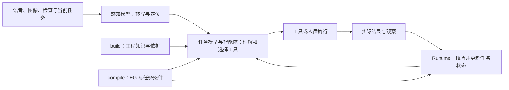
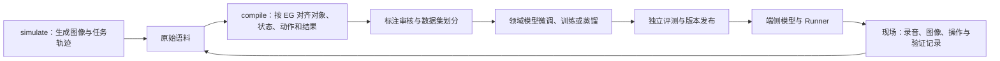
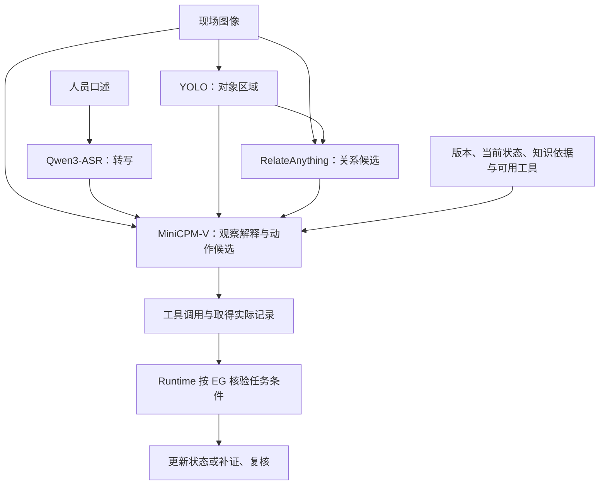
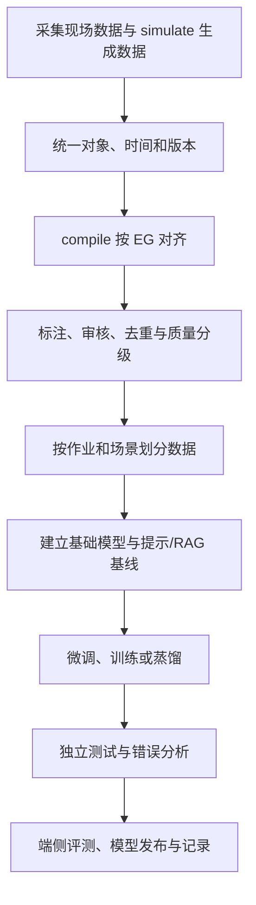

# PSOP 学习手册：从设备知识到 AI 与智能体

**学习主题：如何把工程知识、作业过程和现场观察，组织成智能体能够使用、模型能够学习、系统能够核验的工业任务。**

适用读者：具有设备、机械、软件或机器人相关背景，希望理解 AI 方法及参与项目研发的硕士研究生、实习生和新成员。默认读者已经熟悉设备使用与基本工程判断，从 AI 基础开始建立知识体系。阅读无需先掌握深度学习代码；训练原理、数据示例和评测设计可以结合自己的研究任务逐步练习。

对应材料：[当前演示说明](README.md)、[逐页内容稿](script.md)、[65 页教学 SVG](PSOP-教学SVG插图/index.html)和[教学逐页文字稿](PSOP-实习生与零基础学习课件-逐页文字稿.md)。本次教学案例更新于 2026 年 10 月 15 日。

贯穿案例是 **Microduck 替换舵机后的软件识别与复检**：设备 `MD-01`，教学任务 `MD-SERVO-CHECK-01 / Rev.A`，步骤 `S03`，目标关节 `J01`。当前已有软件识别记录，缺少复检日志与传感器状态；系统应先确认设备身份、绑定目标关节，再查询或请求复检，条件齐备并审核后才允许核验完成。文中 JSON、状态、EG、标签和训练方案均为教学设计。

真实资料来自 [Microduck build 知识包](../../../build/microduck-official-assembled/microduck-official-assembled-v1.2.1.build.dkp/package.yaml)及[任务事实](../../../build/microduck-official-assembled/microduck-official-assembled-v1.2.1.build.dkp/kb/tasks/task-definitions.jsonl)：已有“单个替换舵机的软件识别”和“软件与传感器逐项检查”等来源支持的定义，审核为 `proposed`、验证方式为 `document`。这些资料尚不表示实机更换、机械验收或运行闭环已验证。当前包是 build profile，没有已发布的 compile EG 与仿真绑定；本课中的 EG、模拟轨迹及样本为教学设计。

## 目录

1. [阅读路线与学习目标](#learning-route)
2. [先理解 PSOP 的 AI 主线](#ai-mainline)
3. [AI 与工业智能的演进](#ai-evolution)
4. [机器学习与深度学习基础](#ml-basics)
5. [大语言模型怎样工作](#llm-basics)
6. [视觉、语音与多模态方法](#multimodal)
   - [四个模型的分工](#four-models)
   - [Qwen3-ASR：语音转写](#qwen-asr)
   - [YOLO：对象检测与定位](#yolo)
   - [RelateAnything：区域关系预测](#relateanything)
   - [MiniCPM-V：视觉语言理解](#minicpm-v)
   - [四个模型怎样配合与入门实验](#four-model-pipeline)
7. [提示词、RAG、图谱与微调怎样选择](#method-choice)
8. [build：工程知识如何供 AI 使用](#build-knowledge)
9. [智能体如何计划、调用工具和观察结果](#agents)
10. [compile：EG 如何表达任务并对齐语料](#compile-alignment)
11. [simulate：怎样生成检测和多模态训练语料](#simulate-data)
12. [从语料到领域模型训练](#model-training)
13. [端侧模型、Runner 与 Runtime](#edge-runtime)
14. [一条任务贯穿整个 AI 系统](#worked-example)
15. [评测、实验与错误分析](#evaluation)
16. [经验怎样更新知识、任务和模型](#learning-loop)
17. [16 页 PPT 的 AI 阅读导航](#slide-navigation)
18. [项目研发任务与研究切入点](#research-work)
19. [AI 与智能体术语词典](#glossary)
20. [常见问题](#faq)
21. [四周学习与实习实践](#practice-plan)
22. [练习与参考答案](#exercises)
23. [论文、官方文档与本地资料](#references)

<a id="learning-route"></a>
## 01 阅读路线与学习目标

### 1.1 学完后应该能够解释什么

先达到以下目标，再考虑独立编写训练代码：

1. 区分模型、智能体、工具、任务图、知识图谱和运行系统。
2. 解释提示词、检索增强、微调、蒸馏分别改变什么。
3. 看懂语音、图像、工程文本和任务状态如何进入同一个任务上下文。
   能够具体说明 Qwen3-ASR、YOLO、RelateAnything 和 MiniCPM-V 的输入输出、领域数据要求及分工，详见 6.7—6.12。
4. 说明 **simulate 生成语料，compile 通过 EG 对齐语料，训练系统用对齐后的样本微调和训练模型**。
5. 将一条作业过程整理成“输入—状态—候选动作—验证结果”的监督样例。
6. 为检测、ASR、任务模型和完整智能体分别设计评价指标。
7. 根据错误定位问题：资料、感知、语料、模型、工具或任务机制中的哪一层需要改进。
8. 结合自己的设备与机器人研究背景，提出一个可验证的 AI 研究问题。

### 1.2 三条阅读路线

| 路线 | 建议顺序 | 重点 |
| --- | --- | --- |
| 一小时建立框架 | 02、03、07、10、11、13、17 | 先理解系统为何这样组织、三台工作台怎样服务 AI |
| 系统学习 | 04—16，遇到缩写查 19 | 补齐模型、智能体、语料和评测的方法知识 |
| 准备参与研发 | 14、15、18、21、22 | 将工程经验转换为数据定义、标签规则和实验问题 |

把每个 AI 方法都落实到四个问题：**输入是什么、输出是什么、如何获得正确答案、怎样证明有效。** 例如“用多模态大模型做任务判断”还不够，需要说清模型看到哪些画面、采用哪个状态快照、预测哪个动作、由什么记录验证。

### 1.3 用研究生已经熟悉的经验理解 AI

| 已有研究经验 | 对应的 AI 概念 | 需要进一步注意 |
| --- | --- | --- |
| 用实验数据拟合关系 | 模型训练 | 学到的关系能否推广到新批次和新工况 |
| 比较预测与实测 | 损失函数与评测指标 | 训练目标和最终使用目标是否一致 |
| 控制试验变量 | 基线、配对实验与消融 | 比较时只改变需要研究的因素 |
| 整理试验台账 | 数据集与元数据 | 图像、任务版本、时间、标注是否能够正确关联 |
| 依照流程做实验 | 工作流与任务图 | 并行步骤、缺失记录、回退和复核怎样表达 |
| 根据结果决定补试验 | 智能体的观察与行动循环 | 决策必须接收实际工具反馈，不能只生成一段计划 |

<a id="ai-mainline"></a>
## 02 先理解 PSOP 的 AI 主线

### 2.1 AI 在项目中承担哪些工作

PSOP 将几类 AI 能力组织到同一工程任务中：模型理解语音和图像，知识机制补充适用依据，智能体选择工具与候选动作，EG 表达任务条件，Runtime 核验执行结果，审核后的经验再用于知识与模型更新。

工程师的专业知识在三个地方尤其重要：定义对象与术语；判断记录和标签是否正确；制定任务能够推进的条件。模型研发需要这些明确的定义作为输入。

### 2.2 同时看懂运行链路与学习链路

**运行链路**解决当前任务怎样完成：



**学习链路**解决经验怎样改善模型：



两条链路共用对象、任务和版本信息。运行时使用已经发布的模型；训练时汇集历史语料并更新参数。模型推理、任务状态提交和模型训练是三种不同操作。

### 2.3 三台工作台的分工

| 工作台 | AI 角度的主要问题 | 主要作用 |
| --- | --- | --- |
| build | 模型怎样找到适用于当前对象的知识 | 组织对象、特征、关系、约束与来源，支撑检索和工具使用 |
| compile | 作业流程和训练语料怎样对齐 | 用 EG 表达步骤、状态与验证条件，将已有语料对齐为任务学习样例 |
| simulate | 如何观察任务变化并补充训练数据 | 三维操作、回放、分支试验；生成目标检测和多模态大模型的训练语料 |

可以记成：**build 组织知识；simulate 生成语料；compile 对齐语料并定义任务；训练系统学习；现场系统执行与核验。** 实际数据会在模块之间循环，不要求只按这个顺序操作。

### 2.4 六个容易混在一起的层次

| 层次 | 保存或处理什么 | 项目例子 |
| --- | --- | --- |
| 数据 | 录音、图片、检查、文档与记录 | 一张现场画面、一段口述、一条复检记录 |
| 知识 | 对象之间的关系、适用要求与来源 | 当前设备适用哪个任务版本和检测要求 |
| 模型 | 从输入学习预测或生成的参数 | ASR、目标检测器、多模态任务模型 |
| 智能体 | 围绕目标选择能力、执行并观察 | 查资料、请求检查、调用检测工具、整理候选 |
| 任务机制 | 状态、并行关系与推进条件 | 软件识别与复检记录齐备后进入复核 |
| 应用与终端 | 工程师实际使用的入口 | 工作台、手机、AR 眼镜 |

换一个基础模型，只直接改变模型层。整个系统能否改进，还取决于知识质量、工具接口、语料定义和任务机制。

<a id="ai-evolution"></a>
## 03 AI 与工业智能的演进

### 3.1 从规则到数据，再到基础模型

这是一条帮助理解方法选择的技术路线。不同方法长期共存，工程项目经常把规则、统计模型、深度学习和大模型结合使用。

| 阶段与代表性进展 | 方法怎样工作 | 带来的能力 | 对工业任务的启发 |
| --- | --- | --- | --- |
| 专家系统与规则方法 | 专家写入条件、推理规则和知识 | 清楚表达已知要求 | 明确流程条件与规则适用范围 |
| 统计学习与传统机器学习 | 从人工定义的特征拟合关系 | 分类、回归、异常筛查 | 建立小数据基线，检验变量与结果关系 |
| 深度学习与 CNN | 从大量样本学习多层特征 | 图像识别和视觉检测明显发展 | 图像任务需要标签、代表性与独立测试；2012 年 AlexNet 是代表性节点。[原论文](https://papers.nips.cc/paper_files/paper/2012/hash/c399862d3b9d6b76c8436e924a68c45b-Abstract.html) |
| 2017 年 Transformer | 通过注意力组织序列信息 | 支撑后续语言与多模态模型发展 | 理解模型怎样利用上下文。[原论文](https://arxiv.org/abs/1706.03762) |
| 预训练与基础模型 | 在广泛数据上学习可迁移表征 | 同一模型适配多个任务 | 在基础能力上进行领域适配 |
| 检索增强与领域适配 | 补充外部知识，或更新部分模型参数 | 增强资料使用和特定任务行为 | 知识更新与模型更新各有路径；2020 年 RAG、2021 年 LoRA 是相关代表。[RAG](https://arxiv.org/abs/2005.11401)、[LoRA](https://arxiv.org/abs/2106.09685) |
| 视觉语言与多模态指令学习 | 联合图像和文本进行学习 | 图文关联、看图问答与任务描述 | 将现场图像与工程任务关联；CLIP、LLaVA 分别代表两类相关工作。[CLIP](https://arxiv.org/abs/2103.00020)、[LLaVA](https://arxiv.org/abs/2304.08485) |
| 工具使用与智能体 | 模型选择动作，接收工具与环境结果 | 多步骤执行与动态补充信息 | 任务必须记录真实反馈；ReAct 是代表性研究。[ReAct](https://arxiv.org/abs/2210.03629) |
| 端侧与物理 AI | 将感知、决策、仿真和设备环境连接 | 降低部分交互延迟，开展合成数据与动作学习 | 需要同时评价任务效果和部署条件；VLA 是相关研究方向之一。[OpenVLA](https://arxiv.org/abs/2406.09246) |

### 3.2 工业应用怎样从单点模型走向任务系统

第一类应用关注一个确定输出，例如图像分类、区域检测或参数预测。任务目标清楚，容易定义数据和指标。

第二类应用把模型与资料连接，用检索和问答帮助工程师找到依据。此时核心问题增加了文档版本、适用条件和来源追溯。

第三类应用将模型放进多步骤工作流，调用数据库、检查、仿真或计算工具。此时还需要动作定义、工具反馈、异常恢复和任务状态。

第四类应用把作业记录回流为训练数据，持续更新领域模型与任务技能。此时数据对齐、评测划分、模型版本和发布机制成为长期能力的一部分。

PSOP 的设计重点落在后两类：**把工程任务表示清楚，并让任务过程成为可学习的数据。** 这也是 build、compile、simulate 与 Runtime 同时存在的原因。

### 3.3 看技术演进时应比较什么

不要仅按模型名称和参数规模判断进展。围绕项目，应比较以下变化：

- 输入从单张图片扩展到语音、图像、资料和任务状态。
- 输出从一个类别扩展到区域、关系、结构化观察和动作候选。
- 行为从一次回答扩展到多轮工具调用和结果核对。
- 训练数据从孤立标签扩展到状态、动作与结果关联的轨迹。
- 评测从单项准确率扩展到完整任务成功率、补证行为与跨场景泛化。
- 部署从只看服务器推理扩展到现场延迟、内存、功耗与连接条件。

这是对项目研发方法的归纳，具体方法是否适用，需要用本项目的数据和实验验证。

<a id="ml-basics"></a>
## 04 机器学习与深度学习基础

### 4.1 模型是一个可学习的输入输出关系

把模型写成 `ŷ = fθ(x)`：`x` 是输入，`θ` 是模型参数，`ŷ` 是预测。训练时根据样本调整参数；推理时使用已训练的参数处理新的输入。

例如，检测模型的输入是一张图，输出是类别、位置和分数；任务模型的输入可以是图像、当前状态和已取得的记录，输出是下一步动作候选。不同输出需要不同的数据和评价方法。

### 4.2 四种学习方式

| 方法 | 从什么信号学习 | 典型问题 | 在项目中的意义 |
| --- | --- | --- | --- |
| 监督学习 | 输入和对应的正确标签 | 图像属于哪类、目标在哪里、下一步应做什么 | 检测标注、校订转写、审核后的任务动作 |
| 无监督学习 | 数据自身的结构 | 样本怎样分组、有哪些异常分布 | 聚类作业模式，帮助发现待整理数据 |
| 自监督学习 | 从数据内部构造预测目标 | 预测被遮蔽内容或后续片段 | 基础模型预训练的重要思路 |
| 强化学习 | 行动后的奖励与状态变化 | 怎样通过一系列动作提高长期收益 | 可研究沙盒中的策略学习；需要环境和奖励定义 |

这些方式可以组合。基础模型可能先进行自监督预训练，再进行监督微调；强化学习也可以使用已有策略和示范数据作为起点。

### 4.3 数据集里到底有什么

一个样本通常不只有“图片和答案”，还应带上来源与上下文：对象编号、采集时间、场景、设备、标签版本、任务版本及审核状态。

| 名称 | 含义 | 教学例子 |
| --- | --- | --- |
| 样本 Sample | 一条用于学习或评测的记录 | 一张图及其目标框 |
| 特征 Feature | 用来描述输入的变量或表示 | 图像像素、声音特征、当前任务状态 |
| 标签 Label | 期望模型学习的答案 | 类别、转写、合法动作 |
| 真值 Ground Truth | 按定义取得的参考答案 | 经核对的对象标注或专家审核动作 |
| 元数据 Metadata | 解释样本来源和使用条件的信息 | 工位、设备、时间、版本和采集配置 |

“真值”的可信程度取决于取得它的方法。人工随意猜测的标签、未经验证的教师模型回答，都需要审核或标明质量级别。

### 4.4 一次训练怎样进行

训练的基本循环是：输入样本，产生预测，计算与标签的差异，再沿梯度更新参数。损失函数描述训练时希望减小的差异，优化器执行参数更新。[PyTorch 训练基础](https://docs.pytorch.org/tutorials/beginner/basics/optimization_tutorial.html)

以 `ŷ = ax + b` 的教学模型为例，训练就是调整 `a` 和 `b`，使预测更接近参考结果。深度网络的参数数量和函数结构更复杂，仍然需要输入、目标和更新规则。

应分清三个层次：

- **参数**：训练调整的权重，如上述 `a`、`b`。
- **超参数**：研发人员设置的学习率、批大小、训练轮数等。
- **任务规则**：某条记录取得后才能推进等条件，由任务定义和系统机制管理。

调低学习率会改变训练过程；修改 EG 条件会改变任务行为。两者需要各自的验证。

### 4.5 训练集、验证集和测试集

训练集用于更新参数；验证集用于选择超参数、检查点和阈值；测试集用于在选择完成后评价效果。

工业数据常有关联：同一设备的相邻图像、同一次任务的多个时间点、同一录音切出的多个片段，都很相似。如果随机拆散到不同集合，测试结果可能只反映对近重复样本的识别。

更合适的划分常以**完整作业、设备、工位、场景或时间段**为单位。具体采用哪种，取决于要证明“对新作业有效”“跨工位有效”还是“未来采集仍有效”。

### 4.6 过拟合、欠拟合与分布变化

| 现象 | 直观表现 | 可能的改进方向 |
| --- | --- | --- |
| 过拟合 | 训练很好，新任务表现差 | 排查泄漏，增加有效样本，控制训练，改善划分 |
| 欠拟合 | 训练和测试都较差 | 检查输入、标签、模型能力和优化设置 |
| 类别不平衡 | 总体分数高，少数重要情况识别差 | 采集难例，调整采样，分别评价类别 |
| 分布偏移 | 换工位、光照或说话人后退化 | 多环境采集、领域适配和跨环境测试 |
| 数据泄漏 | 测试提前接触到训练或输入含答案 | 按来源分组，检查时间顺序和输入字段 |

数据量增加只有在带来有效变化时才有价值。复制同一画面、重复同一回答，不等于覆盖了新场景。

<a id="llm-basics"></a>
## 05 大语言模型怎样工作

### 5.1 从文字到生成结果

以常见自回归语言模型为例：文本先经过分词器转换为 Token，再转换为向量表示；模型结合已有上下文，预测后续 Token，逐步生成结果。

Token 可以是字、词的一部分、符号或其他片段。中文字符数与 Token 数通常没有固定一比一关系。不同分词器对同一个设备编号也可能采用不同切分。

### 5.2 五个核心概念

| 概念 | 可以怎样理解 | 与项目的关系 |
| --- | --- | --- |
| Token | 模型处理序列的基本单位 | 对话、任务描述和部分多模态表示占用输入长度 |
| Embedding | 把内容映射成可计算的向量 | 检索语义相近的术语、文档或对象描述 |
| Attention | 根据上下文组织不同位置的信息 | 将“补检”与当前对象、步骤和已有记录关联 |
| Transformer | 以注意力等组件处理表示的模型架构 | 许多语言与多模态基础模型采用相关结构 |
| Context Window | 单次处理能够容纳的上下文范围 | 决定一次能带入多少资料、图像和历史 |

Transformer 的代表性论文提出以注意力组织序列处理。学习时先理解输入表示和信息关联，再深入网络细节。[Attention Is All You Need](https://arxiv.org/abs/1706.03762)

### 5.3 预训练与后训练

**预训练**帮助模型从广泛数据中学习语言、图像或其他表示。**后训练**在此基础上调整指令遵循、任务行为、输出风格或偏好等能力。

领域项目通常选用已有基础模型，再进行适配。这样可以利用已有识别与语言能力，将研发资源集中于领域数据、任务定义和独立评测。

“领域模型”不要求从零训练全部参数。使用领域样本进行全量微调、LoRA 或蒸馏，都可以成为形成领域能力的技术路线。

### 5.4 模型记住的知识与外部知识

模型参数保存学习形成的模式；外部知识库保存可检索和更新的资料。两者一起服务任务，但承担的作用不同。

一个任务版本发生变更，可以更新知识库及适用条件，让检索取得新的文件。模型若经常不能按要求使用资料或选择动作，则需要进一步改进提示、样例或训练。

适用图纸版本、最新记录和对象编号应通过任务上下文提供。把它们都寄托在模型训练记忆中，难以保证及时和精确。

### 5.5 生成概率、置信度与事实依据

模型的文本生成概率描述序列生成倾向；检测分数描述特定模型的预测评分；工程判断依赖对象、记录和适用判据。它们含义不同。

模型可能生成非常流畅、具体的错误回答。常见原因包括训练中的相似模式、输入缺少关键资料、检索没有命中，以及当前任务超出训练覆盖范围。

因此，任务输出应带上引用或记录编号、已知条件、缺失信息和待执行动作。这样才能核对其依据，并定位错误发生在哪一层。

### 5.6 温度、结构化输出与上下文组织

温度等采样设置影响生成随机性。降低温度有助于减少部分输出变化，但知识错误和输入错误仍要通过资料、训练和评测处理。

结构化输出把结果放入明确字段，例如 `object_id`、`observation`、`next_action`、`evidence_ids`。它便于解析和检查；字段存在并不自动保证内容真实。

任务上下文宜优先包含当前对象、版本、状态、可用工具、已取得记录和缺失要求。长历史可以摘要，但精确数值、来源编号和状态更新应保存在明确的数据结构里。

<a id="multimodal"></a>
## 06 视觉、语音与多模态方法

### 6.1 “看见”包含多种任务

| 视觉任务 | 输出是什么 | 适用问题 |
| --- | --- | --- |
| 分类 Classification | 一张图或区域的类别 | 识别场景类型或已定义对象类别 |
| 目标检测 Detection | 对象类别、边界框和评分 | 定位设备、工具或待关注区域 |
| 分割 Segmentation | 像素级区域 | 提取轮廓、区域范围或实例掩码 |
| 关键点/姿态估计 | 关键位置或姿态参数 | 对齐对象、辅助交互或标定 |
| 跟踪 Tracking | 连续帧中的对象关联 | 保持移动视角下的对象身份 |
| 关系预测 | 两个对象或区域之间的关系 | 判断位于、连接、遮挡等关系候选 |
| 视觉定位 Grounding | 文本指向的图像区域 | 找出“右侧孔位”或被描述的对象 |
| 视觉问答 VQA | 对图像相关问题的回答 | 结合图像和上下文解释当前情况 |

检测器常输出框、类别和分数。训练需要相应图像和标注，评价还要考虑定位质量。[Ultralytics 检测文档](https://docs.ultralytics.com/tasks/detect)

检测框有助于定位观察对象；将图像位置转换成精确工程量，还需要适用的传感器、标定和检查过程。

### 6.2 YOLO、SAM、视觉语言模型怎样配合

YOLO 代表目标检测方法与模型生态。SAM 代表可提示的图像分割研究，可由点或框等提示得到区域掩码。[Segment Anything](https://arxiv.org/abs/2304.02643)

视觉语言模型可以把画面与描述联系起来，再结合问题生成文本或结构化结果。工程任务可以采用“检测定位 → 必要时分割 → 关系理解 → 任务判断”的组合，各阶段分别输出可以核对的结果。

采用何种组合，应通过错误分析决定。例如，定位准确但下一动作错了，需要检查任务上下文和监督；框经常漏掉目标，则先解决视觉数据和检测能力。

### 6.3 ASR 怎样把口述变成任务输入

ASR 是自动语音识别，主要输出转写文字。后续还需要实体和字段抽取，才能把“这个位置需要再测一次”关联到对象、区域和动作。

可以把语音链路分成：

1. 音频采集与处理：记录采样率、通道、设备与时间。
2. ASR 转写：声音转换成文字。
3. 术语及关键字段核对：型号、数值、单位、否定词与动作词。
4. 任务关联：匹配设备、检查点和当前状态。
5. 结构化观察：形成有来源和时间的信息记录。

领域 ASR 微调需要录音与校订转写。热词、词表或解码偏置可以帮助部分术语识别；是否修改模型参数，应按实际实现说明。

### 6.4 多模态大模型如何理解任务

“多模态”指模型或系统结合文字、图像、声音等不同类型输入。具体支持哪些模态，由模型结构和训练决定。

CLIP 通过图文配对学习相关表示，适合理解图文对齐的基础思路；多模态指令学习进一步让模型按图像和问题生成任务回答。[CLIP](https://arxiv.org/abs/2103.00020)、[Visual Instruction Tuning](https://arxiv.org/abs/2304.08485)

在 PSOP 中，任务模型应看到的不仅是画面，还包括：当前对象和任务版本、已知状态、关联依据、可用动作、缺失记录。学习目标可以是识别当前步骤、请求补充信息、选择工具或解释推进依据。

### 6.5 VLM、VLA 与世界模型

| 名称 | 主要关注 | 与项目的联系 |
| --- | --- | --- |
| VLM：视觉语言模型 | 关联视觉与语言，回答问题或生成描述 | 理解现场画面并结合任务解释 |
| VLA：视觉语言动作模型 | 将视觉和语言条件连接到动作输出 | 研究感知与动作学习；动作空间需明确 |
| 世界模型 World Model | 表示或预测环境状态和变化 | 支撑场景生成、预测及仿真研究 |
| 物理 AI Physical AI | AI 与物理环境交互的较广研究方向 | 将感知、仿真、任务和设备联系起来 |

VLA 中的动作可能是机器人控制量，也可能是其他明确定义的动作表示，取决于研究。PSOP 的“请求复检、调用工具、保持状态”属于任务层动作，接入具体设备还需对应接口。[OpenVLA](https://arxiv.org/abs/2406.09246)

### 6.6 PPT 中技术参考的读法

| 材料列举的名称 | 应理解的技术类别 | 学习时关注的问题 |
| --- | --- | --- |
| YOLO26 | 目标检测 | 类别、区域、标注、漏检与定位效果 |
| Qwen3-ASR | 语音识别 | 领域录音、术语、数值与关键字段 |
| Gemma 4 / QAT | 多模态模型与量化训练 | 输入模态、任务适配、精度和部署资源 |
| Cosmos 3 / Edge | 世界模型、物理 AI 与设备端研究 | 场景、状态变化、合成数据和迁移 |
| RelateAnything | 区域关系理解 | 外部区域输入、关系词表和任务关联 |
| Muse Gadgets SDK | 终端与设备开发工具 | 输入输出接口、设备条件和交互能力 |

这些是 PPT 中的选型与趋势参考。研究方法可以先按能力类别掌握，具体型号的输入格式、许可、硬件条件和集成方式再查对应官方资料与[本地行业来源](industry-sources.md)。

<a id="four-models"></a>
### 6.7 先分清四个模型分别解决什么问题

下面以 Qwen3-ASR、Ultralytics YOLO26、Maëlic Neau 的 RelateAnything 和 MiniCPM-V 4.5 为具体学习对象。MiniCPM-V 4.5 是本节固定的教学版本；其他版本应采用对应模型卡和接口。模型资料核对日期为 2026 年 10 月 9 日。

| 模型 | 可以先这样理解 | 主要输入 | 主要输出 | PSOP 中的教学用途 |
| --- | --- | --- | --- | --- |
| Qwen3-ASR | 听清人员说了什么 | 音频，可附术语背景 | 转写文字、语言；另接对齐模型可取得时间戳 | 将口述观察送入任务上下文 |
| YOLO | 在画面中找出已学习的对象类别 | 图像或视频帧 | 类别、边界框、评分 | 定位设备、工具、检查区域或已定义的异常外观 |
| RelateAnything | 判断指定区域之间有什么关系 | 图像、外部区域、关系词表 | 主体—关系—客体及评分 | 取得工具、设备和异常区域之间的关系候选 |
| MiniCPM-V | 结合画面与问题生成回答 | 图像或视频及文字上下文 | 描述、问答或按提示生成的结构化文本 | 解释观察、指出缺失信息、提出任务动作候选 |

这张表描述的是**能力分工与项目集成设计**。四个模型的通用能力并不表示已经完成 PSOP 领域训练、终端部署或Microduck 实机验证。研究时可以先独立测各模型，再接入同一任务。

本节代码展示最小调用方式，工程样本与预期结果均为教学设计。运行前需要准备代码中指定的音频、图片和模型环境；首次加载通常需要下载权重。建议为不同模型建立独立 Python 环境，按所选版本的官方依赖安装，再记录实际软件版本。代码中的 CUDA／BF16 示例需要兼容的 NVIDIA GPU 和足够显存；本手册未在目标硬件上执行这些模型。

<a id="qwen-asr"></a>
### 6.8 Qwen3-ASR：把现场口述转成可核对的文字

#### 6.8.1 它是什么，怎样工作

Qwen3-ASR 是 Qwen 团队的语音识别模型系列，包含 0.6B 和 1.7B 两种命名规格。理解结构时，可以顺着“声音特征 → AuT 音频编码器 → 投影层 → Qwen3 语言模型 → 转写文字”阅读：编码器提取声音表示，投影层连接表示空间，语言模型按音频条件生成文字。型号中的参数规格不宜直接作为整个系统的显存占用。[Qwen3-ASR 技术报告](https://arxiv.org/html/2601.21337v2)

在本项目中，关键问题是准确保留设备编号、设备与关节术语、数值、单位、否定词和动作词。例如把“没有复检”转成“已经复检”，比遗漏一个语气词更容易改变任务判断。

#### 6.8.2 输入输出与任务关联示例

假设 `s03.wav` 中人员说：“MD-01 的 J01 已识别，暂未复检，先查复检日志。”ASR 应忠实保留设备、关节、否定语义和动作请求；后续程序再将其关联到教学任务：

```json
{
  "object_id": "MD-01",
  "target_joint": "J01",
  "task_id": "MD-SERVO-CHECK-01",
  "task_revision": "Rev.A",
  "checkpoint": "S03",
  "transcript": "MD-01 的 J01 已识别，暂未复检，先查复检日志。",
  "identification_available": true,
  "verification_available": false,
  "requested_action": "query_verification_record",
  "source_audio": "s03.wav"
}
```

`transcript` 来自 ASR；设备身份、目标关节绑定及状态字段由后续程序结合任务与记录整理。人员口述“已识别”只是观察来源，还应查询与 MD-01、J01、Rev.A 对应的软件识别记录；“这颗舵机”这样的指代还需画面选区或交互确认。音频与图片文件名是教学约定，运行代码前应准备真实文件。

#### 6.8.3 最小转写示例

在独立环境安装 `qwen-asr`，准备一段包含设备、关节编号及“暂未复检”的中文录音。下面使用官方 Python 包接口和原始命名的检查点；原生 Transformers 的 `-hf` 检查点使用另一套接口。[官方快速入门](https://github.com/QwenLM/Qwen3-ASR)

```bash
pip install qwen-asr
```

```python
import torch
from qwen_asr import Qwen3ASRModel

recognizer = Qwen3ASRModel.from_pretrained(
    "Qwen/Qwen3-ASR-0.6B",
    dtype=torch.bfloat16,
    device_map="cuda:0",
    max_inference_batch_size=1,
    max_new_tokens=256,
)
utterance = recognizer.transcribe(audio="s03.wav", language="Chinese")[0]
print(utterance.text)
```

这个示例只完成转写，设备与关节绑定由后续程序完成。若需要词语在录音中的时间位置，可以配置 `Qwen3-ForcedAligner-0.6B`；强制对齐关联文字与音频，本身不证明转写正确。[官方对齐说明](https://github.com/QwenLM/Qwen3-ASR#forcedaligner-usage)

#### 6.8.4 数据、适配与评测

领域训练需要真实录音与人工校订文字。官方微调脚本使用 JSONL 音频—文字对；路径必须指向实际录音。[官方微调指南](https://github.com/QwenLM/Qwen3-ASR/blob/main/finetuning/README.md)

```json
{"audio":"/data/wavs/s03.wav","text":"language Chinese<asr_text>MD-01 的 J01 已识别，暂未复检，先查复检日志。"}
```

术语背景改变当前推理输入，微调通过监督更新参数，两者应分开实验。原生 Transformers 模型卡提供 `prompt` 背景输入，应按检查点和接口版本选用。[官方背景输入说明](https://huggingface.co/Qwen/Qwen3-ASR-0.6B-hf)

录音应覆盖不同人员、麦克风、设备噪声、口音、关节编号和否定句。按人员或完整作业分组划分训练与测试，防止相邻片段泄漏。除 CER／WER 外，单独统计 MD-01、J01、S03、版本、否定语义与动作请求的准确率，以及取得转写的延迟。安静和噪声录音的配对比较可以帮助定位声学问题；“未复检”误成“已复检”还需在下游动作评测中单独统计。

<a id="yolo"></a>
### 6.9 YOLO：找到对象并给出图像位置

#### 6.9.1 它是什么，怎样工作

YOLO 来自 “You Only Look Once”，是一类以快速视觉预测为目标的模型。以目标检测为例，可以将工作过程理解为：提取图像特征，融合不同尺度的信息，再通过检测头预测对象类别和边界框。学习本节时先掌握普通矩形框检测，分割和姿态模型需要相应的其他标签。

本手册选用 Ultralytics YOLO26。该系列提供不同规模和任务的检查点，并支持端到端、无需单独 NMS 的推理路径；具体使用哪种路径，要与模型、软件版本及导出设置一起记录。[YOLO26 官方说明](https://docs.ultralytics.com/models/yolo26)

#### 6.9.2 输入输出示例与类别定义

输入可以是一张 `s03.jpg`。经过领域训练后，预期输出可整理为下列记录。以下类别、框和分数均为教学值：

```json
{
  "image_id": "s03.jpg",
  "image_size": [1280, 720],
  "detections": [
    {"region_id":"r1","class_name":"microduck_robot","bbox_xyxy":[180,160,960,620],"score":0.93},
    {"region_id":"r2","class_name":"servo_module","bbox_xyxy":[820,120,1120,350],"score":0.88}
  ]
}
```

`image_size` 表示宽、高；`bbox_xyxy` 表示原图像素坐标的左上角与右下角。类别 `microduck_robot` 表示一个类型，`servo_module` 表示舵机类型；`MD-01` 是具体设备编号，`J01` 是教学任务中的目标关节身份，要通过任务绑定、标识识别或其他关联机制取得。普通检测器不会自动把类型预测变成工程对象身份。

训练前应说明“异常”究竟是哪种可见外观，以及遮挡、模糊和不可见时怎样标注。图像检测只能覆盖图像中可观察的目标，软件认领、传感器状态或最终验收结论还需要对应的检查与判据。

#### 6.9.3 最小检测与领域训练入口

安装 `ultralytics` 后，先用通用权重理解返回字段：[官方检测文档](https://docs.ultralytics.com/tasks/detect)

```bash
pip install ultralytics
```

```python
from ultralytics import YOLO

detector = YOLO("yolo26n.pt")
prediction = detector.predict(source="s03.jpg", conf=0.25, verbose=False)[0]
for detected in prediction.boxes:
    class_id = int(detected.cls.item())
    coordinates = detected.xyxy[0].tolist()
    print(prediction.names[class_id], coordinates, float(detected.conf.item()))
```

`conf=0.25` 是练习阈值，实际阈值应由验证集和漏检／误报要求决定。通用 COCO 权重没有本例的Microduck 与舵机类别，因此这段代码用于检查调用与输出；要取得前面的领域结果，需准备领域标签并训练。

Ultralytics 普通检测标签采用 `class_id x_center y_center width height`，后四项按图像宽高归一化到 0—1，每个对象一行。例如 1280×720 图像中 `r1` 的框对应类别 0 时，可写为 `0 0.4453125 0.5416667 0.609375 0.6388889`。这与推理返回的像素 `xyxy` 格式不同。[官方数据格式](https://docs.ultralytics.com/datasets/detect)

数据配置的教学示例如下，需实际准备对应的图像目录和配对标签目录，例如 `images/train` 与 `labels/train`：

```yaml
path: /data/microduck-detect
train: images/train
val: images/val
test: images/test
names:
  0: microduck_robot
  1: servo_module
```

将配置保存为训练环境中的 `microduck.yaml` 后，可用下列调用建立基线。这里的轮数和分辨率是练习起点，需根据数据与设备调整：[官方训练入口](https://docs.ultralytics.com/modes/train)

```python
from ultralytics import YOLO

if __name__ == "__main__":
    baseline = YOLO("yolo26n.pt")
    baseline.train(data="microduck.yaml", epochs=30, imgsz=640, batch=4)
```

#### 6.9.4 应怎样评测

标注集要包含不同视角、光照、尺度、遮挡、相似工具和空场景。simulate 的合成图像可以补充难采视角，但测试必须保留独立真实作业，验证材质与光照差异的影响。

按类别统计 Precision、Recall、mAP 与漏检案例，再记录完整图像处理延迟。可以先固定阈值观察关键对象漏检率，再分析阈值变化的影响；连续视频帧应按完整作业划分，避免几乎相同的画面同时进入训练和测试。

<a id="relateanything"></a>
### 6.10 RelateAnything：预测指定区域之间的关系

#### 6.10.1 它是什么，怎样工作

本手册的 RelateAnything 指 Maëlic Neau 的 **Real-Time Open-Vocabulary Relation Prediction From Any Inputs**。它接收图像和外部区域，对区域对预测关系；区域可来自检测、分割或人工标注，关系词表可在推理时指定。它自身不承担目标检测。[作者官方仓库](https://github.com/Maelic/RelateAnything)

可以把结构理解为：视觉骨干读取图像，区域形成表示，候选区域对结合场景信息，再与关系词语的向量匹配评分。官方实现采用 DINOv3 视觉骨干和关系词表评分头；更换词表改变要评分的关系范围。[官方架构说明](https://github.com/Maelic/RelateAnything#how-it-works)

早期另有 EvolvingLMMs-Lab 的同名项目，技术实现不同。本节代码、来源与模型名称统一对应 Maëlic Neau 的版本。

#### 6.10.2 输入输出与关系方向

例如将 YOLO 或人工提供的两个区域交给模型，并指定 `beside`、`above`、`touching` 等关系词。程序可以把结果映射为下列教学记录；这不是原生返回字段规范：

```json
{
  "image_id": "s03.jpg",
  "subject_region_id": "r2",
  "relation": "beside",
  "object_region_id": "r1",
  "score": 0.81,
  "region_source": "manual_annotation"
}
```

含义是“区域 r2 的对象在区域 r1 的对象旁边”。对于 `above` 这样的关系，主体和客体对调会改变含义；`beside` 也应按统一的方向规则存储。`touching` 表示图像关系候选。舵机在设备旁边或接触设备，不证明它已被软件认领，也不证明 J01 的复检通过；这些结论需要目标关节绑定、日志与传感器结果。

“开放词表”意味着能够指定要预测的关系词，并不保证任意新关系都准确。定义领域词表时，可以从可见的空间关系开始；“完成检验”“复检通过”一类需要外部记录支持的判断，应由任务层处理。

#### 6.10.3 最小关系预测示例

按官方入门要求使用 Python 3.12 或以上，在独立环境安装仓库。在克隆后的仓库根目录运行下面代码，并将 `s03.jpg` 放入该目录；框应替换为该图片上实际标注的位置。[官方快速入门](https://github.com/Maelic/RelateAnything#quickstart)

```bash
git clone https://github.com/Maelic/RelateAnything.git
cd RelateAnything
pip install -e ".[hub]"
```

```python
import numpy as np
from PIL import Image
from relsgg import RelateAnything

relation_model = RelateAnything.from_pretrained(
    "maelic/relsgg-vits16plus", device="cpu"
)
scene = Image.open("s03.jpg").convert("RGB")
regions = np.asarray(
    [[180, 160, 960, 620], [820, 120, 1120, 350]], dtype=np.float32
)
relation_model.set_vocabulary(["beside", "above", "touching"])
candidates = relation_model.predict(
    scene, regions, box_labels=["microduck_robot", "servo_module"], topk=5
)
for candidate in candidates:
    print(candidate)
```

这里先用人工框隔离关系模型的效果。接入检测器后，必须保证图片尺寸、框坐标、区域顺序与标签对应一致；`box_labels` 用于帮助阅读结果，类别标签不是该关系模型的必需输入。[官方输入与部署说明](https://github.com/Maelic/RelateAnything#deployment)

#### 6.10.4 领域数据与评测

建议整理“图像、区域列表、主体编号、关系、客体编号、标注依据与可见性”。负样本要区分“明确没有该关系”和“遮挡导致无法判断”；只标注一种关系，不能直接推断同一对象对的其他关系全部不存在。

改变词表不更新视觉模型参数。开展领域训练时，需要将标注转换成对应代码版本的训练数据，并按作者训练指南准备配置与相关数据资产；普通 YOLO 标签只包含对象类别和位置，不能直接提供关系监督。[官方训练指南](https://github.com/Maelic/RelateAnything/blob/main/docs/training.md)

评测分两步：先使用人工正确区域测关系预测，再使用实际检测区域测整条链路。这样可以分清关系错误与上游漏检、错框的影响。按关系类别及方向统计准确性、召回或 F1，并检查不存在关系时的误报和未知场景表现；采用 top-k 指标时明确 k、对象对选择规则及参考关系集合。

<a id="minicpm-v"></a>
### 6.11 MiniCPM-V：结合图像与文字理解任务

#### 6.11.1 它是什么，怎样工作

MiniCPM-V 是 OpenBMB 的视觉语言模型系列，支持图像与文字结合的理解任务。与检测器相比，它更适合根据问题生成解释和回答；MiniCPM-V 与 MiniCPM-o 是不同系列，语音能力应查对应型号，不能从名称直接推定。[官方系列仓库](https://github.com/OpenBMB/MiniCPM-V)

以本节的 MiniCPM-V 4.5 为例，视觉编码使用 SigLIP2，语言部分基于 Qwen3-8B，并通过重采样机制压缩视觉表示。可以顺着“图像或视频帧 → 视觉特征 → 重采样后的视觉 Token → 与文字共同进入语言模型 → 生成回答”理解。它支持单图、多图和视频输入，具体接口见对应模型卡。[4.5 官方模型卡](https://huggingface.co/openbmb/MiniCPM-V-4_5)、[技术报告](https://arxiv.org/abs/2509.18154)

#### 6.11.2 在 PSOP 中输入什么、学习什么

本项目可以研究将以下信息一起提供：现场图像、ASR 转写、检测与关系候选、当前任务版本、已取得的记录、缺失条件和可用动作。把图像对象与工程编号关联好，再让模型提出候选判断。

例如输入问题：“当前对象 MD-01，任务 Rev.A，处于 S03；J01 待复检，尚无复检记录。结合图像说明可见情况、还缺什么信息，并从 `request_recheck`、`query_verification_record`、`hold_state` 中选择下一步候选。”

人工审核的教学参考回答可以整理为：

```json
{
  "object_id": "MD-01",
  "checkpoint": "S03",
  "observation": "J01 已完成软件识别，仍缺复检记录",
  "missing_evidence": ["J01 复检日志", "J01 传感器状态"],
  "next_action": "request_recheck",
  "state_update": "hold_until_verified"
}
```

这些是项目定义的输出字段。真实生成可能缺字段、产生错误 JSON 或误用依据，接口需要解析、校验并保留原始回答。模型提出动作后，实际调用由工具执行；Runtime 再根据取得的记录核验任务状态。

#### 6.11.3 最小图像问答示例

先建立与 **MiniCPM-V 4.5** 相匹配的环境，按其[官方用法与 Cookbook](https://huggingface.co/openbmb/MiniCPM-V-4_5#usage)安装 PyTorch、Transformers、Pillow 和相关依赖。不同版本的依赖和加载方式可能不同，实验中应固定模型修订与软件版本。下面使用支持 BF16 的 CUDA GPU，通过 `trust_remote_code=True` 加载官方模型实现：

```python
import torch
from PIL import Image
from transformers import AutoModel, AutoTokenizer

checkpoint = "openbmb/MiniCPM-V-4_5"
vision_language_model = AutoModel.from_pretrained(
    checkpoint,
    trust_remote_code=True,
    attn_implementation="sdpa",
    torch_dtype=torch.bfloat16,
).eval().cuda()
tokenizer = AutoTokenizer.from_pretrained(checkpoint, trust_remote_code=True)
photo = Image.open("s03.jpg").convert("RGB")
question = (
    "请描述图片中可见的设备和工具；看不清的部分请明确说明。"
    "当前S03尚无复检记录，请列出需要补充的信息。"
)
messages = [{"role": "user", "content": [photo, question]}]
with torch.inference_mode():
    answer = vision_language_model.chat(
        msgs=messages,
        tokenizer=tokenizer,
        enable_thinking=False,
        stream=False,
    )
print(answer)
```

这个示例用于检查“图像确实进入模型，模型能够结合问题回答”。它没有加载项目知识库、EG 或真实设备状态接口，现场动作与状态核验需要在系统集成中实现。

#### 6.11.4 微调样本与评测

领域监督样本应包含图像、当时可用的任务上下文、问题及审核后的参考回答。下例是**教学数据结构**，训练时需转换成所选框架接受的图文对话格式：

```json
{
  "image": "s03.jpg",
  "context": {"checkpoint":"S03","verification_available":false,"task_revision":"Rev.A"},
  "question": "当前能否推进任务，下一步应该做什么？",
  "target": {"next_action":"request_recheck","state_update":"hold_until_verified"}
}
```

先比较固定提示与检索基线，再考虑监督微调或 LoRA。官方提供版本对应的训练框架入口；选择时核对框架对该型号的支持及其样本格式。[官方训练说明](https://github.com/OpenBMB/MiniCPM-V#training-llama-factory-swift)

样本应覆盖正常、异常、缺证、遮挡、版本不匹配与工具失败等分支。输入只能包含当时可取得的信息，不能把后续检查结果提前写入上下文。检测框不能替代图文任务回答，教师生成的解释也需要工程人员审核。

评价应分别检查视觉观察、状态识别、动作选择、依据引用、缺证处理和结构化输出合法率。为检查模型是否真正使用图像，可以保持问题一致，分别使用正确图像、无图和错配图像；所选问题必须有一部分答案取决于视觉变化。最后再评测加入 Runtime 后的整条任务成功率。

<a id="four-model-pipeline"></a>
### 6.12 四个模型怎样配合，以及怎样开始实验

#### 6.12.1 同一条作业中的信息流

下面是本手册提出的教学集成设计。语音与图像可以并行采集；关系模型使用图像区域，任务模型结合观察与任务条件提出候选动作：



以 S03 为例：ASR 保留“暂未复检”的口述；检测提供设备与舵机区域；关系模型提出舵机与设备的位置关系；MiniCPM-V 结合当前缺证状态提出复检候选；复检工具或人员取得记录后，Runtime 才判断能否推进。图片中的舵机出现或关系分数升高，不能代替真实复检记录。

接入系统时，为每份观察记录保留对象、任务版本、采集时间、来源文件、模型版本及处理参数。检测和关系还要保留原图尺寸、坐标格式、区域 ID 与关系方向。把这些字段对齐后，compile 才能将观察、状态、动作和结果组织成可学习轨迹。

#### 6.12.2 四类训练数据各自需要什么

| 模型 | 最基本的监督 | 领域数据中的重点 | 首次实验关注的指标 |
| --- | --- | --- | --- |
| Qwen3-ASR | 音频＋正确转写 | 编号、术语、数字、单位、否定表达及噪声 | CER／WER、关键字段正确率、转写延迟 |
| YOLO | 图像＋类别与区域 | 相似对象、遮挡、小目标、光照与真实场景 | Recall、Precision、mAP、漏检及推理延迟 |
| RelateAnything | 图像＋区域＋有方向的关系标注 | 明确关系、可靠负样本、不可判断情况 | 按关系评价、方向错误、人工区域与检测区域的差距 |
| MiniCPM-V | 图像＋上下文＋问题＋参考回答 | 缺证处理、依据使用、可用动作与工具失败 | 视觉与动作正确率、依据一致性、输出合法率 |

一段作业可以提供四类样本，但它们的标签目标和训练格式各不相同。simulate 更适合补充视觉场景与任务分支；ASR 的现场泛化仍需要真实人员与设备录音，关系和任务判断的工程语义仍需审核。

#### 6.12.3 实习生的首次实验

先准备少量授权的录音与图片，例如 10 段短录音、20 张不同视角图片，并人工整理转写、区域、关系和任务问答。这一规模用于学习接口与发现问题，不能支撑泛化结论。

1. 独立运行 ASR，标出术语、数值和否定词错误。
2. 独立运行检测，查看框和类别；使用通用权重时记录类别不匹配，随后准备领域训练基线。
3. 先给关系模型人工正确框，再换成检测框，比较两次关系结果。
4. 给 MiniCPM-V 同一任务的图像与上下文，检查可见观察、缺失信息和动作候选。
5. 保持样本与模型不变，只改变一个条件，如术语背景、图像视角或是否提供当前状态，解释结果变化。

模型之间的分数含义不同，不应把检测分数、关系分数和生成概率直接当作同一种工程置信度。端侧实验还应记录加载时间、峰值显存／内存和完整调用延迟；速度取决于硬件、输入长度、分辨率、模型规模与运行后端。

<a id="method-choice"></a>
## 07 提示词、RAG、图谱与微调怎样选择

### 7.1 先判断短板在哪里

| 方法 | 主要改变什么 | 适合解决的问题 | 所需基础 |
| --- | --- | --- | --- |
| 提示词与上下文设计 | 单次输入和输出要求 | 模型不知道本次任务目标、字段或工具规则 | 清楚的任务说明与代表性示例 |
| RAG：检索增强生成 | 提供给模型的外部资料 | 需要查询适用知识、版本和记录 | 可检索资料、元数据与检索评测 |
| 知识图谱 | 知识的结构和关联 | 需要连接对象、特征、条件和依据 | 对象体系、关系定义和来源审核 |
| 工具调用 | 能获得的信息和能执行的操作 | 需要检查、计算、检索或修改记录 | 稳定接口与可核对反馈 |
| 微调 | 模型参数及任务行为 | 经常出现相同领域行为错误 | 高质量任务样本与独立评测 |
| 蒸馏 | 将教师能力转移到学生模型 | 需要较小模型学习特定能力 | 可信教师输出、筛选和学生评测 |
| Runtime 与 EG | 任务条件、核验和状态提交 | 需要处理并行、缺证、合法推进与回退 | 明确任务语义与记录结构 |

这些方法可以组合。RAG 提供依据，微调帮助模型学会如何使用依据，EG 和 Runtime 负责检查动作与状态条件。

### 7.2 提示词的最小结构

一条任务提示宜明确：任务目标、对象及版本、当前状态、可用记录、可用工具、输出字段和完成条件。

教学示例：

```text
任务：判断当前检查点应执行的下一项操作。
对象：MD-01；任务版本：Rev.A；检查点：S03。
状态：待复检关节 J01；J01 已有软件识别记录，缺少复检日志与传感器状态。
工具：查询记录、请求复检、提交候选观察。
输出：观察、缺失依据、下一动作、所引用的记录编号。
```

这个提示先定义模型要解决的问题。真正的工具调用、权限与状态核验由系统接口承担。

### 7.3 RAG 的基本过程

RAG 在回答时检索相关资料，把结果作为上下文交给生成模型。[RAG 原论文](https://arxiv.org/abs/2005.11401)

工程应用的关键步骤是：整理资料和版本 → 切分与索引 → 按对象和条件过滤 → 检索相关内容 → 重排 → 生成带来源的结果 → 核对引用与适用性。

切分文档时应保留标题、表格、单位和上下文。若把“仅适用于某条件”的限制切掉，检索出的正文可能失去原来的适用范围。

### 7.4 向量检索与关键词检索

向量检索擅长寻找语义相近的表述；关键词检索擅长精确编号、型号和术语。工程资料常需要两者结合，并使用元数据过滤。

例如“Rev.A 的 S03 检查要求”先限制版本和任务，再检索内容，通常比只按语义寻找“关节复检”更符合目的。重排器可以进一步比较查询与候选资料的匹配程度。

### 7.5 图谱与 GraphRAG

知识图谱表达实体、关系和属性；GraphRAG 是利用图结构增强检索与生成的一类方法。它可以结合实体邻居和原文，也可以利用图社区摘要回答跨资料问题。Microsoft GraphRAG 的官方文档分别介绍了局部与全局查询。[局部查询](https://microsoft.github.io/graphrag/query/local_search/)、[全局查询](https://microsoft.github.io/graphrag/query/global_search/)

PSOP 可以先建立明确的工程对象、关系与来源，再研究适合的检索方式。采用图数据库或图谱界面，并不自动意味着实现了某个完整 GraphRAG 框架。

### 7.6 用一个错误决定下一步研发

模型答错时依次检查：

1. 输入是否绑定了正确对象和版本。
2. 检索是否取得所需资料，是否保留限制条件。
3. 模型是否正确理解和使用资料。
4. 工具返回是否完整，字段和单位是否一致。
5. 当前动作是否符合 EG 定义的状态与条件。

如果资料缺失，先改善资料与检索；如果依据齐全但模型反复选错动作，可以增加对齐样本和微调；如果正确动作不能提交，排查接口与 Runtime。这样可以把实验资源用在实际短板上。

<a id="build-knowledge"></a>
## 08 build：工程知识如何供 AI 使用

### 8.1 从资料到可以查询的对象关系

工程师能从图纸、工艺文件和试验记录中理解对象与条件；模型需要这些信息以可识别、可检索的方式组织起来。

build 将设备及其特征与资料、约束和验证要求关联。对于 AI，这相当于建立当前任务的知识背景：讨论哪个对象、适用哪些条件、能查询哪些依据。

教学图谱可以采用下列关系：

```text
设备 MD-01 → 包含 → 目标关节 J01
任务 MD-SERVO-CHECK-01 → 作用于 → 设备 MD-01 的关节 J01
任务 Rev.A → 定义 → 复检步骤 S03
步骤 S03 → 要求 → 软件识别与复检记录
记录 E01-001 → 采集于 → 当前任务运行 R001
知识条目 K01 → 来源于 → 文档及具体章节
```

对象编号用于统一身份，关系用于连接信息，来源用于核对内容。

### 8.2 实体、属性、关系与本体

| 项目 | 含义 | 教学例子 |
| --- | --- | --- |
| 实体 Entity | 能独立识别的对象 | 设备、任务、记录、工具、文档 |
| 属性 Property | 对实体的描述 | 编号、版本、时间、单位、审核状态 |
| 关系 Relation | 实体之间的联系 | 作用于、包含、要求、来源于 |
| 本体 Ontology | 类型、关系及使用规则的定义 | 什么可称为检查点，记录可关联哪些对象 |
| 溯源 Provenance | 内容的来源与生成过程 | 文档页码、采集设备、审核人员、版本 |

本体可以先从小范围做起。围绕一个任务，明确对象、步骤、观察、动作、记录和依据，比一开始定义大量未使用的类别更有帮助。

### 8.3 大模型可以帮助怎样建图

大模型可辅助识别术语、抽取实体和关系、匹配已有对象、整理字段，并标记来源位置。工程人员审核这些候选后，再将它们用于任务。

需要评价的内容包括：实体是否重名或误合并，关系方向是否正确，单位是否保留，来源是否支持陈述，适用条件是否完整。

例如“在某条件下采用方法 A”应同时保存方法、条件和出处。如果只抽取“采用方法 A”，模型可能在不适用的任务中检索到它。

### 8.4 图谱怎样帮助智能体

图谱为智能体提供检索入口：由设备找到任务，由任务找到当前检查要求，由检查要求找到记录类型与相关工具。返回结果可以同时包含文本、字段和来源。

这有助于减少重复解释任务背景，也让不同模型和终端使用同一套对象定义。图谱质量可以通过实体、关系、来源和适用条件的评测单独检验。

### 8.5 知识图谱与 EG 为什么都需要

知识图谱擅长描述**信息之间的关系**；EG 擅长描述**任务在什么条件下发生状态变化**。

“这条记录属于 S03”是知识关联；“软件识别与复检记录均取得并审核后才能进入复核”是任务条件。图谱可以为条件提供数据，EG 使用这些数据核验推进。

<a id="agents"></a>
## 09 智能体如何计划、调用工具和观察结果

### 9.1 模型怎样成为智能体的一部分

智能体围绕目标使用模型、工具、上下文和反馈。模型可以提出下一步，工具取得实际结果，系统再根据结果继续或结束任务。

ReAct 研究了推理与行动相结合的模式；实际工程系统还要明确工具接口、状态和核验过程。[ReAct](https://arxiv.org/abs/2210.03629)


### 9.2 模型、工作流与智能体怎样区分

| 名称 | 谁决定步骤 | 适合的任务 |
| --- | --- | --- |
| 单次模型调用 | 人员或程序预先定义一次输入输出 | 转写、分类、提取字段或生成摘要 |
| 工作流 Workflow | 代码或任务图预先定义主要路径 | 步骤稳定、条件明确的处理过程 |
| 智能体 Agent | 模型根据目标和反馈动态选择部分步骤 | 需要补充信息、选择工具或调整计划的任务 |
| 混合系统 | 明确流程管理状态，模型处理灵活判断 | 工业任务中的资料理解、工具选择和条件核验 |

行业实践区分了预定义工作流和模型动态引导的智能体，并强调按任务需要选择复杂度。[Anthropic 智能体工程说明](https://www.anthropic.com/engineering/building-effective-agents)

PSOP 采用任务机制与模型能力结合的思路：模型可以选择候选工具和组织信息，正式状态推进依照 EG 与 Runtime 的核验结果。

### 9.3 工具调用到底发生了什么

工具调用通常包含三步：模型形成工具名称和参数；程序执行对应接口；接口把实际结果返回给模型或任务系统。

教学示例：

```json
{
  "tool": "query_evidence",
  "arguments": {
    "object_id": "MD-01",
    "task_revision": "Rev.A",
    "checkpoint": "S03",
    "target_joint": "J01",
    "record_type": "servo-verification"
  }
}
```

接口可以返回“找到记录”“没有记录”或“查询失败”，并附记录编号、时间和状态。三者对应不同后续动作。

模型生成上述 JSON 只是提出调用。真正取得记录，还需要接口执行和反馈。

### 9.4 工具接口为什么影响效果

工具应有清楚的用途、参数、单位、返回结构、失败信息和使用条件。模糊名称和混合结果会增加模型选错工具或误读结果的机会。

可以分别评价工具选择是否正确、参数是否完整、对象是否匹配、调用是否成功、返回结果是否被正确使用。由此判断问题在模型、接口还是数据服务。

### 9.5 Harness、Runner 与 Runtime

| 名称 | 学习时怎样理解 | PSOP 中的相关作用 |
| --- | --- | --- |
| Harness | 让智能体运行的支撑环境，如工具、上下文、循环和测试机制 | 第 5 页中的实验比较条件 |
| Runner | 加载并调度模型与工具的组件 | 按任务和版本组织端侧能力调用 |
| Runtime | 管理任务运行状态与核验的机制 | 检查条件、证据和状态转移，再提交正式状态 |

Harness 的具体内容需要按实验定义理解。Runner 与 Runtime 也不是行业统一的固定分工；本手册采用项目材料中的职责。

### 9.6 状态、上下文与记忆

**状态**记录当前任务已经完成什么、处于哪个阶段；**上下文**是本次模型调用能看到的信息；**记忆**是跨调用或跨任务保存的记录。

关键对象、版本和状态应由系统保存。对话摘要可以帮助模型回顾过程，但任务状态应以正式记录为准。长期经验应经过整理和审核，再进入知识库或训练集。

### 9.7 多智能体什么时候有意义

可以按能力划分资料检索、视觉处理、任务规划和结果审核，也可以由一个智能体调用多个专用工具。选择依据是任务效果、接口复杂度、延迟和维护成本。

多个智能体若使用不同对象编号或状态版本，会产生协作错误。协作前需要共享任务上下文，明确谁提出候选、谁执行工具、谁核验和提交状态。

### 9.8 执行失败如何成为可分析的数据

一次失败应记录尝试的动作、输入参数、实际结果和下一步，而不仅是“任务未完成”。失败类别可以包括：资料未找到、输入质量差、工具超时、对象不匹配、条件未满足、模型选错动作。

这些记录有两种价值：帮助恢复当前任务；成为后续错误分析与训练中的难例。具体如何转为样本，由 compile 按任务语义对齐。

### 9.9 接口协议与任务技能

MCP（Model Context Protocol）是一种连接 AI 应用与外部数据、工具的开放协议。协议帮助统一接口，工具本身仍要定义用途、参数、返回结果及任务条件。[MCP 官方介绍](https://modelcontextprotocol.io/docs/getting-started/intro)

可复用的任务技能可以包含操作指导、工具规范、输入输出示例和评价条件。技能指导、接口协议和 EG 分别组织如何使用能力、怎样连接能力，以及任务怎样推进。研发时应明确这些内容之间的版本关系。

<a id="compile-alignment"></a>
## 10 compile：EG 如何表达任务并对齐语料

### 10.1 compile 的核心作用

compile 用执行图 **EG（Execution Graph）**定义任务，并围绕 EG 对齐训练语料，组织领域模型微调和训练所需的任务监督。

原始语料可以来自现场、simulate、工程资料及审核记录。compile 将它们关联到正确对象、步骤、状态、动作和结果，使模型学到“在这个任务条件下，应怎样判断和行动”。

### 10.2 为什么只有步骤列表还不够

步骤列表能表达顺序，但工程任务还包含并行、等待、缺证、复检、回退和条件分支。Microduck 教学任务先完成设备与关节绑定及软件识别，再开展复检。核验时可以并行查询已产生的识别与复检记录，等待两类记录齐备、身份和版本一致，并通过审核；并行查询不改变实际操作的先后要求。

EG 把这些关系显式表达，既支持运行时核验，也帮助整理训练样本的当前状态和合法动作。

### 10.3 类 Colored Petri Net 的基本元素

| 元素 | 通俗含义 | 教学例子 |
| --- | --- | --- |
| Place：库所 | 表示一种条件或状态位置 | 等待记录、记录齐备、待复核 |
| Transition：变迁 | 表示状态改变的事件或动作 | 提交记录、完成复核 |
| Token：令牌 | 表示当前存在的带类型信息 | 指定对象的复检记录、任务状态 |
| Colour：颜色/类型 | 令牌携带的数据类型与值 | 对象编号、版本、检查点、结果 |
| Arc：弧 | 表达输入与输出联系 | 某变迁需要哪些令牌、产生哪些令牌 |
| Guard：守卫条件 | 变迁允许发生的布尔条件 | 两条记录属于同一对象和任务版本 |
| Marking：标识 | 令牌在各库所的当前分布 | 当前已有哪类记录，仍等待什么 |
| Firing：发生/发射 | 条件成立后执行变迁 | 核验后从待复核进入下一状态 |

CPN 中“颜色”主要指数据类型与值。守卫是参与变迁使能判断的条件，变迁还需满足其他输入要求。[CPN 语言材料](https://cpntools.org/wp-content/uploads/2018/01/cpn.pdf)、[守卫文档](https://cpntools.org/2018/01/09/guards/)

项目采用类 CPN 的任务表达思路。具体软件是否完整实现形式化语义，应通过运行与一致性测试确认。

### 10.4 四种对齐

| 对齐维度 | 要解决的问题 | 忽略后可能发生什么 |
| --- | --- | --- |
| 对象与版本对齐 | 语音、画面和记录是否属于同一对象与任务版本 | 把另一设备的结果用于当前任务 |
| 时间与检查点对齐 | 模型当前时刻已经能获得哪些信息 | 把事后结果提前放进模型输入 |
| 状态与动作对齐 | 当前状态允许哪些动作，需要哪些条件 | 学会在缺少记录时错误推进 |
| 动作与结果对齐 | 动作是否实际执行，验证结果是什么 | 把计划、尝试和成功混成同一个标签 |

多模态样本还需要将图片、语音片段、区域和任务语义关联。它们可以来自不同设备，时间戳和对象身份尤其重要。

### 10.5 从原始记录到监督样本

假设原始资料包含一张画面、一次口述、一条识别记录和一次后续复检。compile 可以按以下过程对齐：

1. 统一对象、任务版本和检查点。
2. 将记录映射到 EG 的相应节点、动作或证据类型。
3. 按时间重建模型决策前的状态快照。
4. 标出当前可用记录与缺失条件。
5. 结合实际动作、验证结果和工程审核形成目标标签。
6. 输出对应模型任务所需的样本，保留原始来源。

检测模型使用图像和区域标签；ASR 使用音频和转写；任务模型使用多模态输入、状态和动作监督。EG 帮助关联任务语义，具体训练格式由模型决定。

### 10.6 一条对齐后的任务样本

以下为教学结构，用来说明输入与学习目标怎样区分：

```json
{
  "sample_id": "teaching-001",
  "source": "simulation",
  "object_id": "MD-01",
  "task_id": "MD-SERVO-CHECK-01",
  "task_revision": "Rev.A",
  "checkpoint": "S03",
  "input": {
    "image_ref": "frame-s03",
    "state": "waiting_for_evidence",
    "verification_status": "missing",
    "available_evidence": ["identification-record-001"],
    "target_joint": "J01",
    "missing_evidence": ["verification-record"],
    "allowed_actions": ["query_evidence", "request_recheck"]
  },
  "target": {
    "next_action": "request_recheck",
    "state_decision": "keep_current_state",
    "basis": ["required-evidence-condition"]
  },
  "review": {
    "status": "teaching_reference",
    "label_revision": "teaching-label-v1"
  }
}
```

模型输入描述决策时可获得的信息；目标描述希望学会的行为。未来的检测结论可以参与事后标签审核，但不能泄漏到当时的输入中。

### 10.7 EG 怎样同时服务训练与推理

| 使用阶段 | EG 的作用 | 需要验证什么 |
| --- | --- | --- |
| 数据整理 | 关联状态、动作、条件和结果 | 样本映射是否正确，是否有时间泄漏 |
| 监督学习 | 定义当前状态下的目标行为 | 标签是否正确，是否覆盖重要分支 |
| 样本筛选 | 识别缺证、错序、越界与未验证轨迹 | 筛选规则是否误删有价值的失败样本 |
| 推理 | 提供当前状态、可用动作与要求 | 模型是否使用了正确版本和上下文 |
| 运行核验 | 检查证据与状态转移 | 条件检查和提交行为是否一致 |
| 评测 | 比较任务判断与轨迹行为 | 是否同时评价正确动作和正确等待 |

### 10.8 “任务语料对齐”与其他对齐

多模态表示对齐关注图像、声音与文本之间的表示关系；偏好对齐关注模型行为与偏好目标；compile 的任务语料对齐关注真实或模拟作业中的对象、状态、动作和结果。

它们可以共同用于模型研发。称为“对齐”时，应同时说明对齐什么数据、依据什么定义、产生什么训练目标。

### 10.9 EG 对齐是否是一种新的训练算法

EG 对齐首先是任务表示与监督组织方法。对齐后的数据可以用于 SFT、LoRA、动作分类、序列学习或蒸馏等训练路线。

若要证明 EG 对齐的价值，应保持基础模型和训练设置尽量一致，比较普通整理与 EG 对齐样本在任务判断、分支处理和完整执行中的差异。第 15 节给出实验设计。

<a id="simulate-data"></a>
## 11 simulate：怎样生成检测和多模态训练语料

### 11.1 simulate 的两个用途

simulate 支持三维操作、回放和分支试验，用于观察任务变化；另一个用途是**生成目标检测和多模态大模型的训练语料**。

两种用途互相联系：同一个场景既能供人员操作，也能按视角、对象、状态与动作生成学习样本。下面介绍可采用的数据构建方法，自动标注、导出和训练接入属于需要实现与验证的具体功能。

### 11.2 目标检测语料怎样构成

检测样本至少包含图像、类别及对应区域。三维场景还可以保存对象身份、相机参数、可见性和生成配置，便于追溯标签。

| 数据部分 | 内容 | 作用 |
| --- | --- | --- |
| 输入图像 | 渲染画面或选定相机图像 | 模型实际看到的视觉信息 |
| 类别标签 | 设备、工具、指定区域等已定义类别 | 说明检测目标是什么 |
| 区域标签 | 边界框，必要时附掩码 | 说明目标在哪里 |
| 场景元数据 | 视角、光照、对象、遮挡、随机种子 | 解释样本怎样产生 |
| 任务关联 | 对象、检查点、任务版本 | 将视觉结果连接到任务上下文 |

合成数据工具可利用场景语义标签产生框或分割等标注。NVIDIA Replicator 官方资料展示了此类流程及随机化方法。[语义标注与生成概述](https://docs.isaacsim.omniverse.nvidia.com/latest/replicator_tutorials/tutorial_replicator_overview.html)、[随机化方法](https://docs.isaacsim.omniverse.nvidia.com/latest/replicator_tutorials/tutorial_replicator_isaac_randomizers.html)

### 11.3 类别应怎样定义

标签类别应对应模型输入能够支持的判断。例如“设备”“工具”“目标关节区域”可以是视觉定位目标；更深入的性质结论，需要相应参考依据。

制定标签规范时记录：类别名称、定义、包含范围、相似类别区别、遮挡处理方式和无法确认时的标签。这样不同标注人员与生成脚本才能采用一致口径。

教学检测标注可以写成：

```json
{
  "image_ref": "scene-001-camera-02",
  "coordinate_system": "normalized_xyxy",
  "objects": [
    {
      "instance_id": "MD-01",
      "class": "microduck_robot",
      "bbox": [0.22, 0.18, 0.74, 0.83]
    },
    {
      "instance_id": "J01",
      "class": "servo_module",
      "bbox": [0.48, 0.42, 0.61, 0.58]
    }
  ],
  "source": "synthetic",
  "scene_seed": 101,
  "annotation_revision": "teaching-v1"
}
```

坐标值仅用于解释格式。正式数据必须明确框的定义、图像尺寸、坐标约定与实例身份。

### 11.4 多模态任务语料怎样构成

多模态样本可以将图像或图像序列、任务描述、状态和动作关联，再给出审核后的任务目标。

| 输入组合 | 可以训练的任务 |
| --- | --- |
| 图像 + 对象名称 | 视觉定位或对象识别 |
| 图像 + 当前状态 + 已有记录 | 当前步骤识别、缺失依据判断 |
| 图像序列 + 动作记录 | 动作前后状态变化描述 |
| 画面 + 问题 + 适用依据 | 有来源的任务回答 |
| 当前状态 + 工具集合 + 反馈 | 工具选择、参数生成与结果使用 |
| 候选分支 + 验证记录 | 比较候选、保持状态或请求补证 |

一张图配一句“发现异常”只能教会有限行为。若目标是任务推理，应让样本包含当前已知信息、尚缺条件，以及为什么选择下一动作。

### 11.5 生成样本与对齐样本的关系

simulate 可以生成画面、状态变化和操作轨迹；compile 按 EG 将这些内容与任务节点、条件和目标行为对齐。

例如，相同外观的两张图分别对应“尚未补检”和“记录已取得但待审核”，下一动作可能不同。只有图像而没有状态，模型难以学到区别；只有状态而没有画面，又无法学习现场识别。

### 11.6 合成数据的主要方法

| 方法 | 改变什么 | 使用目的 |
| --- | --- | --- |
| 多视角生成 | 相机位置、朝向和距离 | 覆盖现场观察角度 |
| 光照与材质变化 | 亮度、反射和外观参数 | 减少对固定渲染风格的依赖 |
| 背景与遮挡变化 | 工具、人员或其他对象的可见性 | 形成复杂观察条件 |
| 任务分支生成 | 记录齐备、缺失、冲突或待审核状态 | 覆盖不同合法动作 |
| 难例生成 | 相似对象、边缘区域、信息不足场景 | 测试识别与补证能力 |
| 回放与动作序列 | 动作前后画面、状态和记录 | 学习任务轨迹与反馈 |

领域随机化研究通过改变模拟环境帮助模型迁移到真实场景。工程应用需要围绕目标任务选择合理变化，并独立检查真实数据效果。[Domain Randomization](https://arxiv.org/abs/1703.06907)

### 11.7 从仿真到真实：Sim-to-Real

合成画面与现场画面在纹理、噪声、光照、遮挡、相机和操作习惯上存在差异，这种差异称为领域差距或现实差距。

可采用的研究流程是：真实数据建立基线 → 合成数据补充覆盖 → 混合训练 → 真实独立测试 → 分析退化情况 → 调整生成与采集。

真实测试集应覆盖实际使用条件。合成集表现好，只能说明模型适应该合成分布。

### 11.8 数据质量的关键点

- 保存生成配置、随机种子、对象身份和标签版本，支持复现。
- 核对标签与模型实际看到的可见区域，处理遮挡和边界截断。
- 按评测目标以资产、场景或完整轨迹划分数据，防止近重复进入测试。
- 检查画面中的文字、颜色、标记和固定背景是否意外透露答案。
- 为无目标、相似对象、信息不足和待确认情况建立样本。
- 对任务标签进行工程审核，并单独记录合成与真实来源。

例如，若所有“异常”样本都带黄色提示框，而正常样本没有，模型可能主要学习提示框。正式训练应明确提示框是不是部署时真实可获得的输入。

### 11.9 几何标签、任务标签与物理结果

几何标签可来自已知场景对象及投影；任务标签可来自 EG、操作过程和审核；物理结果需要适用求解或实验依据。

三维场景的显示能力、数据生成能力和工程求解能力，应分别定义与评测。当前原型的旋转、剖切和回放可以帮助建立几何与任务数据流程，进一步的工程结果需要对应模型或工具接入。

<a id="model-training"></a>
## 12 从语料到领域模型训练

### 12.1 训练前先定义预测目标

| 模型或能力 | 主要输入 | 训练目标 | 必要的监督数据 |
| --- | --- | --- | --- |
| 领域 ASR | 音频 | 转写文字 | 录音、校订文本及采集信息 |
| 目标检测 | 图像 | 类别、位置 | 图像与目标标注 |
| 关系理解 | 对象区域与上下文 | 关系类别或描述 | 对象配对、关系词表与标签 |
| 多模态任务模型 | 图像、文字、状态、依据 | 判断、动作或工具调用 | EG 对齐的多模态样本 |
| 任务策略 | 当前状态与反馈 | 后续动作序列 | 示范轨迹或明确的环境反馈 |

同一条作业可以派生不同任务的样本，但每类模型仍需要符合其输入和目标格式的数据。

### 12.2 领域适配的几条路线

| 路线 | 主要做什么 | 可研究的场景 |
| --- | --- | --- |
| 继续预训练 | 在领域数据上继续学习表示或语言分布 | 大量领域文本或多模态资料 |
| 监督微调 SFT | 依据输入与目标输出学习任务行为 | 步骤判断、结构化观察、工具调用 |
| 参数高效微调 PEFT | 只训练较少参数 | 用有限资源适配基础模型 |
| 全量微调 | 更新所选模型的全部参数 | 数据与资源充足、需要较大适配 |
| 蒸馏 Distillation | 学习教师的输出、分布或表示 | 较小端侧模型学习特定能力 |
| 偏好优化 | 学习同一输入下候选之间的偏好 | 改进依据使用、表达和动作选择 |
| 强化学习 | 根据环境反馈优化长期行为 | 可交互沙盒中的策略研究 |

应该先建立可检查的基线，之后逐项研究适配方法。采用的训练方法应通过目标任务实验评价。

### 12.3 SFT 怎样使用 EG 对齐数据

SFT 把输入及参考输出组织为训练样本。任务模型的输入可包含当前画面、状态和依据，输出可包含观察、缺失信息与下一动作。

EG 对齐帮助确保这些信息属于同一时刻和状态，并让监督覆盖合法推进、等待、补证、分支和复核。训练器据此更新模型参数。

可设计三类任务：

1. **状态理解**：当前已完成哪些步骤，哪些条件仍不满足。
2. **动作选择**：在可用工具和条件下，下一步应做什么。
3. **结果使用**：工具返回后是否更新观察，是否具备提交状态的条件。

把这些任务分开评测，有助于定位模型是看不懂状态、选错动作，还是不会使用反馈。

### 12.4 LoRA 与 QLoRA

LoRA 冻结基础权重，用较小的低秩矩阵学习权重增量。教学上可写为 `W' = W + BA`，实际实现还包含秩和缩放等设置。[LoRA](https://arxiv.org/abs/2106.09685)

QLoRA 将量化后的基础模型与可训练的低秩适配部分结合，用于降低微调资源需求。[QLoRA](https://arxiv.org/abs/2305.14314)

对于项目，关键问题是：训练哪些层、输入怎样组织、样本是否有效、更新后哪类任务改善。采用 LoRA 本身不能替代对齐样本和独立评测。

### 12.5 蒸馏怎样连接云端与端侧

教师模型可以生成候选回答、工具选择或更丰富的输出；经过筛选和审核后，学生模型学习这些目标。经典知识蒸馏还可以利用教师的概率分布。[知识蒸馏原论文](https://arxiv.org/abs/1503.02531)

在 PSOP 中，可以研究：教师结合工程依据生成任务样例，EG 核对语义和状态条件，工程人员审核，再训练较小的任务模型。

需要保留教师版本、输入依据、审核和样本来源。教师输出也可能出错，蒸馏质量取决于筛选及独立评测。

### 12.6 偏好优化与 DPO

对于同一个任务输入，可比较“请求缺失记录”和“直接宣布通过”两个候选，并提供经过审核的偏好。偏好优化学习这些比较信号，DPO 是一种代表方法。[DPO 原论文](https://arxiv.org/abs/2305.18290)

偏好标签应说明评价目标，例如依据使用、动作合法性或信息完整性。文字更流畅的候选不一定是更正确的任务动作。

### 12.7 强化学习、示范学习与奖励

示范学习从参考动作或轨迹学习；强化学习从环境反馈优化行为。两者的核心差别在于训练信号的取得方式。

若采用强化学习，必须定义状态、动作、环境转移、终止条件和奖励。只奖励“更快结束”，可能让策略减少必要的信息取得；只奖励步骤多，可能导致反复调用工具。

可以先研究是否正确补证、是否使用工具结果、是否满足完成条件，再综合任务效率。奖励设计与 EG 条件应各自明确，避免把“环境记录已完成”误当“真实工程目标已实现”。

### 12.8 数据整理与训练流程



数据划分应在训练和模型选择前确定。需要调整划分时，应记录原因和新的评测范围。

### 12.9 每次训练应保存什么

保存基础模型、数据与标签版本、EG 版本、训练配置、随机种子、检查点、评测集定义及结果。多模态模型还应保存图像预处理、分词器和输入模板等配置。

这样才能判断增量来自训练方法、数据变化、模型变化还是任务规则变化，也便于复现和回滚。

### 12.10 训练目标怎样写清楚

语言任务微调通常让模型提高参考输出序列的概率；检测训练同时关注类别和位置；任务动作学习可以预测离散动作，也可以生成结构化工具调用。目标形式应与模型输出一致。

若分别研究状态判断、动作选择和证据使用，可以为它们建立独立数据与评价。是否采用多任务训练、怎样加权，属于需要通过实验选择的方案。

一个任务模型既要学会条件齐备时推进，也要学会信息不足时请求依据。监督中的“正确等待”应来自明确条件，而不是把所有困难问题都标成转交。

### 12.11 训练中常见的错误

| 现象 | 优先检查 |
| --- | --- |
| 训练损失持续下降，任务成功率不升 | 训练目标与实际任务是否一致，是否缺少分支样本 |
| 经常输出“通过” | 标签分布、成功样本比例、缺证样本和状态输入 |
| 文本回答正确，工具参数错误 | 接口定义、结构化监督和对象编号映射 |
| 对旧设备有效，换对象明显退化 | 数据划分、对象覆盖和视觉依赖 |
| 图像变化没有影响回答 | 多模态输入是否实际进入模型，样本是否只靠文字就能猜答案 |
| 合成数据效果好，真实数据差 | 渲染与采集差异、背景依赖及标签一致性 |

<a id="edge-runtime"></a>
## 13 端侧模型、Runner 与 Runtime

### 13.1 为什么研究端侧部署

端侧可以靠近数据采集和人员交互，降低部分网络依赖与响应延迟。实际部署位置可以是手机、工位计算设备或终端配套设备，取决于资源和接口。

ASR、检测和任务理解可以使用不同大小的模型。模型选择应以目标能力、输入条件、延迟、内存和维护成本共同评价。

### 13.2 模型资源怎样粗略估计

权重存储可以粗略估算为：`参数量 × 每参数位数 ÷ 8`。

例如，30 亿参数模型仅权重在 16 位表示下约为 6 GB，在 4 位表示下约为 1.5 GB，按十进制单位计算。这是教学估算；实际运行还包含量化元数据、缓存、激活、运行引擎和其他模型。

因此，“权重能放进设备”与“完整任务能流畅运行”需要分别测试。图像数量、上下文长度和并发也会影响资源。[Hugging Face 推理优化说明](https://huggingface.co/docs/transformers/llm_tutorial_optimization)

### 13.3 量化、PTQ 与 QAT

量化采用较低精度表示部分权重或激活。PTQ 在训练后进行量化；QAT 在训练中考虑量化影响。不同模型与硬件支持的方式不同。[NVIDIA 量化说明](https://docs.nvidia.com/deeplearning/tensorrt/latest/inference-library/work-with-quantized-types.html)

量化后要重新测试关键字段、目标定位、工具调用和任务判断。资源收益与任务退化应同时记录。

### 13.4 Runner 调度哪些内容

Runner 按任务加载模型和工具版本，组织语音、图像和状态输入，调用相应能力，并将输出整理为观察或候选。

需要解决输入预处理、字段转换、模型间接口、超时、缓存和日志。例如 ASR 的转写与检测器的区域，必须关联同一任务，而不能只拼接成一段文字。

### 13.5 Runtime 核验哪些内容

Runtime 使用 EG、当前状态和实际记录核验推进条件，决定提交状态、保持状态或请求补充信息。

| 输入 | 核验重点 |
| --- | --- |
| 观察 | 对象、时间、检查点与来源是否正确 |
| 证据 | 是否取得所需记录，状态和适用条件是否满足 |
| 候选动作 | 是否属于当前允许的动作范围 |
| 状态转移 | 输入条件、守卫和结果是否满足 |
| 工具反馈 | 操作是否实际执行，返回是否有效 |

模型输出是核验输入之一。任务系统保存的正式状态由核验结果决定。

### 13.6 本地、云端与人工复核

材料中的设计是：常规样例在本地处理，低置信度或未知对象可以进入云端增强，高风险或越界问题交由人工复核。

分流需要明确定义输入质量、对象范围、模型评分、任务类型和资源条件。阈值应在验证集上选择，并在独立测试中评价。云端模型仍应使用同一对象、任务版本和证据结构。

### 13.7 置信度校准

模型评分不能直接当作真实正确率。校准关注“某一评分范围的预测，实际有多少正确”，可以利用校准曲线等方法检验。[scikit-learn 概率校准](https://scikit-learn.org/stable/modules/calibration.html)

项目可以同时记录接受率、错误率和转交率。提高自动接受比例时，需要观察错误是否增加，尤其是不同对象、工位和输入条件下的变化。

### 13.8 终端交互也是系统的一部分

手机和 AR 提供图像、语音、对象定位和步骤提示。一次提示是否被看见、对象是否选对、记录是否提交，都会影响完整任务。

因此端侧评测应包含真实终端输入和实际接口，而不仅是在服务器上离线测试模型回答。

<a id="worked-example"></a>
## 14 一条任务贯穿整个 AI 系统

### 14.1 案例目标

Microduck 设备 MD-01 的目标关节 J01 在替换舵机后需要软件识别与复检。教学任务为 `MD-SERVO-CHECK-01 / Rev.A`，当前步骤 S03 已有识别记录、缺少复检日志和传感器状态。目标是按“设备身份 → 目标关节绑定 → 软件识别 → 复检记录 → 核验”组织判断，缺证时请求复检并保持状态。

这一任务组合是教学设计。真实 build 资料中的 `TSK-000006` 只支持单个替换舵机的软件识别定义，`TSK-000008` 支持软件与传感器检查定义；二者仍为 `proposed / document`，不能把本课的组合 EG 当作已验证的设备操作程序。

### 14.2 第一步：绑定对象与知识

build 返回当前设备、任务版本、检查点和相关要求。智能体先建立上下文，再查询适用资料。

输出可以是：对象 `MD-01`，任务 `MD-SERVO-CHECK-01 / Rev.A`，检查点 `S03`，当前已绑定目标关节 `J01`、关联软件识别记录，尚缺复检日志和传感器状态。

### 14.3 第二步：听清并定位观察

人员口述“J01 暂未复检”，ASR 给出转写；YOLO 提供设备与舵机区域，关系模型描述可见位置。系统再通过任务绑定确认目标关节 J01，保留当时的软件识别与复检状态。

这一步形成的是观察与定位。模型需要保留原始录音、图像和区域关联，供后续核对。

### 14.4 第三步：结合 EG 选择动作

任务模型看到当前状态、已有记录、缺失条件和可用工具，提出“查询是否已有复检记录；若没有，请求复检”。

动作目标是取得缺失依据。它应对应 EG 中当前允许的路径，而不是凭画面跳到后续结论。

### 14.5 第四步：工具执行并返回结果

智能体调用查询接口。如果没有记录，系统返回明确的空结果；随后按任务要求请求补充检测。

工具轨迹保留名称、参数、开始结束时间、返回内容和错误状态。模型根据实际结果继续选择下一步。

### 14.6 第五步：Runtime 核验状态

此时证据仍不齐备，Runtime 保持当前状态并记录待补证事项。后续取得记录后，重新核验对象、版本、审核状态和转移条件。

“请求已发出”“记录已取得”“已审核”“可推进”是不同状态，需要分别保存。

### 14.7 第六步：simulate 补充场景和轨迹

simulate 可用于回放这条过程，比较不同候选；还可围绕同一任务生成不同视角、遮挡和记录状态的样本。

检测数据关注对象与区域；多模态任务数据关注画面、状态、已有条件和下一动作。生成配置随样本保存。

### 14.8 第七步：compile 对齐语料

compile 将画面、口述、工具返回和动作结果关联到同一 EG 节点和决策时刻。工程审核后得到标签：在这类缺证状态下，应请求补充记录并保持状态。

后续验证结果可用于审核标签，训练输入仍只包含当时可获得的信息。

### 14.9 第八步：训练并独立验证

用对齐样本微调任务模型，或将审核后的教师样例蒸馏到端侧模型。独立测试采用新的作业、视角或工位，并检查模型是否真正改善缺证判断、工具选择和结果使用。

这一流程把工程经验转成了三个可研发对象：知识关系、任务条件和训练监督。

### 14.10 各阶段应留下什么

| 阶段 | 应保存的记录 | 用于哪项研究 |
| --- | --- | --- |
| 知识查询 | 文档版本、来源、对象映射 | 检索和依据使用 |
| 感知 | 原始音频/图像、预测及参考标签 | ASR、检测和多模态识别 |
| 动作选择 | 状态快照、可用动作、模型候选 | 任务模型训练 |
| 工具执行 | 参数、返回与实际结果 | 工具调用和反馈理解 |
| 状态核验 | 条件、证据、保持或提交结果 | Runtime 和完整任务评价 |
| 数据对齐 | EG 节点、时间、标签与审核 | 监督质量和泄漏排查 |
| 模型发布 | 数据、模型和配置版本 | 效果复现与持续更新 |

<a id="evaluation"></a>
## 15 评测、实验与错误分析

### 15.1 将评测分成三层

**模型能力**：转写、检测、关系与任务判断是否正确。**任务机制**：工具调用、状态核验和分支处理是否正确。**完整系统**：在实际接口和终端条件下，目标任务能否可靠完成。

单项模型分数和系统成功率应该一起报告，才能知道系统增量来自哪里。智能体评测还需要检查多轮轨迹与最终环境结果。[智能体评测工程说明](https://www.anthropic.com/engineering/demystifying-evals-for-ai-agents)

### 15.2 主要指标

| 能力 | 常用指标 | 使用重点 |
| --- | --- | --- |
| ASR | WER、CER、关键字段准确率 | 术语、数值、单位和否定词单独评价 |
| 检测 | Precision、Recall、IoU、AP/mAP | 同时看漏检、误检和定位 |
| 分割 | IoU、Dice 等 | 区域边界及目标类别分别检查 |
| 关系理解 | 关系准确率、分类型 F1 | 对象配对与关系方向是否正确 |
| 状态识别 | 分类准确率、混淆矩阵 | 重点看相邻状态和缺证状态 |
| 动作选择 | 下一动作成功率、非法动作率 | 正确执行与正确等待都应计入定义 |
| 工具使用 | 选择、参数与结果使用正确率 | 分开定位模型和接口错误 |
| 完整任务 | 成功率、步骤覆盖、依赖遵守、验证完整性 | 根据完整轨迹和实际结果评分 |
| 部署 | 延迟、资源、功耗、调用成本 | 与任务效果同时评价 |

### 15.3 Precision、Recall 与 F1

以“待关注区域检测”为教学例子，真阳性 TP 表示正确检出，假阳性 FP 表示错误检出，假阴性 FN 表示漏检：

```text
Precision = TP / (TP + FP)
Recall    = TP / (TP + FN)
F1        = 2 × Precision × Recall / (Precision + Recall)
```

若共有 20 个参考目标，检出 15 个正确目标并误报 5 个，Precision 为 75%，Recall 为 75%。评价时还需要明确怎样算位置匹配、每张图如何计数以及类别定义。[分类评价指标](https://scikit-learn.org/stable/modules/model_evaluation.html)

### 15.4 IoU、AP 与 mAP

IoU 是预测区域与参考区域的交集面积除以并集面积。AP 综合某类目标在不同阈值下的查准与查全表现；mAP 按规定汇总多个类别或评价条件。

报告 mAP 时应同时说明数据集、类别、IoU 条件和实现方式。单独一个 mAP 数字难以解释现场漏检集中在哪些场景。[检测训练与评价文档](https://docs.ultralytics.com/tasks/detect)

### 15.5 WER、CER 与关键字段

WER 常按替换、删除和插入的词数除以参考词数计算，CER 按字符计算。中文和专业口述还应统一文本规范与切分方式。[ASR 评价说明](https://huggingface.co/learn/audio-course/en/chapter5/evaluation)

“未确认”被识别成“已确认”，可能只错一个字，却改变任务语义。因此需要额外评价状态词、数值、单位、编号及否定词。

### 15.6 怎样证明 EG 对齐有效

可以用下列训练比较研究监督组织的增量：

| 组别 | 设置 | 研究问题 |
| --- | --- | --- |
| A | 基础模型 + 固定提示和相同知识输入 | 未微调时的基线 |
| B | 相同基础模型 + 普通整理的轨迹微调 | 一般领域训练带来多少增量 |
| C | 相同基础模型 + EG 对齐的轨迹微调 | 任务对齐是否增加效果 |
| D | 在 C 基础上去掉某类对齐信息 | 状态、结果或并行关系的贡献 |

尽量控制原始语料来源、样本量、训练 Token 量、模型、预算和评测集。不可避免的差异应明确记录。

再采用“普通对齐/EG 对齐 × 无运行核验/有运行核验”的交叉实验，区分**训练监督的贡献**与**Runtime 的贡献**。这两项都可能改善系统，但需要各自的证据。

### 15.7 怎样证明 simulate 数据有价值

比较真实数据基线、合成数据训练、真实与合成混合训练，并在固定的真实独立测试集上评价。

可以消融视角变化、光照变化、遮挡和任务分支。若只增加某类样本却不改变总训练预算，更容易解释是哪种覆盖帮助了模型。

### 15.8 既有受控机制实验怎样读

历史材料比较智能体 Harness 与 PSOP，在机械臂组装受控模拟中开展 `4 个模型 × 6 个场景 × 10 次重复 = 240 个完整配对`。

| 指标 | 材料结果 | 正确解释 |
| --- | --- | --- |
| 五维任务质量均值 | 42.3 → 68.3 | 按材料评分标度增加 26.0；相对提升约 61% |
| 下一动作成功率 | 7.9% → 39.2% | 增加 31.3 个百分点；相对提升约 396%，演讲约称 400% |
| 比较设计 | 240 个完整配对 | 同一比较条件下对应 A/B 结果 |

下一动作成功率约为原来的 4.96 倍。“相对提高约 400%”与“达到原来的约 500%”表达不同含义。

五维包括任务状态判断、动作选择、关键动作覆盖、顺序依赖和验证闭环等任务质量维度。需要结合[逐页稿](script.md)及实验图理解完整定义。这是历史受控任务机制实验，不能把结果归给 Microduck 教学案例；Microduck 领域微调与实机效果需要独立评价。

### 15.9 配对、重复与统计量

配对比较针对相同模型、场景和重复条件的差异。一个配对中的两项结果有关联，同一场景的重复也可能有关联，应按实验设计分析。

标准差 SD 描述样本分散程度；置信区间描述对某个估计量的不确定性。图中的样本 SD 误差棒不能直接当作置信区间或显著性结论。

研究报告应保存逐次结果，说明采样单位、失败处理、评分规则和统计方法，避免只保留总平均值。

### 15.10 按场景切片看结果

至少按对象、视角、输入质量、任务状态、工位、模型版本和语料来源观察表现。对重要分支单独报告：缺证、记录冲突、工具失败、未知对象和需要复核。

平均分提高，仍可能伴随某个关键分支退化。切片结果决定下一轮采集和训练重点。

### 15.11 错误分析如何指导行动

| 错误类型 | 典型表现 | 优先改进 |
| --- | --- | --- |
| 知识错误 | 引用过期或不适用资料 | 元数据、版本过滤和检索 |
| 感知错误 | 转写或区域定位错 | 音频/图像数据和感知模型 |
| 对齐错误 | 用事后状态监督当前动作 | 时间线、EG 映射和样本检查 |
| 模型行为错误 | 依据齐备仍选错下一动作 | 监督样例、提示和训练 |
| 接口错误 | 参数单位或对象字段错 | 工具规范、校验和接口样例 |
| 核验错误 | 条件缺失仍提交状态 | Runtime 规则和运行测试 |
| 分布错误 | 换现场后明显退化 | 多环境数据和跨场景评测 |

<a id="learning-loop"></a>
## 16 经验怎样更新知识、任务和模型

### 16.1 三条更新路径

| 经验中发现的问题 | 更新对象 | 后续验证 |
| --- | --- | --- |
| 知识条目、关系或适用范围需要改进 | 知识库和图谱 | 来源、检索和依据使用 |
| 步骤、证据或分支要求需要改进 | EG 与任务规则 | 状态一致性与完整运行 |
| 模型反复出现领域行为错误 | 训练数据与模型参数 | 独立模型及任务评测 |

模型训练与知识、任务更新可以协同开展，各自保留版本。

### 16.2 成功、失败和补证都能提供信息

成功轨迹展示条件齐备时的合理路径；失败轨迹展示工具、输入或动作问题；补证轨迹展示信息不足时怎样继续取得依据。

轨迹应保留结果及审核状态。将所有记录都改写成“成功完成”，会丢失模型需要学习的分支。

### 16.3 新版本怎样进入现场

审核记录 → 对齐与数据整理 → 训练/更新 → 独立评测 → 端侧测试 → 发布 → 持续观察。

发布包宜关联知识、EG、模型、预处理、工具和配置版本。现场发生问题时能够定位到具体版本组合，并恢复到已验证配置。

### 16.4 数据资产与模型资产

数据资产包括原始资料、规范、对齐轨迹、标签和评测集；模型资产包括权重、适配器、训练配置及效果记录；任务资产包括 EG 和可复用的工具与条件；知识资产包括图谱及其来源。

长期积累的价值来自这些资产能够互相关联，并支持复现与复用。

<a id="slide-navigation"></a>
## 17 16 页 PPT 的 AI 阅读导航

这一节把 PPT 当作技术主线的导航。深入理解时回到对应方法章节。

| 页码与主题 | 从 AI 角度读什么 | 对应学习内容 |
| --- | --- | --- |
| 1 项目介绍 | 模型帮助理解现场，任务系统组织判断与执行，经验进入学习循环 | 02、16 |
| 2 技术机遇 | ASR、检测、关系理解、多模态、世界模型和终端是不同能力 | 03、05、06 |
| 3 现场问题 | 将工程问题转为可定义的模型输入、预测目标、工具和完成条件 | 04、07、14 |
| 4 产品体系 | build 提供知识背景；compile 定义任务并对齐语料；simulate 验证与生成数据 | 02、08、10、11 |
| 5 实验验证 | 区分模型效果、任务机制增量与现场泛化；理解配对与相对提升 | 15 |
| 6 build | 对象、关系、约束与来源如何支持检索和智能体 | 07、08 |
| 7 compile | EG 表达并行、条件和状态；对齐语料用于微调与训练 | 10、12 |
| 8 simulate | 三维操作与回放；目标检测及多模态任务语料生成 | 11 |
| 9 端侧模型 | ASR、视觉、任务模型怎样由 Runner 调度，并由 Runtime 核验 | 06、13 |
| 10 手机与 AR | 将位置、语音、观察和记录接入同一任务上下文 | 09、13、14 |
| 11 AR 演示 | 观察交互入口、步骤提示和对象关联；视频约 20.4 秒 | 13、14 |
| 12 研发基础 | 将现有原型与待验证的数据、训练和接口工作对应 | 18 |
| 13 经验学习 | 将轨迹变成知识更新、任务更新和模型训练输入 | 16 |
| 14 平台资产 | 知识、EG、领域模型和验证记录共同支撑复用 | 02、16 |
| 15 经济价值 | 把任务效果转成时间、等待、返工和适配等可测增量 | 15、18 |
| 16 社会价值 | 通过知识、任务和训练材料传承工程经验 | 16、21 |

### 17.1 阅读第 7—9 页时应连成一句话

**simulate 补充现场难采集的图像和任务样例，compile 用 EG 将语料对齐到状态、动作和验证结果，训练得到领域模型，再由端侧 Runner 调用，Runtime 核验任务能否推进。**

已有现场资料也进入这条链路。合成与真实语料共同服务训练，各自保留来源和评测范围。

<a id="research-work"></a>
## 18 项目研发任务与研究切入点

### 18.1 现有基础与待研究内容

| 范围 | 当前材料中的基础 | 可以继续推进的工作 |
| --- | --- | --- |
| 工作台 | build、compile、simulate 界面与几何交互原型 | 真实对象、记录及任务服务接入 |
| 实验 | 240 个机械臂受控模拟配对 | EG 对齐训练、消融与独立场景评测 |
| 终端 | 机械臂 AR 装配交互演示 | 现场标定、数据采集与用户验证 |
| 知识 | Microduck build 知识包与来源；行为定义为 proposed/document | 知识抽取、审核、来源与检索评价 |
| simulate | 合成一致性切片与教学交互；Microduck 未仿真就绪 | 数据生成、标注导出与真实场景迁移 |
| 模型 | ASR、检测和任务模型的目标架构 | 领域语料、训练、蒸馏及端侧评测 |
| 运行 | EG、Runner、Runtime 职责设计 | 接口、条件核验和版本联动测试 |

### 18.2 设备与机器人方向研究生可以怎样贡献

专业背景能够直接帮助定义 AI 的问题与答案：识别资料适用范围、设计场景变化、审核标签、定义状态与证据、解释失败原因，并建立独立验证。

不必先从训练最大模型开始。一个清楚、可复现的标签规范，或一个能够区分正确推进与错误推进的测试集，已经是模型研发的重要基础。

### 18.3 六类可验证的研究问题

| 方向 | 可以提出的问题 | 建议比较 |
| --- | --- | --- |
| 工程知识检索 | 对象和版本过滤是否改善依据匹配 | 纯语义检索、混合检索、图谱关联检索 |
| 任务监督 | EG 对齐是否改善缺证与分支判断 | 普通轨迹微调、EG 对齐微调及消融 |
| 合成数据 | 哪类场景变化改善真实检测 | 真实、合成、混合训练与生成因素消融 |
| 多模态输入 | 图像与状态结合是否优于单模态 | 仅图像、仅文字、图像+状态+依据 |
| 端侧适配 | 量化或蒸馏带来怎样的资源收益和效果变化 | 教师、学生、量化学生及设备实测 |
| 完整智能体 | 任务机制是否改善工具使用与验证 | 固定提示、工具智能体、EG/Runtime 支撑 |

### 18.4 用最小系统验证主张

先选一个任务、少量对象、明确工具和完成条件，建立基线与固定测试。逐项加入检索、对齐训练、合成数据和运行核验，每一步保留独立结果。

这种方式能回答“哪项方法有效、在什么条件下有效”，也便于论文和工程实现对应。

### 18.5 应用价值怎样与 AI 指标连接

检测改善可能减少重复核对，任务判断改善可能减少等待，工具使用改善可能减少重复操作，知识与模型复用可能降低适配工作量。

这些都需要实际任务记录支持：统计完成时间、人员投入、返工、设备等待和训练/运行成本。模型分数本身不能直接转换为经济收益。

<a id="glossary"></a>
## 19 AI 与智能体术语词典

本节用于查阅。先理解定义，再结合前文样例使用，不必一次记住所有缩写。

### 19.1 基础概念与模型结构

| 术语 | 定义 | 项目中的理解 |
| --- | --- | --- |
| AI / Artificial Intelligence / 人工智能 | 研究和实现感知、学习、推理与行动等能力的领域 | 项目用多类方法组织工程任务 |
| ML / Machine Learning / 机器学习 | 从数据学习输入与输出关系 | 训练检测、转写和任务判断 |
| DL / Deep Learning / 深度学习 | 使用多层可学习网络的方法 | 许多感知与基础模型采用的方法 |
| NLP / 自然语言处理 | 处理和理解语言信息的领域 | 术语、资料、转写与任务描述 |
| Tensor / 张量 | 多维数值数组的常见计算表示 | 图像、音频和模型内部表示 |
| Regression / 回归 | 预测连续量的任务 | 与类别和动作预测区分 |
| Anomaly Detection / 异常检测 | 识别与参考模式不一致的输入 | 需要定义正常分布和验证方法 |
| Transfer Learning / 迁移学习 | 利用已有学习结果适配新任务 | 基础模型领域适配 |
| Zero-shot / 零样本任务使用 | 未用该任务专门训练样本即开展预测 | 实际效果仍需独立测试 |
| Model / 模型 | 根据参数和输入产生预测或生成结果的函数 | 是智能体和系统的能力组件 |
| Algorithm / 算法 | 解决问题或更新参数的过程 | 训练算法、检索算法和核验算法可分别存在 |
| Parameter / 参数 | 模型训练调整的权重等数值 | 微调会更新所选参数 |
| Hyperparameter / 超参数 | 人员设置的训练或推理控制项 | 学习率、批大小、温度等 |
| Architecture / 模型架构 | 网络的组织和计算结构 | CNN、Transformer 等 |
| Neural Network / 神经网络 | 由可学习计算层组织的模型 | 建立复杂的输入输出映射 |
| CNN / 卷积神经网络 | 使用卷积等操作处理局部模式的网络 | 视觉方法中的常见结构 |
| Transformer | 通过注意力等机制处理表示的架构 | 常见语言与多模态模型基础 |
| Attention / 注意力 | 根据相关性组织输入位置之间的信息 | 帮助模型关联任务上下文 |
| Self-Attention / 自注意力 | 在同一序列内部计算关联 | 联系文本或其他表示中的信息 |
| Token | 分词或输入编码后的基本单位 | 不等于固定数量的汉字 |
| Tokenizer / 分词器 | 将输入与 Token 序列转换的组件 | 训练和部署需采用一致配置 |
| Vocabulary / 词表 | 分词器能够使用的 Token 集合 | 与领域术语词典含义不同 |
| Embedding / 向量表示 | 内容的可计算向量编码 | 模型输入和语义检索 |
| Encoder / 编码器 | 将输入转换为表示的模块 | 图像或声音编码 |
| Decoder / 解码器 | 根据表示生成输出的模块 | 生成文字或动作表示 |
| Projection / 投影层 | 将一种表示映射到另一空间的模块 | 多模态连接的一种实现方式 |
| Logits | 概率变换前的模型输出分数 | 与最终概率或工程依据不同 |
| Softmax | 将一组分数转换为归一化分布的函数 | 常用于分类和序列生成 |
| LLM / 大语言模型 | 在语言等序列数据上训练的大规模模型 | 解释资料与任务信息 |
| Reasoning / 推理与求解 | 结合信息完成判断或多步问题处理 | 用实际任务表现评价 |
| Chain of Thought / 分步推导 | 显式组织中间推导的一类方法 | 生成的说明需要与依据和工具结果核对 |
| Foundation Model / 基础模型 | 广泛预训练、可适配多类任务的模型 | 领域研发的起点 |
| Autoregressive / 自回归 | 根据已有序列逐步预测后续内容 | 常见语言生成方式 |
| Context Window / 上下文窗口 | 单次处理可容纳的输入范围 | 约束资料和历史的组织 |
| Temperature / 温度 | 影响生成分布与随机性的采样设置 | 影响输出变化，不能替代事实核验 |
| Top-p | 按累计概率截取候选的采样方式 | 需与模型和推理设置一起记录 |
| Hallucination / 幻觉 | 生成看似合理但缺少支持或错误的内容 | 通过依据、训练和评测分析 |
| Generalization / 泛化 | 对训练外样本保持有效的能力 | 跨对象、工位和场景表现 |

### 19.2 数据、训练与领域适配

| 术语 | 定义 | 项目中的理解 |
| --- | --- | --- |
| Sample / 样本 | 一条学习或评测记录 | 输入、标签和元数据一起保存 |
| Dataset / 数据集 | 按规范组织的样本集合 | 关联来源、划分和标签版本 |
| Feature / 特征 | 描述输入的变量或表示 | 手工字段或模型学习的表示 |
| Label / 标签 | 希望模型学习的目标 | 区域、转写、状态或动作 |
| Annotation / 标注 | 按规则为数据赋予标签 | 人工或场景自动产生后审核 |
| Ground Truth / 真值 | 按定义取得的参考答案 | 说明参考来自什么记录和方法 |
| Metadata / 元数据 | 数据的来源和使用条件 | 对象、时间、设备、版本等 |
| Training Corpus / 训练语料 | 用于模型学习的数据材料 | 可以包含文字、图像、音频和轨迹 |
| Trajectory / 轨迹 | 按顺序关联的状态、动作和结果 | compile 对齐的重要对象 |
| Data Alignment / 数据对齐 | 建立不同数据之间的对应关系 | 对齐对象、时间、状态和结果 |
| Supervised Learning / 监督学习 | 依据输入与目标学习 | 领域模型的主要路线之一 |
| Unsupervised Learning / 无监督学习 | 从数据结构中发现模式 | 聚类与数据探索 |
| Self-Supervised Learning / 自监督学习 | 从数据内部构造学习目标 | 基础模型预训练思路 |
| Pretraining / 预训练 | 广泛学习基础表示与能力 | 通常利用已有模型成果 |
| Continued Pretraining / 继续预训练 | 在额外数据上继续基础学习 | 领域适配的一条路线 |
| Fine-tuning / 微调 | 在已有模型基础上更新参数 | 使用领域与任务样本适配 |
| SFT / 监督微调 | 以输入和参考输出训练 | EG 对齐的任务样本 |
| PEFT / 参数高效微调 | 只训练较少参数的适配方法 | 降低部分训练资源需求 |
| LoRA / 低秩适配 | 通过低秩矩阵学习权重增量 | 常见 PEFT 方法 |
| QLoRA | 量化基础模型与低秩训练结合的方法 | 关注训练资源与任务效果 |
| Adapter / 适配器 | 为任务适配增加或保存的可训练部分 | 与基础模型版本一起管理 |
| Distillation / 蒸馏 | 将教师知识或行为转移到学生 | 研究端侧能力迁移 |
| Teacher / 教师模型 | 提供学习目标的模型 | 输出需要筛选和审核 |
| Student / 学生模型 | 学习教师目标的模型 | 按实际任务独立测试 |
| Preference Optimization / 偏好优化 | 从候选之间的偏好学习 | 偏好应基于任务定义和审核 |
| DPO / 直接偏好优化 | 使用偏好对进行优化的方法 | 可研究任务行为选择 |
| RL / 强化学习 | 通过行动反馈优化收益 | 需要明确环境和奖励 |
| Imitation Learning / 模仿学习 | 从示范动作或轨迹学习 | 审核后的作业示范 |
| Reward / 奖励 | 评价行为结果的训练信号 | 与任务完成条件共同设计 |
| Policy / 策略 | 根据状态选择动作的规则或模型 | 任务模型或沙盒策略 |
| Loss / 损失 | 训练时减小的差异或目标 | 与实际任务指标核对 |
| Gradient / 梯度 | 目标随参数变化的导数信息 | 用于参数更新 |
| Backpropagation / 反向传播 | 计算梯度的方法 | 深度学习训练的基础 |
| Optimizer / 优化器 | 根据梯度执行更新的算法组件 | 保存类型和设置 |
| Learning Rate / 学习率 | 控制参数更新幅度 | 属于超参数 |
| Batch / 批 | 一次处理的一组样本 | 影响训练与资源 |
| Epoch / 轮 | 一次遍历训练数据 | 不直接代表效果好坏 |
| Checkpoint / 检查点文件 | 训练过程中保存的模型状态 | 与任务 S03 检查点含义不同 |
| Overfitting / 过拟合 | 训练表现好、泛化较差 | 检查数据、模型和训练 |
| Underfitting / 欠拟合 | 未充分学到目标关系 | 检查输入、优化和能力 |
| Class Imbalance / 类别不平衡 | 各类样本数量明显不同 | 重要分支需单独评价 |
| Data Leakage / 数据泄漏 | 测试答案或相关信息提前进入训练/输入 | 时间、轨迹及近重复样本是重点 |
| Data Augmentation / 数据增强 | 对现有样本进行合理变换 | 与生成完整新场景相区分 |
| Synthetic Data / 合成数据 | 通过场景、模型或规则生成的数据 | simulate 的训练语料用途 |
| Domain Randomization / 领域随机化 | 改变模拟环境中的因素 | 研究跨渲染与真实场景迁移 |
| Domain Shift / 分布偏移 | 训练和使用环境的分布不同 | 工位、设备、光照和任务变化 |
| Sim-to-Real / 仿真到真实 | 将模拟中学到的能力迁移到现实 | 需要真实独立测试 |
| Curriculum Learning / 课程学习 | 按难度或阶段组织训练 | 可研究从基础识别到复杂分支 |
| Hard Negative / 困难负样本 | 与目标相似但不属于目标的样本 | 减少相似对象误报 |
| Active Learning / 主动学习 | 选择最有价值的新样本进行标注 | 依据不确定性和错误采集数据 |

### 19.3 视觉、语音与多模态

| 术语 | 定义 | 项目中的理解 |
| --- | --- | --- |
| CV / Computer Vision / 计算机视觉 | 从图像或视频取得信息的领域 | 对象和区域识别 |
| Classification / 分类 | 预测输入类别 | 定义类别范围 |
| Detection / 目标检测 | 预测对象类别与位置 | 常输出框和评分 |
| YOLO / You Only Look Once | 快速视觉模型系列，本节主要学习目标检测 | 用领域类别与区域标注训练，见 6.9 |
| Bounding Box / 边界框 | 用矩形描述目标区域 | 明确坐标格式和单位 |
| Segmentation / 分割 | 预测像素级区域 | 对象或关注区域的掩码 |
| Mask / 掩码 | 表示区域归属的像素数据 | 与检测框提供不同细节 |
| Tracking / 跟踪 | 连续帧中关联同一对象 | 保持对象身份 |
| Pose Estimation / 姿态估计 | 估计位置、朝向或关键点 | 依赖模型与标定条件 |
| Grounding / 视觉定位 | 将文字关联到图像区域 | 处理“这个位置”等描述 |
| Relation Prediction / 关系预测 | 预测对象之间的关系 | 关系方向和词表需定义 |
| RelateAnything | 本手册指 Maëlic Neau 的开放词表区域关系模型 | 接收外部区域、生成关系候选，见 6.10 |
| OCR / 光学字符识别 | 从图像中读取文字 | 编号、表格与标识录入 |
| ASR / 自动语音识别 | 将音频转成文字 | 领域录音与转写 |
| Qwen3-ASR | Qwen 团队的语音识别模型系列 | 转写与后续任务字段抽取分开，见 6.8 |
| TTS / 语音合成 | 将文字转换为语音 | 可辅助交互，真实 ASR 测试仍用真实录音 |
| Hotword / 热词 | 为特定词增加识别支持 | 与参数微调分开说明 |
| Forced Alignment / 强制对齐 | 将已有转写与音频时间对应 | 整理语音片段和术语时间 |
| Multimodal / 多模态 | 联合多类信息 | 图像、声音、文字和状态 |
| VLM / 视觉语言模型 | 结合视觉与语言的模型 | 画面理解与任务回答 |
| MiniCPM-V | OpenBMB 的视觉语言模型系列 | 图文问答与任务候选判断，见 6.11 |
| VQA / 视觉问答 | 回答与图像有关的问题 | 输入问题与参考答案需定义 |
| VLA / 视觉语言动作模型 | 将视觉和语言关联到动作 | 动作空间依研究定义 |
| Cross-modal Alignment / 跨模态对齐 | 关联不同模态的表示或数据 | 与 EG 的任务语义对齐相区分 |
| World Model / 世界模型 | 表示或预测环境变化的模型 | 场景和状态预测研究 |
| Physical AI / 物理 AI | AI 与物理环境交互的研究方向 | 涵盖感知、仿真和动作等 |

### 19.4 知识与检索

| 术语 | 定义 | 项目中的理解 |
| --- | --- | --- |
| Knowledge Base / 知识库 | 按规则组织的知识与资料 | 保存版本、来源与适用条件 |
| KG / Knowledge Graph / 知识图谱 | 实体、关系与属性的结构化表示 | build 的知识组织基础 |
| Entity / 实体 | 可识别的对象 | 设备、任务、文档和记录 |
| Relation / 关系 | 实体之间的联系 | 包含、作用于、要求、来源于 |
| Property / 属性 | 实体的描述字段 | 版本、时间、单位等 |
| Triple / 三元组 | 主体、关系、客体的表达 | 适合表示一条简单关联 |
| Ontology / 本体 | 类型与关系的定义及约束 | 统一各成员的语义 |
| Schema / 模式 | 字段、类型和结构的定义 | 数据和工具输出约定 |
| Provenance / 溯源 | 内容来源与生成过程 | 知识和语料都需保留 |
| RAG / 检索增强生成 | 检索外部信息用于生成 | 按对象和版本取得依据 |
| Chunk / 文档片段 | 文档切分后的检索单元 | 保留限制条件和上下文 |
| Index / 索引 | 帮助检索定位数据的结构 | 关联原文与元数据 |
| Vector Search / 向量检索 | 按向量相似性检索 | 语义匹配 |
| Keyword Search / 关键词检索 | 按词和编号匹配 | 型号、编号和版本 |
| Hybrid Search / 混合检索 | 结合多种检索方式 | 兼顾语义与精确字段 |
| Reranker / 重排器 | 对候选资料再次评分排序 | 改善相关性 |
| GraphRAG | 利用图结构增强检索和生成的方法 | 需要明确采用的具体流程 |
| Retrieval Recall / 检索召回 | 需要的相关资料是否被取回 | 与最终回答正确率分别评价 |
| Citation / 引用 | 结果指向的来源 | 核对来源是否支持陈述 |

### 19.5 智能体、执行图与运行机制

| 术语 | 定义 | 项目中的理解 |
| --- | --- | --- |
| Agent / 智能体 | 围绕目标选择行动并使用反馈的系统 | 模型、工具、上下文与任务机制共同构成 |
| Agentic System / 智能体系统 | 含模型决策和工具执行的较广系统类别 | 可包含工作流与动态智能体 |
| Workflow / 工作流 | 预定义主要处理路径的流程 | 明确步骤和条件的任务 |
| Planning / 规划 | 分解目标并选择步骤 | 计划需接受实际反馈修正 |
| Tool / 工具 | 可调用的检索、计算或操作能力 | 查询记录、请求检查、处理图像等 |
| Tool Calling / 工具调用 | 模型提出名称与参数，系统执行接口 | 提议、执行和结果分别记录 |
| Function Calling / 函数调用 | 以函数及结构化参数调用能力的接口方式 | 常见工具调用实现 |
| API / 应用编程接口 | 软件组件之间的调用约定 | 连接记录、模型和工程服务 |
| SDK / 软件开发工具包 | 帮助开发和调用接口的工具集合 | 终端与模型生态常见 |
| Skill / 任务技能 | 可复用的任务指导与能力使用规范 | 与工具接口、模型权重和 EG 分别管理 |
| MCP / Model Context Protocol | 连接 AI 应用与外部数据、工具的协议 | 规范化接口的一种选项 |
| Prompt / 提示 | 模型本次调用的指令与内容 | 目标、状态、依据与输出要求 |
| Few-shot / 少样本示例 | 在输入中提供少量参考案例 | 不直接更新模型参数 |
| Context / 上下文 | 单次调用可见的信息 | 与系统正式状态分别管理 |
| Memory / 记忆 | 跨调用保存的信息 | 需说明来源、时效和用途 |
| Context Engineering / 上下文组织 | 选择和维护调用时需要的信息 | 对象、版本、状态、工具与历史 |
| Structured Output / 结构化输出 | 按明确字段和类型输出 | 便于解析与核对 |
| JSON | 一种结构化数据表示格式 | 教学样例和接口常用 |
| Harness | 组织智能体运行与测试的支撑环境 | 按第 5 页实验定义理解 |
| Runner | 加载、调度模型与工具的组件 | 项目中的端侧能力编排 |
| Runtime | 管理任务运行、核验与状态的机制 | 项目中的正式推进依据 |
| EG / Execution Graph / 执行图 | 项目用于表达任务条件与状态的图 | 同时服务运行与语料对齐 |
| FSM / 有限状态机 | 用有限状态及转移描述系统 | 可理解基本状态组织 |
| DAG / 有向无环图 | 不含有向循环的图结构 | 常见依赖表达，回退需另行处理 |
| Petri Net / Petri 网 | 用库所、变迁和令牌表达状态及并发 | 理解并行与同步 |
| CPN / Coloured Petri Net | 令牌携带数据类型和值的 Petri 网 | 类 CPN 任务表示的参考 |
| Place / 库所 | 条件或状态的表示位置 | 等待、记录齐备等 |
| Transition / 变迁 | 消耗与产生条件的事件或动作 | 检查完成、进入复核 |
| Token / 令牌 | 库所中的状态或数据标记 | 与语言模型 Token 含义不同 |
| Colour / 类型和值 | CPN 令牌所携带的数据 | 对象、版本和结果 |
| Guard / 守卫 | 参与变迁使能判断的条件 | 核对对象和要求 |
| Marking / 标识 | 全网令牌分布 | 描述当前任务条件 |
| Firing / 发生 | 条件满足后变迁执行 | 更新相应状态 |
| Concurrency / 并发 | 多项工作可以独立推进 | 多类记录并行取得 |
| Synchronization / 同步 | 等待多个条件共同齐备 | 复核前汇合记录 |
| Observation / 观察 | 来自模型、工具或人员的信息 | 保留对象、时间与来源 |
| Evidence / 证据 | 满足任务判定要求的记录与依据 | 需要符合适用条件 |
| State / 状态 | 当前任务已经达到的阶段和条件 | 由正式记录与核验管理 |
| State Transition / 状态转移 | 从当前状态进入另一状态 | 依照 EG 条件 |
| Trace / 执行记录 | 多轮调用、结果和状态的记录 | 复盘与错误分析 |
| Replay / 回放 | 按记录重新观察执行过程 | simulate 与研究验证 |
| Sandbox / 沙盒 | 可控制和重置的试验环境 | 操作、分支与合成数据 |
| Digital Twin / 数字孪生 | 关联物理对象、数据与模型的数字表达 | 应说明数据更新和模型适用能力 |
| Branch / 分支 | 在条件或候选下形成的不同路径 | 合法动作及训练覆盖 |
| Idempotency / 幂等 | 重复同一操作不产生额外效果的性质 | 避免重复提交记录 |
| Timeout / 超时 | 调用在规定时间内未完成 | 单独记录和处理 |
| Fallback / 降级或替代路径 | 原能力不可用时采用的路径 | 转交、补证或使用已验证方案 |
| Human-in-the-loop / 人在回路 | 人员参与判断、审核或操作 | 领域标签与复核的重要来源 |

### 19.6 部署与模型管理

| 术语 | 定义 | 项目中的理解 |
| --- | --- | --- |
| Inference / 推理 | 使用模型处理输入 | 与训练更新参数区分 |
| Edge / 端侧 | 接近采集和交互环境的计算位置 | 手机、工位设备或配套终端 |
| Cloud / 云端 | 远程计算与服务环境 | 增强能力或集中训练 |
| CPU / 中央处理器 | 通用计算处理器 | 执行应用和部分模型计算 |
| GPU / 图形处理器 | 适合大规模并行计算的处理器 | 常用于模型训练与推理 |
| NPU / 神经网络处理单元 | 面向神经网络计算的处理器 | 终端资源需按设备测试 |
| Quantization / 量化 | 用较低精度表示数值的技术 | 降低部分存储和计算需求 |
| PTQ / 训练后量化 | 完成训练后进行量化 | 重新评价目标任务 |
| QAT / 量化感知训练 | 训练中考虑量化影响 | 与一般领域微调区分 |
| FP16 / BF16 | 两种 16 位浮点表示 | 数值范围和精度特性不同 |
| INT8 / INT4 | 8 位或 4 位整数相关表示 | 实际支持与量化方式有关 |
| KV Cache | 保存部分注意力计算结果的缓存 | 影响长上下文推理内存 |
| Prefill | 处理输入上下文的阶段 | 影响首次响应时间 |
| Decode | 逐步生成输出的阶段 | 影响生成速度 |
| Latency / 延迟 | 输入到输出所需时间 | 现场交互的重要指标 |
| Throughput / 吞吐 | 单位时间处理的数据量 | 与单次交互速度不同 |
| Model Registry / 模型登记 | 管理模型版本及关联记录 | 记录训练、评测和部署信息 |
| Versioning / 版本管理 | 标识并关联不同更新版本 | 模型、数据、EG 和工具共同管理 |
| MLOps | 模型数据、训练、发布与运行的管理实践 | 支撑持续改进 |
| PyTorch | 张量计算与模型开发框架 | 学习数据、网络、梯度和训练循环 |
| Transformers | Hugging Face 的预训练模型工具库 | 具体模型需采用相应输入和配置 |
| Monitoring / 运行监测 | 观察效果、错误和资源变化 | 发现分布与版本退化 |
| Drift / 漂移 | 数据或效果随时间改变 | 分析对象、工位和输入条件 |
| Rollback / 回滚 | 恢复到先前配置 | 依赖可复现版本组合 |
| AR / 增强现实 | 将数字信息叠加到现实视野 | 对象定位与步骤提示 |

### 19.7 评测与实验

| 术语 | 定义 | 项目中的理解 |
| --- | --- | --- |
| Benchmark / 基准 | 固定数据、任务和规则的比较体系 | 明确适用范围 |
| Baseline / 基线 | 用于比较的起点方案 | 简单模型、固定提示或现有系统 |
| Ablation / 消融 | 去掉或改变组件以检验贡献 | 状态信息、对齐、检索等 |
| Paired Experiment / 配对实验 | 将相同条件下结果对应比较 | 第 5 页的 A/B 比较 |
| Train / Validation / Test | 训练、选择与最终测试的数据角色 | 按完整作业和场景划分 |
| Accuracy / 准确率 | 正确预测占比 | 类别不平衡时需补充指标 |
| Precision / 查准率 | 检出的结果中有多少正确 | 观察误报 |
| Recall / 查全率 | 参考目标中有多少被检出 | 观察漏检 |
| F1 | 查准与查全的调和平均 | 与具体阈值及类别定义关联 |
| Confusion Matrix / 混淆矩阵 | 参考与预测类别的对应计数 | 分析相邻状态错误 |
| IoU / 交并比 | 区域交集面积除以并集面积 | 定位和分割评价 |
| AP / 平均精度 | 综合特定类别的查准与查全曲线 | 需说明评价条件 |
| mAP | 汇总多个类别或条件的 AP | 不同定义之间不能直接比较 |
| WER / 词错误率 | 词级替换、删除、插入错误比例 | ASR 评价 |
| CER / 字符错误率 | 字符级转写错误比例 | 中文转写常用 |
| Calibration / 校准 | 评分与实际正确率的对应程度 | 支持分流策略研究 |
| OOD / 分布外 | 输入超出训练或定义分布 | 未知对象与新环境 |
| Task Success Rate / 任务成功率 | 满足完整任务标准的比例 | 标准、环境结果和轨迹一起定义 |
| Next-action Success / 下一动作成功 | 当前状态下动作达到目标的比例 | 与完整任务成功率不同 |
| Illegal-action Rate / 非法动作率 | 不满足任务动作定义的输出比例 | 按 EG 和接口规则评价 |
| Slice Evaluation / 切片评测 | 按场景或条件分组评价 | 查明关键分支退化 |
| SD / 标准差 | 样本的分散程度 | 与置信区间区分 |
| CI / 置信区间 | 估计量不确定性的区间表达 | 依实验设计和统计方法计算 |
| Percentage Point / 百分点 | 两个百分数的直接差 | 7.9%→39.2% 增加 31.3 个百分点 |
| Relative Improvement / 相对提升 | 增量除以原值 | 与“达到原来的多少倍”区分 |
| Regression Test / 回归测试 | 检查更新是否使已有能力退化 | 发布新模型或规则时使用 |
| Reproducibility / 可复现性 | 根据记录重复得到可比较结果 | 保存数据、模型和配置 |

### 19.8 八组同名或相近概念

| 概念 | 区别 |
| --- | --- |
| 语言 Token / Petri 网令牌 | 前者是模型输入单位，后者是任务状态或数据标记 |
| 训练 Checkpoint / S03 检查点 | 前者是模型状态文件，后者是工程任务中的检查位置或阶段 |
| 数据对齐 / 跨模态表示对齐 / 偏好对齐 | 分别关注记录对应、模态表示关联和行为偏好 |
| 训练 / 推理 / 状态更新 | 分别更新模型参数、处理当前输入和提交任务状态 |
| 知识图谱 / EG | 分别组织知识关系和任务条件 |
| 提示示例 / 微调样本 | 前者进入一次调用上下文，后者参与参数训练 |
| 模型评分 / 工程依据 | 分别描述预测评分与适用记录支持 |
| 动作候选 / 实际执行结果 | 分别表示建议与环境已经发生的反馈 |

<a id="faq"></a>
## 20 常见问题

### 20.1 学 AI 必须先学完高等数学和编程吗

可以先理解任务、数据、模型和评测，再逐步学习概率、线性代数、优化和 Python。参与资料整理、标签定义、数据审核和实验设计，主要依赖专业知识及清楚的问题定义。

### 20.2 PSOP 的创新应怎样从 AI 角度解释

主线是以工程对象、知识和任务状态组织模型能力，并通过 EG 对齐作业语料，使训练、运行和验证使用一致的任务语义。具体增量需要通过对齐训练、任务机制及独立场景实验分别验证。

### 20.3 compile 为什么要对齐语料

录音、图片、状态和验证记录原本可能来自不同时间与设备。EG 对齐让样本明确“模型当时知道什么、应做什么、动作结果是什么”，支持任务微调与训练。

### 20.4 simulate 与 compile 在数据上的关系是什么

simulate 生成画面、状态和轨迹；compile 把这些语料与 EG 的对象、节点、条件和动作对应。两者共同构建可审核的任务样本，现场语料也可以进入相同对齐过程。

### 20.5 一份 EG 能直接训练所有模型吗

EG 能提供任务语义与对齐线索，但 ASR 需要音频与转写，检测需要图像与区域，多模态模型需要符合输入形式的任务样本。应按模型任务导出对应格式。

### 20.6 有 RAG 还需要微调吗

RAG 帮助取得适用资料，微调可以帮助模型学会稳定使用资料、组织输出和选择动作。是否需要微调，应先评测提示与检索基线，再分析剩余错误。

### 20.7 建了知识图谱就具备推理能力了吗

图谱提供关系与查询结构。具体任务推理还需要检索、规则、模型或工具过程，并且要验证这些过程是否正确使用了关系和来源。

### 20.8 为什么不用一个多模态大模型处理全部输入

可以研究统一模型，也可以采用专用 ASR、检测和任务模型的组合。应比较关键能力、可观察性、延迟、资源和维护成本，而不是只按模型数量决定。

### 20.9 微调是否只是把工程知识背进去

微调还可以学习输出结构、工具参数、缺证判断和动作选择。经常变化的版本、记录和适用资料通常通过外部知识与上下文提供，任务行为通过数据与训练改善。

### 20.10 多收一些成功样本就够了吗

还需要等待、补证、工具失败、未知对象和复核等分支。模型必须学习条件不足时如何继续取得信息。

### 20.11 教师模型生成的答案能直接作为标签吗

可以作为候选标签，之后按 EG、工具结果和工程依据审核。保存教师版本与质量等级，有助于研究标签误差怎样影响学生。

### 20.12 生成很多合成图像就能减少真实采集吗

合成数据可以补充视角和场景覆盖；其实际价值通过真实独立测试确定。真实数据还用于理解现场分布、审核标签和检验迁移。

### 20.13 为什么模型只看文字也能得到很高分

可能是样本答案主要由文字决定，也可能存在固定模板或标签泄漏。应比较只看图、只看文字及完整输入，并设计必须利用视觉才能回答的任务。

### 20.14 模型回答正确，任务为什么仍失败

工具参数、记录关联、实际操作、条件核验或终端交互都可能出错。需要分析完整轨迹和环境结果。

### 20.15 Runtime 提高成功率是否说明模型变聪明了

说明系统支撑机制可能改善了任务结果。证明模型本身改善，需要固定运行条件比较模型能力；证明对齐训练有效，需要控制训练比较。

### 20.16 所有现场记录都会自动成为训练数据吗

记录应先经过来源检查、EG 对齐、标签审核、去重和划分，再进入训练。各类记录的质量和使用目的需要明确。

### 20.17 端侧模型一定要在 AR 眼镜里运行吗

部署位置取决于设备、接口与任务，可以在手机、工位计算设备或配套终端。应以实测资源和交互延迟决定。

### 20.18 领域适配最先应做哪一步

先明确一个任务、参考答案和固定测试集，再建立简单基线。根据错误选择改进知识、数据、模型或运行机制。

### 20.19 什么时候适合研究强化学习

当环境能够可靠反馈动作结果，状态和动作定义清楚，且长期收益确实影响任务时，可以开展研究。先建立示范学习与固定策略基线，有助于判断强化学习的增量。

### 20.20 工程背景在 AI 团队里最有价值的作用是什么

把专业判断转化为适用条件、标签规范、任务状态、真实验证与错误解释。AI 方法需要这些内容来定义训练目标和成功标准。

<a id="practice-plan"></a>
## 21 四周学习与实习实践

### 21.1 第一周：把工程问题定义成 AI 任务

学习 02—07 节，打开 PPT 与工作台。选一个自己熟悉的任务，写清输入、输出、参考答案和完成条件。

练习成果：一页任务说明；一张模块关系图；五条模型可能答错的情况。能够解释 RAG 与微调、模型与智能体的区别。

### 21.2 第二周：整理知识与语料

学习 08、10、11 节。围绕同一任务整理对象、记录、来源和术语，定义少量标签，并按时间线对齐一段轨迹。

练习成果：小范围实体关系表；标签规范；若干对齐样本；按完整作业划分的训练与测试方案。

### 21.3 第三周：建立基线与错误分析

学习 09、12、15 节，并参照 6.8—6.12 的模型调用与入门实验。在指导下使用已有模型或固定提示处理测试样例，分别记录转写、检测、关系预测、状态判断、动作选择和工具参数。

练习成果：固定测试集与评分规则；基线结果；按知识、感知、对齐、模型和接口分类的错误清单。

### 21.4 第四周：做一个可以解释的增量实验

选择一项改进，例如增加状态输入、加入版本过滤、补充合成视角或开展小规模监督微调。保持其他条件，比较前后结果。

练习成果：实验问题、变量控制、逐项结果、失败分析及下一步。能够说明改进来源和适用范围。

### 21.5 不同研究工作怎样衔接

| 研究工作 | 主要贡献 | 交接内容 |
| --- | --- | --- |
| 工程方向 | 对象、术语、适用依据、标签与状态定义 | 可审核的样本和判断规则 |
| AI 方向 | 数据策略、模型适配、训练与评测 | 输入输出要求、效果及错误 |
| 软件方向 | 数据服务、接口、Runner、Runtime 与版本管理 | 工具反馈、执行记录和系统行为 |
| 终端方向 | 采集、标定、交互与资源实测 | 真实输入条件和使用过程 |

### 21.6 日常研究记录的最小结构

```text
研究问题：希望改善什么任务行为？
比较条件：基线是什么，本次只改变什么？
数据范围：对象、作业、场景、来源和版本。
训练或配置：模型、样本、提示、EG 和工具设置。
评价标准：正确、失败、等待和复核怎样计分？
结果：总体、分场景和重要分支。
解释：增量来自哪里，还有哪些未解决错误？
```

<a id="exercises"></a>
## 22 练习与参考答案

### 22.1 模型与智能体

**问题：**检测器输出一个区域，是否已经完成“现场异常处置智能体”？

**参考答案：**只完成了某项视觉预测。完整任务还需要对象关联、知识、动作选择、工具结果和状态核验。

### 22.2 判断该用 RAG 还是微调

**问题：**模型经常引用旧版本文件，应先做什么？

**参考答案：**先检查文档版本、元数据过滤和检索。取得正确文件后仍不会按条件判断，再研究提示与训练。

### 22.3 判断是否发生参数更新

**问题：**给模型十条提示示例，与用十条样本训练 LoRA，有何区别？

**参考答案：**提示示例进入当前上下文；LoRA 训练更新适配参数。两者应分别记录和评测。

### 22.4 为 ASR 设计数据

**问题：**术语表能否直接替代领域录音与转写？

**参考答案：**术语表可辅助词表或热词策略，ASR 参数训练仍需适合的音频与转写监督。

### 22.5 为检测与多模态模型设计样本

**问题：**同一张场景图分别怎样服务两类训练？

**参考答案：**检测使用类别与区域；任务模型结合状态、问题、依据和目标动作。两类目标可共享图像但监督不同。

### 22.6 说明 simulate 与 compile

**问题：**场景生成了画面和操作日志，compile 还需做什么？

**参考答案：**将它们按对象、版本、时间、EG 状态、动作和结果对齐，形成可以审核和训练的任务样本。

### 22.7 找到时间泄漏

**问题：**训练“发现异常时的下一动作”，输入中放入后续检测结论，问题在哪里？

**参考答案：**后续结论在当时不可获得，泄漏了未来信息。它可用于事后审核标签，不能放入当前决策输入。

### 22.8 选择正确动作

**问题：**当前已有一类记录，还缺另一类要求，标签写成“直接推进”是否合理？

**参考答案：**应按 EG 条件核对。若要求两类齐备，应监督查询或请求补充，并保持当前状态。

### 22.9 防止近重复泄漏

**问题：**同一轨迹每帧随机分到训练和测试，能证明对新作业有效吗？

**参考答案：**不能充分证明。相邻帧高度相关，应根据研究目标以完整轨迹、场景或对象分组划分。

### 22.10 识别合成数据捷径

**问题：**只有异常样本带黄色标记，模型可能学到什么？

**参考答案：**可能主要利用标记颜色判断标签。需要明确部署输入，去掉意外答案线索并设计消融测试。

### 22.11 设计 Sim-to-Real 实验

**问题：**怎样检查新合成数据是否有效？

**参考答案：**固定真实测试集，比较真实、合成和混合训练，控制预算并按视角、遮挡和工位分析。

### 22.12 检查工具反馈

**问题：**模型说“查询成功”，接口实际返回超时，应保存什么？

**参考答案：**保存调用、参数和真实超时结果，按任务处理重试或替代路径，并分析模型是否误用了反馈。

### 22.13 区分训练增量与 Runtime 增量

**问题：**加入 Runtime 后成功率提高，能否证明 EG 对齐微调有效？

**参考答案：**还需要控制训练比较。可以采用对齐方式与运行核验的交叉实验分别评价贡献。

### 22.14 计算检测指标

**问题：**参考目标 20 个，正确检出 16 个，误报 4 个，Precision 与 Recall 各是多少？

**参考答案：**Precision = 16/(16+4)=80%；Recall = 16/20=80%。还应说明位置匹配规则。

### 22.15 计算成功率增量

**问题：**7.9% 提高到 39.2%，直接增量与相对增量各是多少？

**参考答案：**增加 31.3 个百分点；相对提高约 396.2%，约为原来的 4.96 倍。

### 22.16 粗估模型权重

**问题：**30 亿参数、16 位表示，仅权重约多少 GB？

**参考答案：**约 6 GB，按十进制计算。实际运行资源还包含缓存、激活、元数据与其他组件。

### 22.17 判断“模型没看图”

**问题：**去掉图像后任务成绩几乎不变，下一步怎样检查？

**参考答案：**检查模型输入链路，并研究任务是否能仅靠文字或固定模板解决；设计必须使用视觉的样例。

### 22.18 解释平均分提高但需要继续研究

**问题：**总体准确率提高，缺证状态却更常误推进，怎样报告？

**参考答案：**同时报告总体和缺证切片，解释该分支退化并调整数据或监督，不能只保留均值。

### 22.19 审核教师模型样本

**问题：**教师模型生成了流畅答案，应怎样筛选？

**参考答案：**核对对象、版本、依据、状态、动作和实际结果，保留教师版本及审核记录。

### 22.20 提出自己的研究问题

**问题：**围绕一个熟悉的工程任务，写出可检验的 AI 假设。

**参考答案示例：**“在固定模型、样本量和 Runtime 条件下，加入 EG 对齐的缺证样本，能够降低缺证状态的非法动作率。”同时定义数据划分、基线、指标和消融。

### 22.21 区分四个模型的输出

**问题：**将“口述转写”“设备位置框”“舵机在设备旁边”“缺少复检记录，应申请复检”分别对应到哪种模型能力？

**参考答案：**依次对应 Qwen3-ASR、YOLO、RelateAnything 和 MiniCPM-V 的教学分工。最后一项还需要任务上下文；动作执行和正式状态更新由工具与 Runtime 完成。

### 22.22 定位关系预测错误

**问题：**RelateAnything 使用人工框时正确，换成检测框后错误，应先检查什么？

**参考答案：**检查上游漏检与错框、原图与框的尺度、坐标格式、区域顺序及对象对应，再检查关系方向与词表。应分别保留人工区域评测和实际检测区域评测。

### 22.23 选择领域训练数据

**问题：**已有一批带框的设备图片，能否直接用于 Qwen3-ASR 和 MiniCPM-V 的任务微调？

**参考答案：**ASR 需要录音与正确转写；MiniCPM-V 需要与图像、任务上下文相匹配的问题和参考回答。带框图片可帮助构建视觉样本，但不能替代其他任务的监督。

<a id="references"></a>
## 23 论文、官方文档与本地资料

### 23.1 基础学习

| 资料 | 阅读重点 |
| --- | --- |
| [PyTorch：Learn the Basics](https://docs.pytorch.org/tutorials/beginner/basics/intro.html) | 从张量、数据到模型、自动微分、优化和保存，理解完整学习流程 |
| [PyTorch：优化模型参数](https://docs.pytorch.org/tutorials/beginner/basics/optimization_tutorial.html) | 损失、梯度、优化器及训练循环 |
| [Attention Is All You Need](https://arxiv.org/abs/1706.03762) | 先读摘要和架构图，再学习注意力与表示 |
| [AlexNet 原论文](https://papers.nips.cc/paper_files/paper/2012/hash/c399862d3b9d6b76c8436e924a68c45b-Abstract.html) | 理解数据、网络与计算共同推动视觉学习 |

### 23.2 知识、智能体与任务

| 资料 | 阅读重点 |
| --- | --- |
| [RAG 原论文](https://arxiv.org/abs/2005.11401) | 参数知识与外部检索结合的思路 |
| [GraphRAG 局部查询](https://microsoft.github.io/graphrag/query/local_search/) | 实体、关系与原文共同进入上下文 |
| [GraphRAG 全局查询](https://microsoft.github.io/graphrag/query/global_search/) | 图社区摘要支持跨资料问题 |
| [ReAct](https://arxiv.org/abs/2210.03629) | 通过行动和观察组织多步骤任务 |
| [Building Effective Agents](https://www.anthropic.com/engineering/building-effective-agents) | 工作流、智能体与工具接口的分工 |
| [智能体评测](https://www.anthropic.com/engineering/demystifying-evals-for-ai-agents) | 多轮轨迹、评分方式与实际结果 |
| [MCP 官方介绍](https://modelcontextprotocol.io/docs/getting-started/intro) | AI 应用如何连接外部工具和数据 |
| [CPN 语言材料](https://cpntools.org/wp-content/uploads/2018/01/cpn.pdf)、[Guards](https://cpntools.org/2018/01/09/guards/) | 类型、令牌、库所、变迁与守卫 |

### 23.3 多模态、合成数据与训练

| 资料 | 阅读重点 |
| --- | --- |
| [CLIP](https://arxiv.org/abs/2103.00020) | 图文配对与可迁移视觉表示 |
| [Visual Instruction Tuning](https://arxiv.org/abs/2304.08485) | 图像与语言指令结合的训练 |
| [Segment Anything](https://arxiv.org/abs/2304.02643) | 提示式分割、掩码与数据构建 |
| [OpenVLA](https://arxiv.org/abs/2406.09246) | 视觉、语言与动作的学习关系 |
| [Domain Randomization](https://arxiv.org/abs/1703.06907) | 改变模拟环境与现实迁移 |
| [Replicator 数据生成](https://docs.isaacsim.omniverse.nvidia.com/latest/replicator_tutorials/tutorial_replicator_overview.html) | 场景语义标签与合成数据 |
| [Replicator 随机化](https://docs.isaacsim.omniverse.nvidia.com/latest/replicator_tutorials/tutorial_replicator_isaac_randomizers.html) | 光照、对象、材质和相机变化 |
| [LoRA](https://arxiv.org/abs/2106.09685)、[QLoRA](https://arxiv.org/abs/2305.14314) | 参数高效微调与资源优化 |
| [知识蒸馏](https://arxiv.org/abs/1503.02531) | 教师与学生的学习信号 |
| [DPO](https://arxiv.org/abs/2305.18290) | 从候选偏好进行优化 |

### 23.4 评价与部署

| 资料 | 阅读重点 |
| --- | --- |
| [Ultralytics 目标检测](https://docs.ultralytics.com/tasks/detect) | 检测输入、训练和评价 |
| [ASR 评价](https://huggingface.co/learn/audio-course/en/chapter5/evaluation) | WER、CER 与评价约定 |
| [scikit-learn 评价指标](https://scikit-learn.org/stable/modules/model_evaluation.html) | 分类、回归和指标选择 |
| [概率校准](https://scikit-learn.org/stable/modules/calibration.html) | 评分与实际正确率的关系 |
| [Hugging Face 推理优化](https://huggingface.co/docs/transformers/llm_tutorial_optimization) | 缓存、速度和内存 |
| [NVIDIA 量化说明](https://docs.nvidia.com/deeplearning/tensorrt/latest/inference-library/work-with-quantized-types.html) | 量化表示、部署与实现条件 |

### 23.5 本地学习入口

| 材料 | 用途 |
| --- | --- |
| [当前演示说明](README.md) | 查当前 16 页演示与交付方式 |
| [65 页教学 SVG](PSOP-教学SVG插图/index.html) | 对照课程图示与四模型示例 |
| [逐页内容稿](script.md) | 查每页判断、图示与实现范围 |
| [SVG 总览](slides/index.html) | 按页观察技术图和交互演示 |
| [工作台入口](prototypes/index.html) | 观察 build、compile、simulate 的功能分工 |
| [simulate 原型](prototypes/simulate.html) | 体验几何操作、状态回放与分支 |
| [行业来源](industry-sources.md) | 查 PPT 技术参考和来源 |

### 23.6 四个模型的官方学习入口

| 模型与资料 | 建议阅读顺序与用途 |
| --- | --- |
| [Qwen3-ASR 官方仓库](https://github.com/QwenLM/Qwen3-ASR)、[技术报告](https://arxiv.org/abs/2601.21337) | 先看音频输入和快速转写，再看音频编码器与语言模型结构 |
| [Qwen3-ASR 微调指南](https://github.com/QwenLM/Qwen3-ASR/blob/main/finetuning/README.md)、[原生 Transformers 模型卡](https://huggingface.co/Qwen/Qwen3-ASR-0.6B-hf) | 查 JSONL 音频—文字样本、背景输入与参数训练；按检查点类型选择接口 |
| [YOLO26 模型文档](https://docs.ultralytics.com/models/yolo26)、[检测数据格式](https://docs.ultralytics.com/datasets/detect)、[训练指南](https://docs.ultralytics.com/modes/train) | 查模型规格、框坐标、归一化标签、数据配置与领域训练 |
| [RelateAnything 作者仓库](https://github.com/Maelic/RelateAnything)、[架构](https://github.com/Maelic/RelateAnything/blob/main/docs/architecture.md)、[训练指南](https://github.com/Maelic/RelateAnything/blob/main/docs/training.md) | 核对作者版本；先看外部区域与词表输入，再看关系评分与数据准备 |
| [MiniCPM-V 官方系列仓库](https://github.com/OpenBMB/MiniCPM-V)、[4.5 模型卡](https://huggingface.co/openbmb/MiniCPM-V-4_5)、[4.5 技术报告](https://arxiv.org/abs/2509.18154) | 先跑版本对应的图像问答，再看视觉表示压缩、训练与部署入口 |

读论文时优先记下研究问题、输入、监督、比较条件和局限，再与 PSOP 的任务对应。将一种方法迁移到工程任务时，应重新建立领域数据和独立评价。
