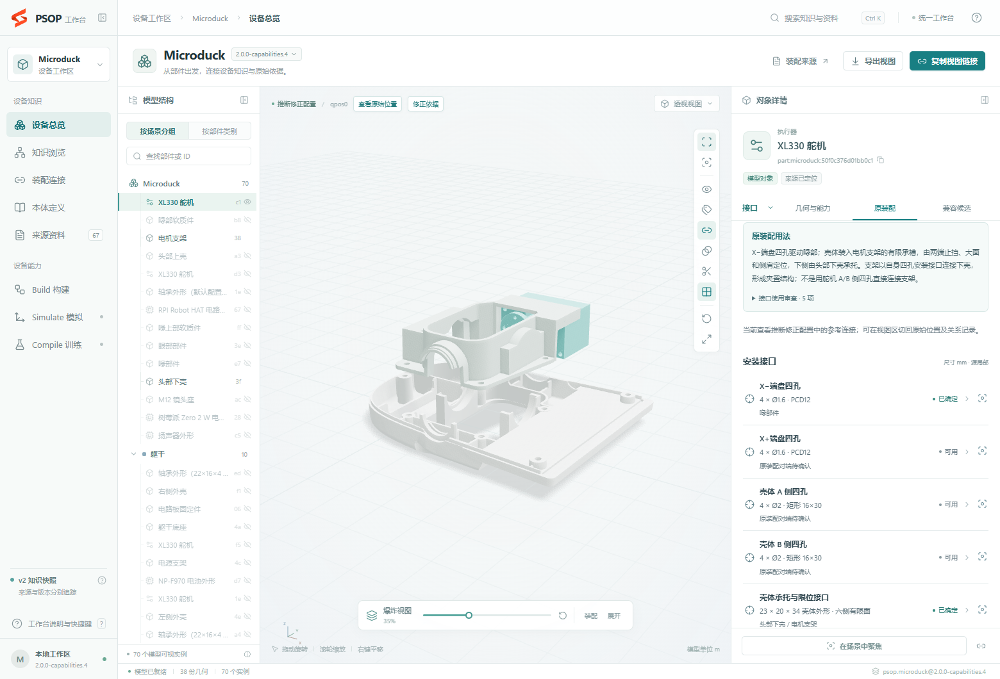
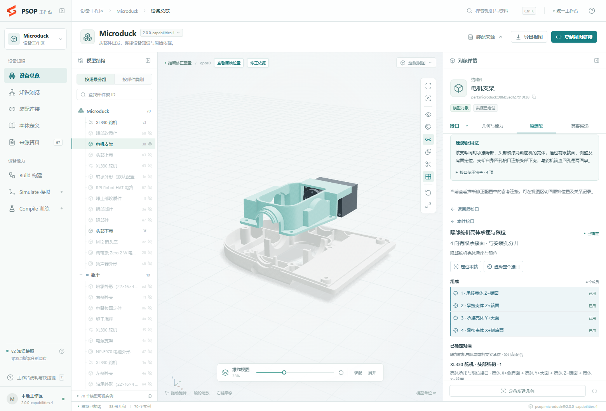

# Microduck：接口与原装配用法复查

后续独立[全量复核](original-installation-audit.md)又确认四处漏登记，现已在 `.5` 补录，七项也已继续调查到具体结构和对端；见[安装补录与复核结果](installation-followup.md)。本文保留 `.4` 首次审查的基线；当时“七项未决”没有覆盖这四处，不能作为全部安装接口已识别的结论。

2026-11-09。截图对应的 `2.0.0-capabilities.3` **没有找完整**。几何目录已经保留了许多有限面，但功能接口和原装配关系没有完整解释它们如何参与安装。新修订补录了本轮有依据的漏项；仍有 7 项具体用法未决，不能宣称全部实物安装结构或所有潜在用途已穷尽。

## 截图中的舵机怎样安装

喙部舵机为 `part:microduck:50f0c376d01bb0c1`，电机支架为 `part:microduck:986b5adf27910138`。它的安装链是：

1. **舵机固定壳体进入电机支架的承槽。** 壳体端部止挡、大面和侧肩分别对应支架的有限面，形成多方向定位。
2. **头部下壳从相对侧承托壳体。** 下壳和支架共同形成夹置结构；承托和限位分别记录，不用一个孔组代替。
3. **电机支架自身的安装孔组连接头部下壳。** 这些是支架与下壳的接口，不能套用舵机的壳体 A/B 四孔作为它们的对端。
4. **舵机输出端盘连接喙部件。** 这是活动输出关系，与固定壳体的安装关系分开。

源网格的固定壳体包络为 23 × 20 × 34 mm，源局部范围 X±11.5、Y±10、Z[−24.5, 9.5] mm；端盘超出壳体的部分单独处理。独立重算原三角法向、实际有限投影相交后，壳体与支架有四组定位见证：

| 壳体局部作用侧 | 有限重合面积 | 解释 |
| --- | ---: | --- |
| Z− 端 | 66.000 mm² | 端部止挡 |
| Z+ 端 | 49.114 mm² | 相对端限位 |
| Y+ 大面 | 515.313 mm² | 主要承接面 |
| X+ 侧肩 | 30.687 mm² | 侧向限位 |
| Y− 大面与头部下壳 | 69.932 mm² | 相对侧承托 |

这些是源模型在所审查配置中的有限面见证，不是由包络相交直接推导。另有 0 / 0.1 mm 间隙的定位邻面分别保留。已知夹置结构可以解释定位；螺钉实际选孔、预紧、装入路径与实物保持工艺没有完整来源，未补造数量或规格。

现在舵机有独立的 `servo_body_seating` 接口，成员引用六个实际壳体作用侧，原装配连接分别选择支架及下壳所涉及的面。支架和下壳分别拥有对应承座接口；可以从任一侧查看正确对端。头部横滚舵机 `96e22c7fa2b976d3` 的同类安装也已补录。

社区 [Microduck replica CAD](https://github.com/fanhao375/microduck-replica-cad) 的头部爆炸图和装配说明用作构型交叉核对；它是复刻来源，不能代替当前源网格的尺寸、紧固规格或实物确认。

## 全量核查方法与发现

本轮独立读取全部 **38 份 STL、70 个来源实例**，检查全部 **2,415 个无序异实例对**。原三角法向从顶点重算，有限接触使用真实三角投影相交，世界包围盒只用于本轮原装配邻近分析的计算剪枝，不参与位姿无关兼容候选筛除。

共保留 20,018 个原始有限平面区域，形成 **1,618 条几何观察、105 个观察部件对**；其中 20 对此前没有参考关系。观察不是固定连接：活动间隙、光学窗口、简化包络接触等单独处置。不能把这些数量当作 1,618 个安装点或 105 对固定连接。

本轮新增 **211 项语义几何、47 项接口、31 条参考关系**：

| 补录类别 | 参考关系数 | 本轮修正 |
| --- | ---: | --- |
| 舵机壳体承座/止挡 | 25 | 为全部 15 个舵机实例保留固定壳体能力；补录头部、颈部、躯干和腿部有依据的有限面承接。多数补充已有孔连接，不能称为 25 对全新部件连接 |
| 面部与上下头壳嵌合 | 2 | 记录定位槽边/承接面及对应成员 |
| 上下头壳接缝 | 1 | 五组有限闭合面与三孔紧固能力分开 |
| 左右膝部输出端到大腿 | 2 | 原有四孔接口补上遗漏的参考对端；PCD12 一致，静态相位相差 45°，不误判成孔距错误，也不虚构已求出的共同姿态 |
| 扬声器简化包络接触 | 1 | 仅记录假设接触和真实面见证；不升级成已确定的固定安装 |

完整独立要求见 [reference-use-review.json](../device-materials/assembly/reference-use-review.json)，原始有限观察见 [reference-surface-observations.json](../device-materials/assembly/reference-surface-observations.json)。它们来自冻结的旧包原件、原三角独立计算及有来源的装配角色，先形成审查基线，再运行新生产器；不是从新结果反向计数。

## 仍然缺少的具体依据

| 部件 | 尚未闭合的问题 |
| --- | --- |
| 扬声器 | 输入只有简化包络，真实耳孔、卡槽或其他固定结构没有提供 |
| M12 镜头座 | 双安装孔对应的相机板几何未提供，不能把附近主控板当成对端 |
| 电源板锁扣 | 被锁持板件几何及实际夹持方式不完整 |
| 眼环 | 三个凸耳与对端缺口的完整映射及保持方式未确认 |
| 左侧外壳 | 新增竖孔及部分非圆导向结构的具体原装选用未全部核定 |
| 右侧外壳 | 同上，几何保留但用途不冒认 |
| 头部偏航轴承 | 外圈的具体承座/轴向止挡仍不明确；内外圈能力继续独立保留 |

这些问题分别发布在对应部件的“原装配用法”下，并包含接口级处置。没有出现参考对端不代表结构不存在，也不证明来源装配实际未使用它。

## 之前为什么遗漏

几何发现层与功能解释层之间缺少独立的原装配用法验收。此前作者目录偏重端盘、壳体孔组和已知轴承关系，真实承槽、端挡、侧肩虽然可作为几何保留，却没有完整组织为接口及具体原装对端。工作台照实显示这份不完整目录，因而舵机看起来只有四组孔，无法回答固定壳体怎样装进支架。

旧检查能证明已发表几何、引用和候选符合合同，不能证明所有安装作用都已解释。新检查额外锁定全实例用法审查、具体关系与成员映射、应有有限面和所有观察对的处置；删除其中任一必需项后，即使重算统计和摘要，也会失败。语义别名与原测量片共享物理资源，避免给同一承接面换个名字就重复计数。

## 发布与验证

已按 `prepare → freeze → finalize → validate → register` 发布并选中 **`2.0.0-capabilities.4`**。工作台菜单仅登记当前修订；后续清理已移除旧包物理文件，历史摘要与审查记录继续保留。

- 包：[microduck-capabilities-4.dkp](../build/microduck/source-1.15/microduck-capabilities-4.dkp/manifest.json)
- 摘要：`69f6ee2e13b4051f6f42522639f77459081b83e9b95d4b5ea5b99c48324fe0e4`
- 快照：`dkp-69f6ee2e13b4051f6f42`
- 内容：8,656 项有限几何、397 项接口（243 项功能接口 + 154 项几何布局假设）、7,435 项物理资源、138 条参考关系、9,796 类候选；全部 2,415 对 × 8 模板有处置。候选关系族数量不等于已枚举的全部姿态或映射。
- 完整校验：[新包结果](../build/reference-use-review/package-validation.json) `valid=true`；[旧 .3 重放](../build/reference-use-review/history-validation.json)同样通过。历史资源策略保持原义，新包的语义面别名共享见证一致的测量资源，故资源数减少不表示删除真实几何。
- 124 项相关回归检查通过：52 项能力/分片/冻结检查、23 项参考修正与用法检查、23 项候选检查、9 项设备输入维护检查、17 项工作台数据/资源/配置检查。包括删除接口与关联关系、改变成员映射、替换真实面区域、丢失审查处置、过期来源/配置和删改部件未决说明。TypeScript 和 Vite 构建通过。
- [浏览器实查](../build/reference-use-review/audit.json)：全部 70 个实例的用法说明和 243 项功能接口可见，7 项未决问题均显示在对应部件；实查舵机到支架/下壳、两处膝部相位条件、扬声器保持未知，没有页面脚本错误。逐实例审查不代表整机物理装配验证。

头部仍沿用同一次下壳与喙部轴承约 −0.2 mm 的最小参考平移，没有修改源网格或原始来源位姿；受影响邻接检查由 13 项扩展到 20 项，均通过。新增检查覆盖头壳闭合面、横滚舵机承托及面部下定位区域。

| 指标 | 旧 .3 | 本轮 .4 |
| --- | ---: | ---: |
| 原始 scene JSON | 1,922,130 bytes | 3,688,744 bytes |
| 包内登记文件合计（不含 manifest） | 154,131,698 bytes | 171,875,738 bytes |
| 同一当前校验器完整校验 | 165.04 s | 158.92 s |
| 参考修正有限检查 | 13 | 20 |

本轮 prepare 为 148.05 s，其中几何/捕获 42.90 s，候选 55.46 s；独立原三角参考审查另为 94.85 s。两次校验存在并行执行，不能据几秒差异断言性能提升。scene 的增长来自功能摘要及语义几何覆盖层；完整网格发现详情、逐对候选、三角审查正文继续按需读取。

下图为便于查看，仅显示喙部舵机、电机支架及头部下壳，使用 35% 显示展开；展开间距是查看效果，不是装配尺寸。

完整性结论限于固定输入和声明审查范围，保留上述 7 项未决问题；不能由这些检查追认全部实物安装结构或所有潜在用途已穷尽。

## 全部输入实例的审查处置

下表来自独立用法基线，按来源实例分行。同网格实例不合并；“记录/冲突/未观察/未决”为已发表功能接口的使用处置数，不表示实物占用、螺钉数或已经穷尽全部功能。详细说明和原三角见证保存在固定审查输入及部件分片。

| 部件实例 | 所属来源刚体 | 功能接口 | 记录 / 冲突 / 未观察 / 未决 | 具体待核实项 |
| --- | --- | ---: | --- | --- |
| M12 镜头座 `2d2cde8ae8ebacac` | `jaw_soft` | 2 | 1 / 0 / 1 / 0 | 双孔安装所需的相机板对端几何未提供，具体孔映射仍未确定。 |
| RPI Robot HAT 电路板外形 `554503ef38151e67` | `jaw_soft` | 1 | 1 / 0 / 0 / 0 | 本轮未列出新增未决项 |
| XL330 舵机 `50f0c376d01bb0c1` | `jaw_soft` | 5 | 2 / 0 / 3 / 0 | 本轮未列出新增未决项 |
| XL330 舵机 `96e22c7fa2b976d3` | `jaw_soft` | 6 | 3 / 0 / 3 / 0 | 本轮未列出新增未决项 |
| 喙上部软质件 `88b7496d63cb41ff` | `jaw_soft` | 1 | 1 / 0 / 0 / 0 | 本轮未列出新增未决项 |
| 喙部件 `328011951ac11ee7` | `jaw_soft` | 3 | 3 / 0 / 0 / 0 | 本轮未列出新增未决项 |
| 喙部软质件 `f5797f92c2bf01b8` | `jaw_soft` | 1 | 1 / 0 / 0 / 0 | 本轮未列出新增未决项 |
| 头部上壳 `82d68e991b23c2a3` | `jaw_soft` | 3 | 3 / 0 / 0 / 0 | 本轮未列出新增未决项 |
| 头部下壳 `52fdcacf474a463f` | `jaw_soft` | 10 | 8 / 2 / 0 / 0 | 本轮未列出新增未决项 |
| 扬声器外形 `22f2cd114e324ec5` | `jaw_soft` | 1 | 0 / 0 / 0 / 1 | 仅有简化包络，实际螺孔、卡扣或其他固定工艺未提供。 |
| 树莓派 Zero 2 W 电路板外形 `ebfcaf98422b7b28` | `jaw_soft` | 1 | 1 / 0 / 0 / 0 | 本轮未列出新增未决项 |
| 电机支架 `986b5adf27910138` | `jaw_soft` | 4 | 4 / 0 / 0 / 0 | 本轮未列出新增未决项 |
| 眼部部件 `2559a4c412bcda3e` | `jaw_soft` | 1 | 1 / 0 / 0 / 0 | 三个凸耳与对端缺口的完整对应和保持方式尚未确定。 |
| 轴承外形（默认配置名） `a0775b54397eb21e` | `jaw_soft` | 2 | 2 / 0 / 0 / 0 | 本轮未列出新增未决项 |
| 镜头外形 `b61b0609c61fc572` | `jaw_soft` | 1 | 1 / 0 / 0 / 0 | 本轮未列出新增未决项 |
| 面部件 `afa52198f7fad203` | `jaw_soft` | 4 | 4 / 0 / 0 / 0 | 本轮未列出新增未决项 |
| XL330 舵机 `44b5600c1a735117` | `neck` | 5 | 5 / 0 / 0 / 0 | 本轮未列出新增未决项 |
| XL330 舵机 `4cef8bb24d37fe6e` | `neck` | 5 | 5 / 0 / 0 / 0 | 本轮未列出新增未决项 |
| 颈部件 `133711c520619e45` | `neck` | 4 | 4 / 0 / 0 / 0 | 本轮未列出新增未决项 |
| 颈部件 `6b5602b4416129fe` | `neck` | 4 | 4 / 0 / 0 / 0 | 本轮未列出新增未决项 |
| 轴承外形（22×16×4 配置名） `6b884b140f6e283c` | `neck_pitch` | 2 | 1 / 0 / 1 / 0 | 头部偏航轴承外圈的具体承座/挡面尚未明确；内外圈能力均保留。 |
| 颈俯仰部件 `834f5cc892eba41e` | `neck_pitch` | 3 | 3 / 0 / 0 / 0 | 本轮未列出新增未决项 |
| XL330 舵机 `a07b37bcb704b29f` | `yaw_roll_motion` | 6 | 4 / 0 / 2 / 0 | 本轮未列出新增未决项 |
| 偏航与横滚传动件 `d4b9a9e9474a9829` | `yaw_roll_motion` | 4 | 4 / 0 / 0 / 0 | 本轮未列出新增未决项 |
| 轴承外形（22×16×4 配置名） `55121c0b36f62219` | `yaw_roll_motion` | 2 | 1 / 1 / 0 / 0 | 本轮未列出新增未决项 |
| 轴承外形（22×16×4 配置名） `ea69e2c6bba10a23` | `yaw_roll_motion` | 2 | 1 / 1 / 0 / 0 | 本轮未列出新增未决项 |
| 左脚底 `8b649e45831a1972` | `ankle_left` | 1 | 1 / 0 / 0 / 0 | 本轮未列出新增未决项 |
| 左脚部件 `41db565298264db6` | `ankle_left` | 2 | 2 / 0 / 0 / 0 | 本轮未列出新增未决项 |
| 左踝部件 `07e507f1e9297aa3` | `ankle_left` | 3 | 3 / 0 / 0 / 0 | 本轮未列出新增未决项 |
| 轴承外形（默认配置名） `766eaa6e4dd8b09f` | `ankle_left` | 2 | 2 / 0 / 0 / 0 | 本轮未列出新增未决项 |
| 轴承外形（22×16×4 配置名） `bb34e925e25e29f6` | `hip_l` | 2 | 2 / 0 / 0 / 0 | 本轮未列出新增未决项 |
| 髋部件 `fa9ee2f71faafb88` | `hip_l` | 4 | 4 / 0 / 0 / 0 | 本轮未列出新增未决项 |
| XL330 舵机 `7c130c8489b57c99` | `leg` | 6 | 3 / 1 / 2 / 0 | 本轮未列出新增未决项 |
| 腿部连杆 `638f29b46b322e64` | `leg` | 5 | 5 / 0 / 0 / 0 | 本轮未列出新增未决项 |
| XL330 舵机 `4cf80d5a57c8cb04` | `upper_leg_left` | 6 | 5 / 0 / 1 / 0 | 本轮未列出新增未决项 |
| XL330 舵机 `9ffe9d5bcd6bc13a` | `upper_leg_left` | 6 | 5 / 0 / 1 / 0 | 本轮未列出新增未决项 |
| 大腿加强板 `c75bfc0afb35e000` | `upper_leg_left` | 6 | 6 / 0 / 0 / 0 | 本轮未列出新增未决项 |
| 左大腿部件 `66c73aaad945a993` | `upper_leg_left` | 4 | 4 / 0 / 0 / 0 | 本轮未列出新增未决项 |
| 轴承外形（22×16×4 配置名） `e475134639b3f7e1` | `upper_leg_left` | 2 | 2 / 0 / 0 / 0 | 本轮未列出新增未决项 |
| XL330 舵机 `cd6d48fccc95df41` | `yaw2roll` | 6 | 5 / 0 / 1 / 0 | 本轮未列出新增未决项 |
| 偏航与横滚连接件 `55970da91992f38c` | `yaw2roll` | 3 | 3 / 0 / 0 / 0 | 本轮未列出新增未决项 |
| 横滚轴承支承件 `cb253f38c818b9d8` | `yaw2roll` | 3 | 3 / 0 / 0 / 0 | 本轮未列出新增未决项 |
| 轴承外形（22×16×4 配置名） `47a950fbb3d0e416` | `yaw2roll` | 2 | 2 / 0 / 0 / 0 | 本轮未列出新增未决项 |
| 右脚底 `2f557a24b2729755` | `ankle_right` | 1 | 1 / 0 / 0 / 0 | 本轮未列出新增未决项 |
| 右脚部件 `f9955f19a691a1f4` | `ankle_right` | 2 | 2 / 0 / 0 / 0 | 本轮未列出新增未决项 |
| 右踝部件 `b371ac60e2f6757b` | `ankle_right` | 3 | 3 / 0 / 0 / 0 | 本轮未列出新增未决项 |
| 轴承外形（默认配置名） `e196235810184adf` | `ankle_right` | 2 | 2 / 0 / 0 / 0 | 本轮未列出新增未决项 |
| XL330 舵机 `087d7a46a3ce4ca3` | `bearing_roll` | 6 | 5 / 0 / 1 / 0 | 本轮未列出新增未决项 |
| 偏航与横滚连接件 `48099e14105d3289` | `bearing_roll` | 3 | 3 / 0 / 0 / 0 | 本轮未列出新增未决项 |
| 横滚轴承支承件 `c703574f50f6a46a` | `bearing_roll` | 3 | 3 / 0 / 0 / 0 | 本轮未列出新增未决项 |
| 轴承外形（22×16×4 配置名） `3fbf0b5c8cea4488` | `bearing_roll` | 2 | 2 / 0 / 0 / 0 | 本轮未列出新增未决项 |
| 轴承外形（22×16×4 配置名） `d924e1596ffb042a` | `hip_l_2` | 2 | 2 / 0 / 0 / 0 | 本轮未列出新增未决项 |
| 髋部件 `c7eeeac0a640d191` | `hip_l_2` | 4 | 4 / 0 / 0 / 0 | 本轮未列出新增未决项 |
| XL330 舵机 `0820b4025f26a004` | `leg_2` | 6 | 3 / 1 / 2 / 0 | 本轮未列出新增未决项 |
| 腿部连杆 `7f4fefc3c6de90f1` | `leg_2` | 5 | 5 / 0 / 0 / 0 | 本轮未列出新增未决项 |
| XL330 舵机 `08c5ade0f3fd37db` | `upper_leg_right` | 6 | 5 / 0 / 1 / 0 | 本轮未列出新增未决项 |
| XL330 舵机 `7038a050dbc33fb0` | `upper_leg_right` | 6 | 5 / 0 / 1 / 0 | 本轮未列出新增未决项 |
| 右大腿部件 `e40b9945707505e1` | `upper_leg_right` | 4 | 4 / 0 / 0 / 0 | 本轮未列出新增未决项 |
| 大腿加强板 `7e86db28af59d3cc` | `upper_leg_right` | 6 | 6 / 0 / 0 / 0 | 本轮未列出新增未决项 |
| 轴承外形（22×16×4 配置名） `d6a148b5784955d8` | `upper_leg_right` | 2 | 2 / 0 / 0 / 0 | 本轮未列出新增未决项 |
| NP-F970 电池外形 `f97c1c6580d651d7` | `trunk_base` | 1 | 1 / 0 / 0 / 0 | 本轮未列出新增未决项 |
| XL330 舵机 `09cb390e38430c1e` | `trunk_base` | 6 | 4 / 0 / 2 / 0 | 本轮未列出新增未决项 |
| XL330 舵机 `a682dc3620df43f5` | `trunk_base` | 6 | 4 / 0 / 2 / 0 | 本轮未列出新增未决项 |
| 右侧外壳 `9d70b219a5533bf1` | `trunk_base` | 2 | 2 / 0 / 0 / 0 | 新增竖孔及部分非圆导向结构的具体原装选用尚未全部核定。 |
| 左侧外壳 `e27cbdd6c07a264e` | `trunk_base` | 2 | 2 / 0 / 0 / 0 | 新增竖孔及部分非圆导向结构的具体原装选用尚未全部核定。 |
| 电源支架 `e7e8275c7d01674c` | `trunk_base` | 3 | 3 / 0 / 0 / 0 | 本轮未列出新增未决项 |
| 电路板固定件 `78cf36c41e4fde06` | `trunk_base` | 1 | 1 / 0 / 0 / 0 | 被锁持板件的完整几何和实际夹持方式缺失。 |
| 躯干底座 `203d2686e3321e4a` | `trunk_base` | 9 | 9 / 0 / 0 / 0 | 本轮未列出新增未决项 |
| 轴承外形（22×16×4 配置名） `7938fd9143c59ea4` | `trunk_base` | 2 | 2 / 0 / 0 / 0 | 本轮未列出新增未决项 |
| 轴承外形（22×16×4 配置名） `b364863ffde63eed` | `trunk_base` | 2 | 2 / 0 / 0 / 0 | 本轮未列出新增未决项 |

## 本轮新增的全部功能接口

以下与冻结的 capabilities.3 作者目录比较，列出新增的 47 项功能接口；未改名重建原有身份。

| 所属部件实例 | 新增接口 | 稳定语义键 |
| --- | --- | --- |
| XL330 舵机 `087d7a46a3ce4ca3` · `bearing_roll` | 壳体承托与限位接口 | `servo_body_seating` |
| 偏航与横滚连接件 `48099e14105d3289` · `bearing_roll` | 舵机壳体承座与限位 | `servo_body_087d7a46a3ce4ca3_seat` |
| 横滚轴承支承件 `c703574f50f6a46a` · `bearing_roll` | 舵机壳体承座与限位 | `servo_body_087d7a46a3ce4ca3_seat` |
| 扬声器外形 `22f2cd114e324ec5` · `jaw_soft` | 包络贴靠面（固定方式待核） | `proxy_contact_face` |
| XL330 舵机 `50f0c376d01bb0c1` · `jaw_soft` | 壳体承托与限位接口 | `servo_body_seating` |
| 头部下壳 `52fdcacf474a463f` · `jaw_soft` | 面部件下部槽口定位承座 | `face_lower_registration` |
| 头部下壳 `52fdcacf474a463f` · `jaw_soft` | 头壳有限闭合与承接面 | `head_shell_seam` |
| 头部下壳 `52fdcacf474a463f` · `jaw_soft` | 喙部舵机壳体承座与限位 | `servo_body_50f0c376d01bb0c1_seat` |
| 头部下壳 `52fdcacf474a463f` · `jaw_soft` | 头部横滚舵机壳体承座与限位 | `servo_body_96e22c7fa2b976d3_seat` |
| 头部上壳 `82d68e991b23c2a3` · `jaw_soft` | 面部件上部槽口配合承座 | `face_upper_registration` |
| 头部上壳 `82d68e991b23c2a3` · `jaw_soft` | 头壳有限闭合与承接面 | `head_shell_seam` |
| XL330 舵机 `96e22c7fa2b976d3` · `jaw_soft` | 壳体承托与限位接口 | `servo_body_seating` |
| 电机支架 `986b5adf27910138` · `jaw_soft` | 喙部舵机壳体承座与限位 | `servo_body_50f0c376d01bb0c1_seat` |
| 电机支架 `986b5adf27910138` · `jaw_soft` | 头部横滚舵机壳体承座与限位 | `servo_body_96e22c7fa2b976d3_seat` |
| 面部件 `afa52198f7fad203` · `jaw_soft` | 面部件下部槽口定位 | `face_lower_registration` |
| 面部件 `afa52198f7fad203` · `jaw_soft` | 面部件上部槽口配合 | `face_upper_registration` |
| 腿部连杆 `638f29b46b322e64` · `leg` | 舵机壳体承座与限位 | `servo_body_7c130c8489b57c99_seat` |
| XL330 舵机 `7c130c8489b57c99` · `leg` | 壳体承托与限位接口 | `servo_body_seating` |
| XL330 舵机 `0820b4025f26a004` · `leg_2` | 壳体承托与限位接口 | `servo_body_seating` |
| 腿部连杆 `7f4fefc3c6de90f1` · `leg_2` | 舵机壳体承座与限位 | `servo_body_0820b4025f26a004_seat` |
| 颈部件 `133711c520619e45` · `neck` | 舵机壳体承座与限位 | `servo_body_44b5600c1a735117_seat` |
| 颈部件 `133711c520619e45` · `neck` | 舵机壳体承座与限位 | `servo_body_4cef8bb24d37fe6e_seat` |
| XL330 舵机 `44b5600c1a735117` · `neck` | 壳体承托与限位接口 | `servo_body_seating` |
| XL330 舵机 `4cef8bb24d37fe6e` · `neck` | 壳体承托与限位接口 | `servo_body_seating` |
| 颈部件 `6b5602b4416129fe` · `neck` | 舵机壳体承座与限位 | `servo_body_44b5600c1a735117_seat` |
| 颈部件 `6b5602b4416129fe` · `neck` | 舵机壳体承座与限位 | `servo_body_4cef8bb24d37fe6e_seat` |
| XL330 舵机 `09cb390e38430c1e` · `trunk_base` | 壳体承托与限位接口 | `servo_body_seating` |
| 躯干底座 `203d2686e3321e4a` · `trunk_base` | 舵机壳体承座与限位 | `servo_body_09cb390e38430c1e_seat` |
| 躯干底座 `203d2686e3321e4a` · `trunk_base` | 舵机壳体承座与限位 | `servo_body_a682dc3620df43f5_seat` |
| XL330 舵机 `a682dc3620df43f5` · `trunk_base` | 壳体承托与限位接口 | `servo_body_seating` |
| XL330 舵机 `4cf80d5a57c8cb04` · `upper_leg_left` | 壳体承托与限位接口 | `servo_body_seating` |
| 左大腿部件 `66c73aaad945a993` · `upper_leg_left` | 舵机壳体承座与限位 | `servo_body_4cf80d5a57c8cb04_seat` |
| 左大腿部件 `66c73aaad945a993` · `upper_leg_left` | 舵机壳体承座与限位 | `servo_body_9ffe9d5bcd6bc13a_seat` |
| XL330 舵机 `9ffe9d5bcd6bc13a` · `upper_leg_left` | 壳体承托与限位接口 | `servo_body_seating` |
| 大腿加强板 `c75bfc0afb35e000` · `upper_leg_left` | 舵机壳体承座与限位 | `servo_body_4cf80d5a57c8cb04_seat` |
| 大腿加强板 `c75bfc0afb35e000` · `upper_leg_left` | 舵机壳体承座与限位 | `servo_body_9ffe9d5bcd6bc13a_seat` |
| XL330 舵机 `08c5ade0f3fd37db` · `upper_leg_right` | 壳体承托与限位接口 | `servo_body_seating` |
| XL330 舵机 `7038a050dbc33fb0` · `upper_leg_right` | 壳体承托与限位接口 | `servo_body_seating` |
| 大腿加强板 `7e86db28af59d3cc` · `upper_leg_right` | 舵机壳体承座与限位 | `servo_body_08c5ade0f3fd37db_seat` |
| 大腿加强板 `7e86db28af59d3cc` · `upper_leg_right` | 舵机壳体承座与限位 | `servo_body_7038a050dbc33fb0_seat` |
| 右大腿部件 `e40b9945707505e1` · `upper_leg_right` | 舵机壳体承座与限位 | `servo_body_08c5ade0f3fd37db_seat` |
| 右大腿部件 `e40b9945707505e1` · `upper_leg_right` | 舵机壳体承座与限位 | `servo_body_7038a050dbc33fb0_seat` |
| 偏航与横滚连接件 `55970da91992f38c` · `yaw2roll` | 舵机壳体承座与限位 | `servo_body_cd6d48fccc95df41_seat` |
| 横滚轴承支承件 `cb253f38c818b9d8` · `yaw2roll` | 舵机壳体承座与限位 | `servo_body_cd6d48fccc95df41_seat` |
| XL330 舵机 `cd6d48fccc95df41` · `yaw2roll` | 壳体承托与限位接口 | `servo_body_seating` |
| XL330 舵机 `a07b37bcb704b29f` · `yaw_roll_motion` | 壳体承托与限位接口 | `servo_body_seating` |
| 偏航与横滚传动件 `d4b9a9e9474a9829` · `yaw_roll_motion` | 舵机壳体承座与限位 | `servo_body_a07b37bcb704b29f_seat` |
