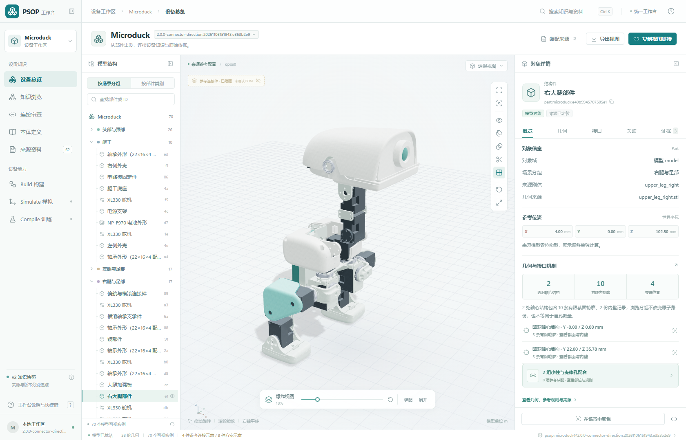
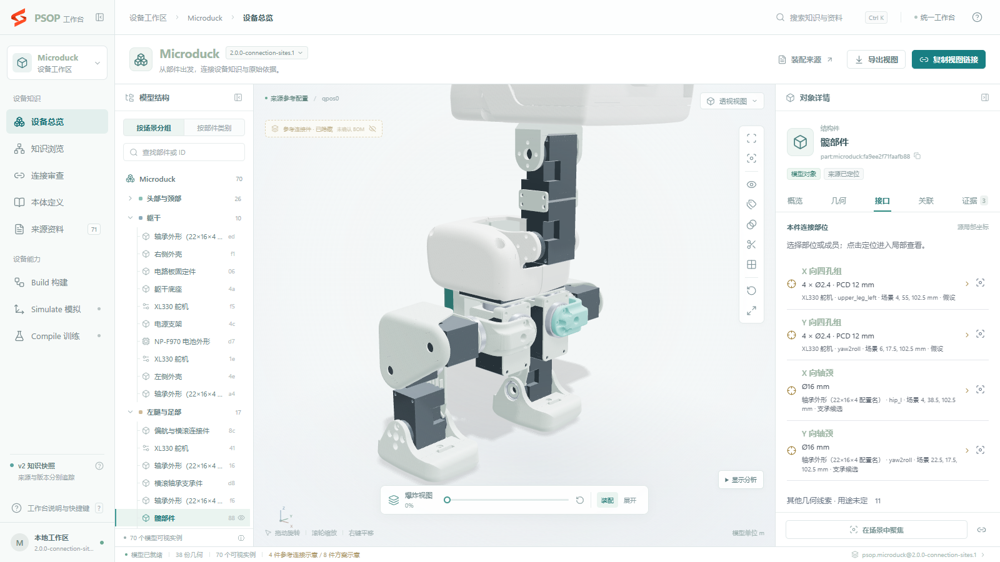
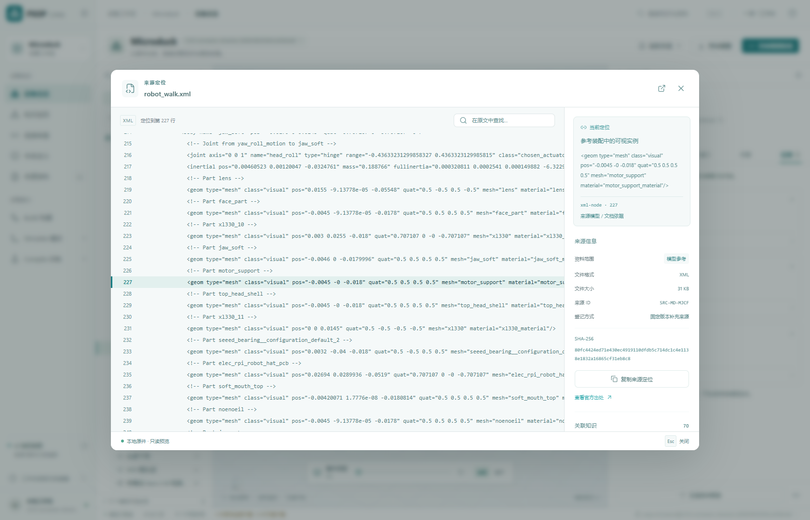

# 工作台使用指南

2026-11-11。当前 Build 合同为 Microduck `source-model/1.15`，几何能力、参考装配和跨件兼容候选分别读取。配图来自已有布局；内容、版本和可用操作以实际选中的知识快照为准。

## 打开设备

按[项目 README](../README.md)启动后，访问 http://127.0.0.1:8780/。左上角选择设备工作区，标题旁的版本选择器列出实际登记的 DKP。

默认打开工作区当前登记版本，已有历史快照可从版本菜单选择。首次克隆仓库时运行 `npm run prepare:workspace`，在本地生成并登记知识包；截图中的包版本号不要求与新构建完全相同。

左侧是共享导航，随后是部件结构树、3D 视口和对象详情。结构树与模型可以互相选中；`Ctrl+K` 打开全局搜索，可按部件名称或对象 ID 查找。

## 看模型与爆炸图

拖动模型旋转、滚轮缩放、右键平移。视口工具支持适应全部、聚焦选中部件、隔离、标签、透明、剖切和视角切换。

底部滑杆控制爆炸展开程度，点击“装配”恢复当前参考配置。展开只改变显示偏移，孔位、来源和对象身份仍指向同一知识版本。

展开会保留同一刚体内舵机的相对位置，先展开分支内部，再整体分离头部和左右腿。腿部舵机与连杆保持高度关系；踝部、脚体、脚底按竖直方向分层，左右腿保持各自归属。展开布局用于观察部件，不代表经过验证的拆装路径。

默认显示“来源原装构型”；“查看几何协调”切到单独发布的工程推断配置，“查看来源原装”切回来源位置。“协调依据”打开冻结的约束和理由。对象信息显示当前配置的世界坐标。推断配置不替代原设计，来源、前后差异和验证范围见[说明](reference-assembly-repair.md)。

选择接口部位或成员只更新局部标注；点击定位才临时仅显示本件，进入局部查看。点击“返回装配”恢复原场景和相机。透明显示由视口工具单独控制。对象详情的竖向分隔条可拖拽调宽，双击恢复默认。

## 从安装接口查看装配

目录从已有装配和原始资料组织本件的连接能力，包括安装孔组、轴颈、轴承内外圈、卡扣承面及包覆结构。它不要求用户先逐个指出所有孔，也不把普通邻近几何都列成接口。

1.15 另外从原始网格发现本件有限几何，未明确用途的孔和台阶也保留。来源摘要、测量质量、孔道/入口、功能依据与待证部分分层查看；参考安装关系与跨件几何候选不共用“已安装”标签。完整详情按部件、部件对按需加载，不在首次打开时下载全部候选。

1. **找接口**：“安装接口”显示本件能力、关键尺寸及已用／可能对端。用途未明确或源位姿有冲突的具体结构用短说明保留。
2. **看组成**：选择接口后查看其孔壁、轴颈、肩面或其他有限成员。成员位置按本件局部坐标显示为毫米，方向保留源局部定义；“本侧选相邻两孔”只显示明确允许的组合。
3. **选择与定位**：选择接口或成员仅更新局部高亮；“定位本端”单独进入局部查看。“查看对端”切换到实际关联接口，“定位对端”再调整视图；“返回原接口”恢复原选择，“返回装配”结束临时局部查看。
4. **核查依据**：“查看依据”打开当前接口和连接所引的实际原件。完整研究留在来源资料中，默认目录显示用途、关键尺寸、组成和具体对端。

功能侧接口和物理孔道分别表达。舵机的两个端盘与两个壳体安装侧分别保留能力；壳体两侧的安装成员仍可共享同一条有限孔壁资源。切换 A、B 侧会保留各自入口方向和对端，不因为共用孔道而合成一张不可区分的孔组。

轴承的内圈配合接口、外圈承座接口分别保留，未登记原装配对端时也可选择和定位。目录明确标注“原装配对端待确认”，不把空对端视为接口不存在。喙部轴颈与头部轴承的补全及全部轴承检查见[轴承接口修正记录](bearing-reference-correction.md)。

“已用对端”表示固定来源装配、明确声明或有限配合中已有具体绑定；“可能对端”表示有结构依据的待核实解释。不相容配对单独列出原因，不混入已用连接。沿连接查看时使用它实际引用的成员；没有指定成员子集时，明确显示“尚未指定选用成员”，需要主动选择成员后才能定位，不将整组孔自动选中。

四个几何孔不等于必须使用四颗螺钉，局部配合也不等于实物预紧或工程验收。已有的定位、挡面和夹置结构会具体显示；尚未核定的紧固件或工艺以对应说明保留。当前目录不自动补造螺钉、压盖或保持状态。

已登记参考路径的连接可选择一个孔查看“螺钉示意”；整组选择不自动生成螺钉。点击“沿接口轴查看”，两端和连接件按同一安装轴组织，滑杆控制沿轴分离，回到 0% 恢复来源参考位置。示意带“规格待定”标识，可拾取并追溯所属接口；它不进入真实 Part 数量或物料清单。“切换连接件示意”可隐藏这些图形。

完整有限孔壁等通过源网格自身着色显示，不复制共面三角叠层。曲面只有离散见证时使用位置标记，完整原三角仍可追溯，不将细长证据三角铺成完整接触面。

“装配连接”页集中列出具体连接，可按部件或接口搜索，并切换已用／可能范围。点击某一端回到该部件的实际接口，不按整个 Part 对替代局部关系。

## 其他部件的几何兼容候选

1.15 的候选索引覆盖所有异来源实例对和固定八族机制，包括需要另配标准连接件的条件组合。选择一个候选查看双方有限几何、尺寸条件、成员关系和缺项；具体按钮以当前工作台实现为准。普通平面候选只表示潜在落座，螺钉候选保留螺纹/长度未知，卡扣候选不代表已验证弹性接合。

历史 `.7` 版先按完整功能接口筛选，再对固定贴合姿态检查两个完整原模型的实体交集。转子四孔须在同一个刚性关系下全部匹配，壳体侧已声明的相邻双孔规则继续保留。70 个部件的全部 2,415 对均有检查处置，默认列表保留 465 对；只有具有通过方向的完整接口进入该列表。未通过方向、局部线索与原装配记录分别保留。

详情先显示“4/4 孔位匹配”等完整接口选项，孔位、尺寸和依据按需展开。点击“整组装配示意”，左侧使用双方真实网格的独立副本，同时高亮全部所选孔位；支持播放、暂停、拖动进度和透视查看。对位终点严格重放已检查的旋转与平移，不添加显示间隙或另猜安装侧。分开到对位的动画仍不表示装入路径通过，紧固与保持也需另行确认。“返回整机”恢复原相机、爆炸程度和显隐状态。

`interface_matches` 保存该版本刚性检查通过的成员对应、有限方向及精确姿态；原始部分映射保存在 `local_geometry_clues`，重叠或无法判断的方向保存到 `placement_exclusions`。装配解释优先遵循[装配判定与设计保真](architecture/assembly-judgment-policy.md)：刚性网格交集不直接否决装配，也不据此要求移动或修改原设计；工程可接受重叠按机制另行处理，不能篡改数值测量。“查看本端/对端接口”进入原装配中的具体接口及所选成员。模型中重复出现的部件是来源实例，未确认数量前不能当作真实库存。核对结果见[接口审查](../build/interference-review/interface-audit.json)及[整件实体复核](../build/interference-review/independent-solid-audit.json)。

## 逐部件核对原装配用法

带用法审查的新包在“原装配”顶部显示“原装配用法”，说明部件如何经承座、端挡、侧肩、孔组或其他结构连接。未决问题在对应部件直接列出；展开“接口使用审查”可区分已登记用法、原位置冲突、输入未观察到使用和具体用法未决，并查看固定审查来源。

例如喙部舵机：输出端盘连接喙部；固定壳体进入电机支架承槽，头部下壳从相对侧承托，支架自身孔组再连接下壳。选择“壳体承座与限位”可分别查看支架和下壳的实际作用面；舵机壳体 A/B 四孔不能替代这条安装链。全量复查、补录及仍缺依据的 7 项见[接口与原装配完整性记录](reference-use-completeness.md)。

用法说明来自 Build 冻结知识，不由页面接触检测生成。几何完整覆盖和候选检查完成均不保证所有实际安装用途已确定；历史没有用法审查的包保持原义。

## 从结论找到原件

打开接口的“查看依据”或对象详情的“证据”页，点击来源记录。XML、CSV 等原件按需读取并显示相关行，装配目录定位到具体证据，PDF 与图片按实际格式预览。来源全文不在接口目录中重复展开。

“复制来源定位”保留来源和证据身份。全局“来源资料”页可检索全部原件，“本体定义”页可浏览类型及其关联。

## 分享和导出

“复制视图链接”保留工作区、快照、对象、相机、爆炸程度、显隐和局部查看状态。接收者需要能访问同一工作台服务及相应知识版本。

“导出视图”下载 `device-view.json`，记录显示状态及包摘要。它不是模型图片或已执行的模拟结果。文档维护者可以用[截图脚本](../apps/workbench/scripts/capture_docs.mjs)重建正式配图。

## Build、Simulate 和 Compile

Build 页可核对实际 DKP 版本、摘要、来源及逐项能力。创建新知识包通过 [Build CLI](build/device-knowledge-build.md)，登记后由同一工作台读取。

Simulate 已接入[三维装配工作台](simulate/simulate-design.md)。每个 DKP 部件独立放在台面，左键拾取和拖动；选中对象显示浅蓝轮廓，其他兼容对象／组合显示金色发光轮廓，不显示散布的接口点。右侧自动出现小信息卡，展示名称、部件／连接数量、可用接口和兼容对象数。拖近兼容对象，实际空间距离和画面间隙同时满足邻近条件后弹出连接卡片；松手后悬停预览，点击已就绪方式直接组合。连接卡片采用紧凑毛玻璃外观，固定在实际可见视口底部，标题与底栏始终完整，方式列表内部滚动。鼠标悬停不锁住卡片，移远后及时关闭。提交后放大接口展示连接动画，结束返回原视角；`Esc` 可以跳过展示，保留已保存结果。右侧信息卡的“候选”、接口浮窗内的关联对象也可打开卡片并选择安装方向。全部接口都会显示；尚无匹配／终态时会说明原因，原装与修正参考姿态分别保留。

默认移动整个组合，`W` 开启轴向移动，`E` 开启旋转，`V` 回到选择，`F` 聚焦，`Alt＋点击`查看内部部件。位置使用毫米、旋转使用角度。选中组合后，模型接口处会出现“拆分”标签，点击即可解除该连接，右侧信息卡的连接工具也有入口。较大子组合留在原处，较小一侧保持内部关系，寻找最近的桌面空位并动画归位；同样大小时保留原连接目标侧。如果双方仍由其他连接相连，只解除该连接，不移动模型。没有足够空位时保留原位并提示，可手动移动。拆分和归位一起保存为一个历史步骤；`Ctrl+Z` 和 `Ctrl+Shift+Z` 撤销、重做。

新方案默认将薄片、加强板、PCB、连杆和轴承平放在桌面，按网格尺寸与较大的底面选择朝向；已有保存的摆放不会因刷新自动改变。左下角的恢复图标可一键回到初始拆散状态：解除当前全部连接，按当前平放规则重新排布并显示全部对象，保留方案名称。该操作自动保存为一步历史，可用 `Ctrl+Z` 恢复刚才的完整装配或摆放，`Ctrl+Shift+Z` 再次恢复拆散。

旁边的“自动组装”会保留符合成品参考的组合，拆开不一致的连接，在当前工作台中逐件转运、预装子组合并完成总成。原有界面和视角保持，动画期间可以用鼠标旋转、右键平移、滚轮缩放；左下紧凑进度提供可选“跟随装配视角”，鼠标操作立即接管。Space 暂停／继续，支持 1×／2×／4×；Esc 或跳过立即显示已保存成品，保留用户视角。整次操作一步撤销／重做，刷新不会丢失结果。来源及未核定的工艺记录保存在内部报告，按用户要求不显示工艺提示，不将参考演示当作工程检查通过。成品出现时先不铺满拆分标签，点选模型或打开右侧连接工具即可继续拆开探索。

安装先后由全部件的退出路径和阻挡关系推导，不仅按部件类型排序。轴承沿发布轴线入座，末段不旋转；需要先预装的部件在独立工位组成子组合后整体接入，已有组合挡住装入空间时可临时打开并合回，保留正确连接和一步撤销。转运逐件避让，来源包覆／软质件缺少真实工艺时采用参考交接，不强行播放不透明实体穿越。

接口和共享孔道不能重复占用，试装也占用接口。卡片明确显示整体干涉、台面穿透或待补连接件／保持条件。首版检查终态及有限采样的装配过程，尚不提供连续装入路径的完备证明、动力学或工程承载验证。

页面进入全视口沉浸布局；左上方案名称打开新建、复制、重命名和知识版本菜单，返回箭头回到共享工作台。`/` 或左侧目录按钮打开临时对象目录，选中后右侧小信息卡自动展示摘要，按需展开变换、接口、候选与连接工具；临时浮窗不挤压三维视口。右上提供视角、画质和全屏，右下展开状态。独立方案自动保存到包外目录。复制清空历史，原方案保留最近 100 步。断线后可重试待确认操作，刷新后仍可恢复；“恢复已保存状态”放弃本地待确认草稿。画质提供高画质、均衡、流畅和自动，手动档位不会自行改变。

三维环境采用 Tony Stark’s Workshop 私人研发空间的长方形布局与局部斜窗带，设备从简：中央装配台、后方双屏仪器桌和一台六轴机械助手。橘黄色任务灯通过带压紧螺杆的夹具固定在桌沿，灰绿色台灯和红色工具箱已移除。墙板、窗框、顶梁、吊灯和桌架具有实际厚度、收边及连接细节；地面与墙体分别使用本地 4K／2K PBR 材质，高／均衡画质提供克制的粗糙地面反射。“工坊”查看整体空间，“透视”回到装配视角。没有车辆、装甲、圆形场地或城市全景。

日常交互可直接在默认浏览器打开本地地址。脚本的 `--headed --keep-open` 交互预览使用原生窗口尺寸，随窗口变化；固定 1920×1080 仅用于独立性能采样，避免测试视口超出可见客户区。

真实操作、桌面窗口的截图和性能范围见[Simulate 验收记录](simulate/verification.md)。

Compile 页组织语料、训练实验、模型和评测的目标位置。实际数据集发布、训练和推理执行器尚未接入。

## 知识版本维护

新构建发布新快照，已有包不原地改写。`--fresh` 会添加一个版本，不自动删除旧包。

1.15 按 `prepare → freeze → finalize → validate` 发布后再登记；封存后修改输入或工具须重新准备。`source-model/1.14` 及以前按其原 Schema 和解释器读取，新几何、共享资源和候选不反写历史包。

清理旧版本时，先从 `workspaces/registry.json` 移除旧快照引用，再删除不再被任何工作区引用的包目录，保留当前选择。刷新页面后，菜单按登记表显示。

实现边界见[系统设计](architecture/system-design.md)，登记和读取接口见[设备工作区](architecture/device-workspace.md)。

## 装配构型与重叠记录

Simulate 方案菜单中选择“参考构型”：新方案默认来源原装，几何协调为工程推断。选择只改变后续连接目标，已有位姿和连接保留；点击“按此构型还原”才执行自动组装。构型和判定设置都可以撤销、重做及随方案复制。

原装重叠与合格接口接触可直接连接，实际体积和采样深度保留在“几何记录”，不需要先修改原件或补全材料。环境设置中的“装配判定设置”可调整接触显示筛选和无关障碍深度门槛；体积不是通用装配否决阈值。完整成员、资源、闭环、台面及新增无关穿入仍按具体证据检查。

当前工作台仅登记新策略包 `2.0.0-capabilities.10`，发布归档见[版本记录](../releases/microduck/2.0.0-capabilities.10/release.json)。旧 `.7/.9` 刚性筛查列表保留各自历史范围；新策略的发布与验收见[执行记录](assembly-judgment-optimization.md)。新版服务已恢复为默认地址 `http://127.0.0.1:8780`，使用同一工作区和已保存方案。
